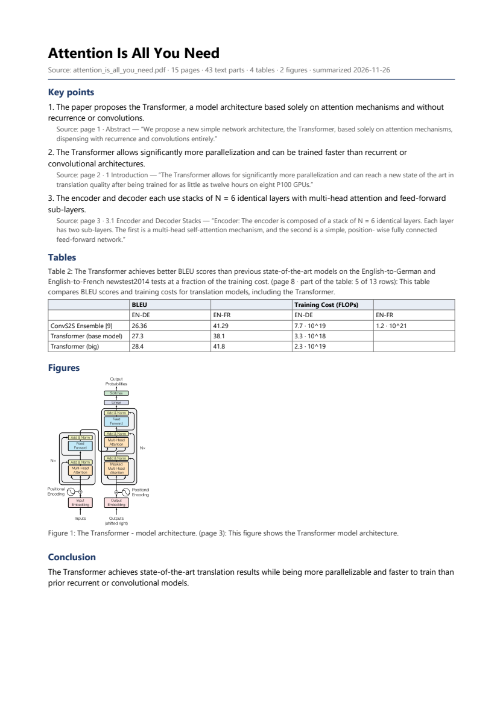
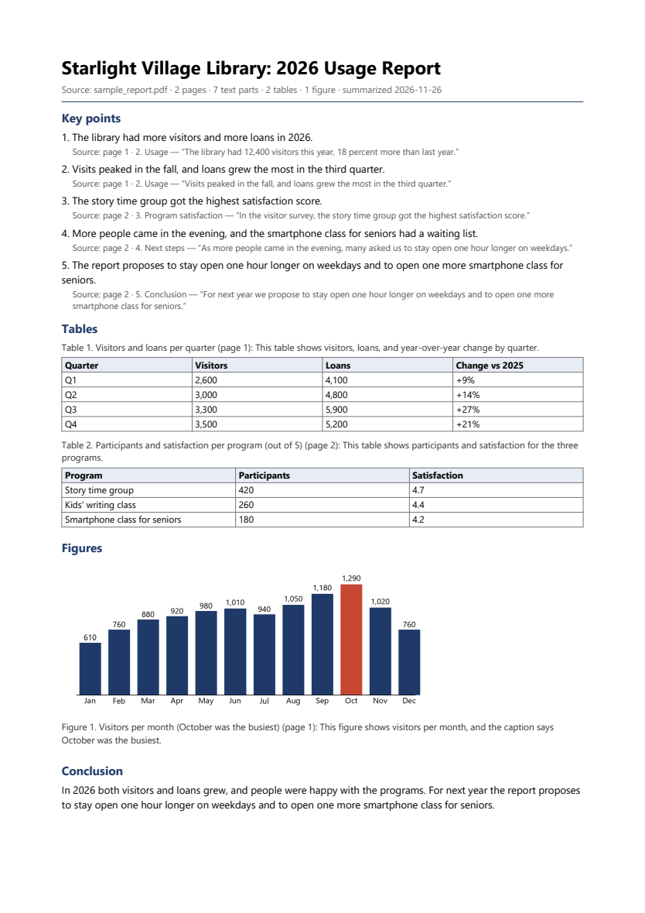

# Tutorial 3. Upload a PDF, get a one-page A4 summary by mail

Give the flow one PDF. The program sorts it into text, tables and figures and counts them, one worker (Morgan) boils the content down to one A4 page, and the summary PDF is mailed as an attachment. **The document's own tables and figures go on the summary page as they are.** The model only **chooses** which tables and figures matter; the program draws the table cells and the pictures from what the file server read (the model never retypes them). Every key point names the **paragraph** it came from (its address) and quotes a sentence of that paragraph word for word, and both the quotes and "is it really one page" are checked by **the program, not a model**.

This is the English edition: the summary, the mail and the classification report are in English. The Korean edition (`../../ko/tutorial_03_pdf_summary`) makes a Korean summary of the same paper.

The example PDF is the paper **"Attention Is All You Need"**. The paper is not part of this tutorial; `python get_paper.py` downloads it. To try it without the internet, use the made-up report this tutorial draws (`python make_sample_pdf.py`).

> Paper: Ashish Vaswani, Noam Shazeer, Niki Parmar, Jakob Uszkoreit, Llion Jones, Aidan N. Gomez, Lukasz Kaiser, Illia Polosukhin, **"Attention Is All You Need"**, 2017. arXiv: <https://arxiv.org/abs/1706.03762> (PDF: <https://arxiv.org/pdf/1706.03762>)
>
> The first page of the paper says: "Provided proper attribution is provided, Google hereby grants permission to reproduce the tables and figures in this paper solely for use in journalistic or scholarly works." This tutorial does not upload or share the paper's PDF (`input/*.pdf` is in `.gitignore`) and shows only the summary page made from the downloaded PDF. Before you use a summary page for anything else (promotion, for example), check that permission (journalistic or scholarly use).

## What you will have at the end

Give the flow a PDF file and four blocks run in turn.

1. **Intake (program)**: puts the PDF on the file server (`pdf`). The file server reads its text layer, keeps the PDF as one record and cuts it into text, table and figure parts **in document order, with their pages**. A text part is cut again into paragraphs, and every paragraph gets an address (`fs://pdf/001#3.1`).
2. **Classify (program)**: counts the parts as text, tables and figures and makes the classification report. The report also holds the addresses of each text part's paragraphs, the table cells and the figure image files. No model.
3. **Summarize (Morgan, model)**: writes to a fixed shape (title, 3-5 key points, 0-2 tables and 0-2 figures for the page, conclusion). Every key point gets a paragraph address and a quote from that paragraph; tables and figures are **chosen by address** (with the row numbers to show for a big table).
4. **Deliver (program)**: draws the summary as an A4 PDF. A chosen table is drawn as a table, cell by cell; a chosen figure is put in as it is, with its caption. The program counts that it is exactly one page, puts the classification report in the mail body and mails the PDF.

A table with many columns is drawn in a smaller font, and for a table with more than 14 rows only the rows Morgan chose are drawn, with "part of the table: M of N rows" on the page. A table with more than 10 columns cannot be drawn and is sent back. When the summary does not fit one page, the program says by how much, and Morgan chooses fewer tables or figures or writes shorter sentences. The program never cuts anything silently.

### A real run (the paper Attention Is All You Need)

Model: gpt-5.4-mini through the OpenAI API, run on 2026-11-26 with nextop 0.4.0.dev6 (a pre-release build of 0.4.0, installed from a wheel). Input: the paper downloaded by `python get_paper.py` (15 pages). The sentences change with the model every time.

Subject: `[PDF summary TEST] attention_is_all_you_need.pdf on one A4 page (43 text parts, 4 tables, 2 figures)` (`[PDF summary TEST]` is there only in test mode, `MAIL_TEST_MODE=1`). Attached: `summary_attention_is_all_you_need.pdf`. The same two files are kept in `summaries/`.

**The mail body = the classification report the program made** (file: [`example_output/attention_is_all_you_need_report.txt`](example_output/attention_is_all_you_need_report.txt). Long lines are cut with `...` here, and only the first 8 text parts are shown.)

```
PDF classification: attention_is_all_you_need.pdf (15 pages)
43 text parts · 4 tables · 2 figures

[Text] 43
  1. (no title) (page 1) · 173 characters
  2. Attention Is All You Need (page 1) · 397 characters
  3. Abstract (page 1) · 2216 characters
  4. 1 Introduction (page 2) · 1904 characters
  5. 2 Background (page 2) · 1812 characters
  6. 3 Model Architecture (page 2) · 489 characters
  7. 3 Model Architecture (page 3) · 260 characters
  8. 3.1 Encoder and Decoder Stacks (page 3) · 1316 characters
  ...

[Tables] 4
  1. Table 1: Maximum path lengths, per-layer complexity and minimum number of sequential operations for different layer typ... (page 6) · 6 rows × 4 columns · columns: Layer Type | Complexity per Layer | Sequential | Maximum Path Length
  2. Table 2: The Transformer achieves better BLEU scores than previous state-of-the-art models on the English-to-German and ... (page 8) · 13 rows × 5 columns
  3. Table 3: Variations on the Transformer architecture. Unlisted values are identical to those of the base model. All metr... (page 9) · 26 rows × 13 columns
  4. Table 4: The Transformer generalizes well to English constituency parsing (Results are on Section 23 of WSJ) (page 10) · 13 rows × 3 columns · columns: Parser | Training | WSJ 23 F1

[Figures] 2
  1. Figure 1: The Transformer - model architecture. (page 3) · 911×1343 pixels
  2. Figure 2: (left) Scaled Dot-Product Attention. (right) Multi-Head Attention consists of several attention layers running in parallel. (page 4) · 1216×769 pixels
```

The reader part read the paper this way: the text parts carry the paper's real section titles (`1 Introduction`, `3.1 Encoder and Decoder Stacks`), Tables 1-4 are table parts with their captions although the paper's tables have no vertical rules, and Figures 1 and 2 are one figure part each, cut at their own resolution, with their whole captions. The first part (the Google permission note on page 1) has no title, and Table 2 has a first column with no header. Figures 3-5 of the paper are drawings made of vector lines and stay out (a figure here is a raster image).

**The attached one-page A4 summary** (as drawn: [`example_output/attention_is_all_you_need_summary.pdf`](example_output/attention_is_all_you_need_summary.pdf))



Morgan chose Table 2 (the rows 1 (the header), 3, 11, 12 and 13 of the 13) and Figure 1. All Morgan wrote for the table is the address `fs://pdf/001#31` and the row numbers; the cells are the parsed table's, including the powers (`2.3 · 10^19`). Morgan wrote three key points; each cites one paragraph (`fs://pdf/001#3.1`, `#4.4`, `#9.1`) and quotes a sentence of it, and the program checked the quotes against those paragraphs (none was sent back). The summary page prints "Source: page 1 · Abstract" from the part data, not from the model.

**How the program checks**

In this run Morgan's first save did not fit one page, and the program sent it back (the second save passed):

```
The summary does not fit one A4 page: it runs to 2 pages and about 586 characters of text spill past page 1. ...
```

A quote that is not word for word in its paragraph is sent back like this (from the tests, where one word was added):

```
quote not found: "Starlight Village Library saw many more visitors and more loans in 2026." (summary.key_points[0]) is not in the text at fs://pdf/003. Quote the source word for word, or remove the claim.
```

The checks on the chosen tables say things like this (from `tests/test_flow.py`):

```
summary.tables[0] (fs://pdf/001#3) has 39 columns, more than 10: it cannot be drawn on the page. Choose another table or none.
summary.tables[0] (fs://pdf/001#2) has 20 rows. Give the numbers of the rows to show (rows, 1 is the header; at most 14 including it), or choose another table.
```

**How Morgan read the paper** (from the run's `tools.jsonl`): 10 `get` calls with section addresses (`fs://pdf/001#3`, `#43`, ...), no `query`. A section with its paragraphs under 8,000 characters comes back as `parts`, a list of `{"address": "fs://pdf/001#3.1", "text": ...}` (a paragraph and its address together); a section without sub-parts comes as one text with its title, page and `format`.

**Time and cost** (gpt-5.4-mini; it changes with the model and the internet):

| Work | Result |
|---|---|
| Morgan: 7 model calls (opening 10 sections, 2 saves: past one page, passed) | 91,838 tokens |
| Whole run | about 21 s |

**Checked again with nextop 0.4.0.dev9 (2026-11-27, gpt-5.4-mini).** The paragraphs splitter is the new nextop example and the tests use the run's default index; a fresh venv with only the wheel installed ran the same paper. Morgan opened 8 sections with `get`; the first save ran past one page by about 1,586 characters and was sent back, the second passed. 4 model calls, 49,363 tokens, 27.5 s. Three key points (`fs://pdf/001#3.1`, `#3.2`, `#3.2`), each quote checked by the program; Table 2 (rows 1, 3, 11, 12) and Table 4 (rows 1, 5, 10, 12, 13), no figure; mail sent. The example output above is still the dev6 run.

### A real run (the made-up report: tables drawn as they are)

The paper's summary has a table too, but the test report with ruled tables (`python make_sample_pdf.py`, 2 pages, 2 tables, 1 figure) shows tables and a figure together (`nextop run --flow pdf_summary --input input.sample.json`). Run on 2026-11-26 with nextop 0.4.0.dev6 and gpt-5.4-mini: Morgan chose both tables (all rows) and Figure 1 and passed at the first save. 3 model calls, 13,444 tokens, about 10 s. Classification: [`example_output/sample_report_report.txt`](example_output/sample_report_report.txt), A4 summary: [`example_output/sample_report_summary.pdf`](example_output/sample_report_summary.pdf).



**The page numbers and part names on the summary are put there by the program** from the file server's part data (they are not numbers the model wrote). The table cells, the figure files, the table and figure names (captions), the row and column counts, the figure sizes and the page count are the values the file server hands the function in the part tree (`parts`: a table's `columns` and `rows`, a figure's `image`, `width` and `height`, `caption`, `pages`, and `doc.pages`). The model cannot see the figures yet, so a figure's line says only what its caption says.

## Time and what you need

About an hour. You read a finished project, fill in the settings and run it.

- Python 3.11 to 3.13 and nextop 0.4.0 with the PDF reader: `setup.bat` in step 0 below installs everything (by hand: `pip install -r requirements.txt`). This tutorial was written for the file servers of nextop 0.4.0 (type folders, common tools, paragraph addresses). Until 0.4.0 is on PyPI, install from a wheel file you were given: `setup.bat <path to the .whl>` `requirements.txt` pins nextop 0.4.0 and `"nextop": ">=0.4,<0.5"` in `project.json` says which versions this project needs (with another version, `nextop check` tells you how to fix it). If another nextop is already installed, `setup.bat` installs 0.4.0 in its place and shows the installed version at the end.
- PDF reading and A4 drawing: `nextop[pdf]` and `reportlab` (both in `requirements.txt`)
- The internet to download the example paper (`python get_paper.py`, about 2 MB). Without it, use the made-up report
- A TrueType font: on Windows Segoe UI is already there and nothing needs doing. On Linux DejaVu Sans or Liberation Sans, on macOS Arial is found; otherwise put the path of a `.ttf` file in `PDF_FONT=` in `.env` (see "Settings"). No font file comes with this tutorial; the PDF holds only the letters it uses.
- An OpenAI API key (the default; any other OpenAI-compatible API works too, see Settings below)
- SMTP settings of a mail account (optional; without them only the mail step fails and the summary stays in `summaries/`)

You can do steps 1 to 4 right away without a model; the tests use a fake model.

## nextop features you learn here

- **A file server defined as type folders**: `file_servers/pdf/types/pages/type.json` (pdf, the official reader part `pdf_text`, the `paragraphs` splitter, figure parts sent to the `figures` type) and `types/figures/type.json` (an image type). One PDF becomes one record (`fs://pdf/001`), cut into text, table and figure parts that keep their order and pages (`#1`, `#2` ...), and every text part is cut again into paragraphs (`#3.1`, `#3.2` ...). A program reads it, not a model.
- **A splitter part** (`parts/splitter/paragraphs.py`, copied from the example part of nextop): it cuts at blank lines. A part with one paragraph is its own paragraph.
- A start function that uploads a file (`FILES_OUT`, `_uploads`) and a function that receives files (`FILES_IN`): intake uploads the PDF, classify receives the PDF's part tree as data (`parts`) and counts it
- A flow of one worker and program blocks (`intake`, `classify`, `deliver`). The model is used for the summary only
- A program check: every key point's address is a paragraph (or a table) of the report, and its quote is in that paragraph word for word (`quotes`), checked without a model (`checks.py`)
- Checks that measure: "can the chosen tables and figures be drawn" (at most 10 columns, row numbers for a big table) and "is it one A4 page". When it is too long, nothing is cut silently; the worker is told by how much and writes again. The check and the mail block use the same drawing code (`functions/_pdf.py`)
- The worker's output shape (schema): 3-5 key points (`minItems`, `maxItems`), 0-2 tables and 0-2 figures chosen by address, row numbers for a big table
- The document values a function gets (the `parts` of the PDF's row: table `columns` and `rows`, figure `image`, `caption`): the program, not the model, draws tables and figures on the page
- A PDF attachment and a test mode for the mail
- Tests without a model: a fake model and a small mail server on this computer

## Step by step

Open PowerShell in this folder (`en/tutorial_03_pdf_summary`).

### 0. Install: run setup.bat

Double-click `setup.bat` in this folder, or run `.\setup.bat` in PowerShell. On the first run it installs everything this tutorial needs.

- It finds Python 3.11 to 3.13. If there is none, it installs Python 3.12 with winget (then open a new terminal and run `setup.bat` again)
- It makes a virtual environment `.venv` in this folder and installs `requirements.txt` (nextop[pdf], reportlab, pytest and the rest). Give it the path of a wheel file, like `setup.bat C:\downloads\nextop-0.4.0...whl` (or set the environment variable `NEXTOP_WHEEL`), and only nextop is installed from that file. The wheel must match your Python version (`cp311` means Python 3.11)
- When there is no `.env`, it copies `.env.example` to `.env` and lists the names to fill. You type the key values into `.env` yourself
- It runs the tests that need no model and ends with `Setup OK` when they all pass

You can run it again at any time (an existing `.venv` and `.env` are kept). Run the commands below with the virtual environment on:

```powershell
.venv\Scripts\activate
```

To install by hand instead:

```powershell
py -3.12 -m venv .venv
.venv\Scripts\activate
pip install -r requirements.txt
copy .env.example .env
```

### 1. Look at the folders

```
project.json              project settings (LLM connection)
get_paper.py              downloads the example paper (Attention Is All You Need) into input/
make_sample_pdf.py        draws a test PDF (a made-up library report, 2 pages, for use without the internet)
input.json                the run input: {"pdf_path": "input/attention_is_all_you_need.pdf"}
input.sample.json         the same for the made-up report: {"pdf_path": "samples/sample_report.pdf"}
workers/summarizer        Morgan: the A4 summary (mission.md, the output shape in worker.json, the checks in checks.py)
functions/intake.py       start block: puts the PDF on the file server
functions/classify.py     sorts text, tables and figures (no model)
functions/deliver.py      draws the A4 PDF (with the chosen tables and figures), checks one page, mails it
functions/_pdf.py         helpers: font, classification report, A4 drawing (tables and figures) and page count, mail
file_servers/pdf          the PDF store (new for every run): file_server.json + types/pages (pdf) + types/figures (figures)
parts/splitter/paragraphs.py   the splitter that cuts text parts into paragraphs
flows/pdf_summary.json    intake -> classify -> Morgan -> deliver
tests/                    tests without a model
example_output/           the classification reports, summary PDFs and pictures of the real runs above
PLATFORM_ISSUES.md        nextop problems found while building this edition
```

### 2. Test the program parts without a model

```powershell
python -m pytest -q tests
```

You should see `19 passed`. The tests check that:
- the sample PDF is read into text, table and figure parts in order and with pages; the counts, the table rows and columns, and the table and figure captions of the report
- the whole flow runs with a fake model; the mail reaches a test server (subject starting with `[PDF summary TEST]`, the report in the body, the attached PDF exactly one page)
- a quote that differs by one word is sent back by the `quotes` check and passes once fixed; a key point whose address is a whole text part instead of a paragraph is sent back with the paragraph addresses of that part
- a chosen table is drawn on the A4 page exactly as the table part's cells have it and a chosen figure as the figure part's picture; when rows were chosen only those rows are drawn and the page says "part of the table"
- a summary longer than one page (also with too many tables and figures) is sent back and passes once shorter; a table or figure that is not in the report, a table with more than 10 columns, or a table with more than 14 rows and no row numbers is sent back; choosing no table and no figure is fine; the mail block sends nothing that is not one page
- without a font the error says what to do, Chinese, Japanese or Korean letters in a sentence are found, a non-ASCII attachment name and the recipients (test mode) are right

### 3. Fill in the settings

```powershell
copy .env.example .env
```

(If you make `.env` in Notepad, save it as "UTF-8".) Then fill it in as described in "Settings" below.

### 4. Get the example PDF

```powershell
python get_paper.py
```

This downloads the paper "Attention Is All You Need" as `input/attention_is_all_you_need.pdf` (the source and the permission note are at the top of this page). Do not upload or share this PDF (it is in `.gitignore`).

To try it without the internet, draw the made-up report and use `input.sample.json` instead of `input.json` in step 6.

```powershell
python make_sample_pdf.py
```

This makes `samples/sample_report.pdf` (open it: a title, paragraphs, two tables and one bar chart). Step 8 shows how to use your own PDF.

### 5. Check the flow

```powershell
nextop check
```

Before the LLM key is filled in you see:

```
[error] adapter llm.default: API key missing: set LLM_API_KEY in the environment or .env
```

With the model address, key and name filled in: `OK: pdf summary (workers 1, tools 0, flows 1, file servers 1)`. Without the PDF reader installed, this step tells you to run `pip install "nextop[pdf]"`.

### 6. Run it

```powershell
nextop run --flow pdf_summary --input input.json
```

After about 30 seconds for the paper or 15 for the made-up report (it depends on the model) you see `run <id>: done`. Run the made-up report with `--input input.sample.json`. At first `MAIL_TEST_MODE=1`, so the mail goes only to `OFFICE_EMAIL`.

### 7. Look at the results

- the `OFFICE_EMAIL` inbox: a mail like the one above (subject starting with `[PDF summary TEST]`, the summary PDF attached)
- `summaries/attention_is_all_you_need_summary.pdf` and `..._report.txt`: the same content
- `runs/<run id>/`: the flow's record. Morgan's `blocks/summarizer/attempt-1/` has the model calls (`calls.jsonl`) and the tool calls (`tools.jsonl`): the parts and paragraphs Morgan opened (`get`) and the sentences the checks sent back (`save_output` lines with `refused_by: program`). `file_servers/pdf/` has the parts read in this run

### 8. Try your own PDF

Put the PDF anywhere and write its path in `pdf_path` in `input.json` (relative to this folder, or a full path).

```json
{"pdf_path": "C:/Documents/my_report.pdf"}
```

Then `nextop run --flow pdf_summary --input input.json` again. Only PDFs with a text layer (not scanned pictures) can be read. A very long PDF takes longer, because Morgan opens parts one by one. A table put in as a picture is a figure, not a table. Tables without vertical lines are found when a "Table N:" caption is above them. Tables without a caption, figures drawn from lines and two-column layouts are still weak spots.

## How it works

```
intake (program)  PDF path -> uploaded to the pdf file server
   |                      the file server's reader part (pdf_text) keeps the PDF as one record and stores its
   |                      text, table and figure parts in order and with pages (fs://pdf/001 = the PDF, #1 #2 ... = parts)
   |                      text parts are cut into paragraphs again (#3.1 #3.2 ... = paragraphs, the paragraphs part)
   |
   +--> classify (program)  counts the parts as text / table / figure -> classification report, with each text part's paragraph addresses
   |        table: caption, page, rows x columns, the cells   figure: caption, page, size, image file
   |
   +--> Morgan (summarizer)  <-- the report + the pdf file server (opens parts and paragraphs with get)
   |        summary: title / 3-5 key points / 0-2 chosen tables (+ row numbers) / 0-2 chosen figures / conclusion
   |        checks.py: the address is a paragraph (or table), each quote is in that paragraph word for word (quotes), the chosen tables and figures can be drawn,
   |                   English only, one A4 page when drawn (when not: by how much, choose or write again)
   |        v   summary
   +--> deliver (program)  draws the A4 PDF (the chosen tables' cells and figures from the report) -> checks one page
                           -> mails the report as the body and the PDF as the attachment
```

- **Two ways to give the PDF; this tutorial takes the second.** One is to put PDFs in the file server's `documents/` folder and load them with `nextop index --file-server pdf`: a store that lasts, with a separate loading step. The other, used here, is to give a path when you run and let the start function (`intake`) upload it: one PDF at a time, a fresh store for every run so no earlier PDF gets mixed in, and one command. To collect PDFs and ask about them later, use `documents/` (see "Try next").
- The file server's reader part reads the PDF's text layer **with a program**. Short lines at least 1.2 times the body size (or bold lines of body size) are headings, ruled grids and aligned columns under a "Table N:" caption are tables, and pictures are figures. No model takes part in this step.
- The classify function only counts the PDF's part tree that it receives (`parts` in `FILES_IN`). Table and figure captions (`caption`) come from the file server's reader.
- Morgan opens text parts, paragraphs and tables with `get` and chooses the tables and figures for the page by address (the table's numbers are never retyped, so they cannot be copied wrong). Every key point gets the address of a paragraph (`source`, from `paragraphs` in the report) and a sentence copied word for word from that paragraph (`quote`). The program compares them letter by letter (only spaces and line breaks may differ). A part with three paragraphs or fewer comes from `get` as text (paragraphs separated by blank lines); a part with more comes as paragraph cards, so Morgan opens the paragraphs it needs by address.
- The one-page check: `checks.py` draws the summary, tables and figures included, and counts the pages. When it runs over, Morgan is told "how many pages and how many characters spill over" and chooses fewer tables or figures or writes shorter sentences. The mail block (`deliver`) draws it again with the same code and sends nothing that is not one page. Only checks that need no model judgment are used.
- Page numbers and part names on the summary come from the report, read by the program. A page number the model copied is never used.

## Settings

### LLM (`project.json`, `workers/summarizer/worker.json`, `.env`)

The default is the OpenAI API: `base_url` in `project.json` is `https://api.openai.com/v1` and `"model"` in each `workers/*/worker.json` is `gpt-5.4-mini`. Put your OpenAI API key after `LLM_API_KEY=` in `.env`. Any other OpenAI-compatible API works too: change `base_url` and the model names.

When `nextop check` says `OK`, you are done.

### Mail (SMTP)

Fill in `SMTP_HOST`, `SMTP_PORT`, `SMTP_USER` and `SMTP_PASS` in `.env`. Port 587 uses STARTTLS and 465 uses SSL (any other port sends without encryption, so use it only for a test server on your own computer).

- `MAIL_TEST_MODE=1` (default): the mail goes only to `OFFICE_EMAIL` and the subject starts with `[PDF summary TEST]`. Keep it like this at first.
- For real use: set `MAIL_TEST_MODE=0` and fill in `MAIL_TO=a@example.com,b@example.com` (several, comma separated). The subject then starts with `[PDF summary]`.

Passwords and keys go only in `.env`. Never commit or share `.env` (it is in `.gitignore`).

### The font (`PDF_FONT` in `.env`)

The summary PDF and the test PDF are drawn with a TrueType font. The program looks in this order: `PDF_FONT` in `.env` (and the bold one, `PDF_FONT_BOLD`), Segoe UI on Windows, DejaVu Sans or Liberation Sans on Linux, Arial on macOS. When none is there it says `no TrueType font found ...`; install a font (.ttf) and put its path in `PDF_FONT=`. Use only fonts whose license allows it (this tutorial ships no font file). The font should have the usual symbols of papers (· — “ ” √ × ≈ →); the ones above do.

## Try next

- Collect and ask: set `"lifetime": "project"` in `file_servers/pdf/file_server.json`, put PDFs in `documents/` and load them with `nextop index --file-server pdf`; the store keeps several PDFs. Then use a `{"from": "documents", ...}` share line instead of the intake function
- Change the summary's shape: edit the output shape in `worker.json` and `mission.md` (for example add "risks") and the same kind of checks keep working. How the page is laid out and how tables and figures are drawn is in `render_summary` in `functions/_pdf.py`
- Many PDFs at once: a short script that runs the flow once per PDF of a folder (`nextop run` per PDF)
- A different summary per reader: let the mail function split by `MAIL_TO`
- Scanned PDFs: pages without a text layer are not read yet. When a reader part that reads letters from pictures (the `ocr` slot) exists, the same flow can use it
