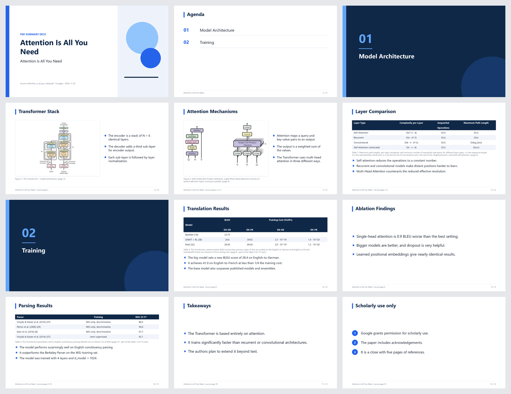
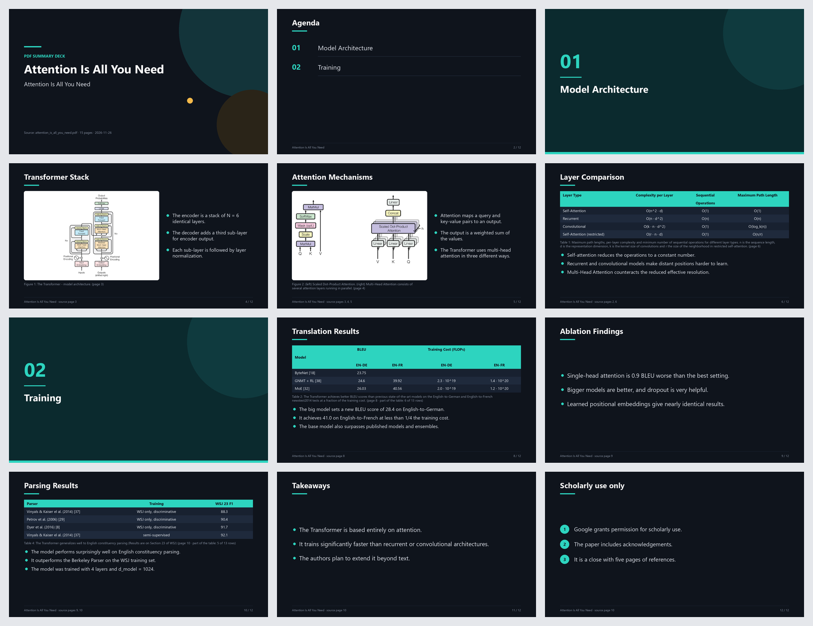
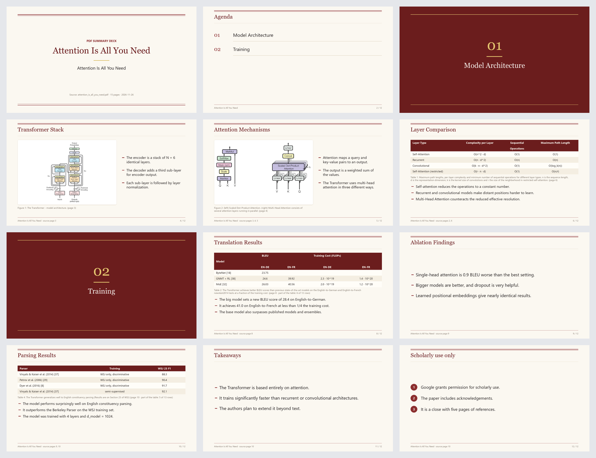

# Tutorial 5. Give it a PDF, get a summary deck in a theme

Give the flow one PDF and a theme name. Two workers plan the slides and write the text, and the program makes **a themed .pptx file and a PNG preview of every slide**. A theme dresses the 8 layouts (Cover, Agenda, Section, Bullets, Figure and text, Table and text, Comparison, Takeaways) in colours, fonts, a background and accent shapes all at once; three themes come with it: Basic, Dark and Academic. The program sets the number of slides from the document's page count.

The models **only choose and write**. The planner (Harper) chooses a layout for each slide and the document parts it rests on, **by address**; the writer (Sage) writes the titles and short bullets **one slide at a time** and gives every sentence the address of the paragraph it came from and a quote from that paragraph. Table cells, figures, captions, page numbers, the document title, the agenda and the slide numbers are put in by **the program** from what the file server read. Whether each quote is in the document, whether the layout names and addresses are right, whether the text fits its box and whether the text is English are checked by **the program, not a model**.

This is the English edition: the slides, the speaker notes, the layout and theme names and the mail are in English, drawn with fonts made for Latin text. The Korean edition (`../../ko/tutorial_05_pdf_to_ppt`) makes Korean slides from the same paper.

The example PDF is the same paper as tutorial 3, **"Attention Is All You Need"**. The paper is not part of this tutorial; `python get_paper.py` downloads it.

> Paper: Ashish Vaswani, Noam Shazeer, Niki Parmar, Jakob Uszkoreit, Llion Jones, Aidan N. Gomez, Lukasz Kaiser, Illia Polosukhin, **"Attention Is All You Need"**, 2017. arXiv: <https://arxiv.org/abs/1706.03762>
>
> The note on the paper's first page: "Provided proper attribution is provided, Google hereby grants permission to reproduce the tables and figures in this paper solely for use in journalistic or scholarly works." So with credit, its tables and figures may be used **in journalistic or scholarly works**. The example slides below hold the paper's Figures 1 and 2 and Tables 1, 2 and 4 (source: Vaswani et al., 2017). Before you use slides like these for anything else (promotion, for example), check that permission. This tutorial does not upload or share the paper's PDF (`input/*.pdf` is in `.gitignore`).

## What you will have at the end

Give the flow a PDF and a theme, and six blocks run in turn.

1. **Intake (program)**: puts the PDF on the file server (`pdf`) and sets the number of slides and sections from the page count (15 pages: 12 slides, 2 sections). It also measures, per layout, how many bullets go on a slide and how many characters fit in one bullet, and puts that in the request (brief).
2. **Classify (program)**: counts the text, table and figure parts the file server read and makes the classification report. The addresses of each text part's paragraphs, the table cells and the figure files are in it too.
3. **Plan (Harper, model)**: per slide, one layout and the parts it rests on (text part addresses, a table or figure address, the table rows to show). The program checks the outline before anything goes on (for example that a table or figure slide rests on a text part that talks about that table or figure).
4. **Split (program)**: cuts the outline into one piece per slide (`slide`): the slide's number, layout, topic, the number of bullets and their length, the text parts and their paragraph addresses, and the table or figure the program will put in.
5. **Write (Sage, model, one slide at a time)**: Sage opens one conversation per piece and writes and saves **that one slide** (12 slides: 12 conversations, 4 at a time). It opens the parts and their paragraphs and writes the title and bullets; every bullet gets the address of a source paragraph (like `fs://pdf/001#4.2`) and a word-for-word quote from that paragraph (the quote is not on the slide; it goes into the speaker notes). A slide the checks send back is written again on its own. Then gather puts the slides back in the outline's order.
6. **Deliver (program)**: builds the slides and saves `output/<name>_<theme>.pptx`, a PNG per slide and one picture of all slides together. When mail is set up it sends the .pptx (without mail, or when it fails, the flow still ends well).

### A real run (Attention Is All You Need, 15 pages → 12 slides)

Model: gpt-5.4-mini through the OpenAI API, run on 2026-11-26 with nextop 0.4.0.dev6 (a pre-release build of 0.4.0, installed from a wheel). The flow ran once with the Basic theme, and the program (`render_deck.py`, no model) drew the same slides again in the Dark and Academic themes. The sentences change with the model every time.

**Basic** ([`example_output/attention_is_all_you_need_basic.pptx`](example_output/attention_is_all_you_need_basic.pptx), slide pictures in [`example_output/attention_is_all_you_need_basic/`](example_output/attention_is_all_you_need_basic/))



**Dark** ([`.pptx`](example_output/attention_is_all_you_need_dark.pptx), [slide pictures](example_output/attention_is_all_you_need_dark/))



**Academic** ([`.pptx`](example_output/attention_is_all_you_need_academic.pptx), [slide pictures](example_output/attention_is_all_you_need_academic/))



Harper planned the 12 slides as cover, agenda, 2 sections, 2 figure slides (the paper's Figures 1 and 2), 3 table slides (all of Table 1, part of Table 2, part of Table 4), 2 bullet slides and the takeaways (the last slide is a short note on the paper's permission for scholarly use). It did not choose the comparison layout this time, so 7 of the 8 layouts show (the tests draw the comparison layout, `tests/test_layouts.py`). For Table 2 Harper wrote only the address `fs://pdf/001#31` and row numbers; the program always adds the header rows and drew "part of the table: 6 of 13 rows" (look at the picture: the rows Harper chose are the earlier models, not the Transformer's own rows, so the slide's bullets talk about results that the table does not show; the program checks addresses and sizes, not whether the rows fit the point). The cell values (`2.3 · 10^19` and so on) are the parsed table's. Figures 1 and 2 are the figure parts' pictures, and their captions are the paper's own.

What I saw reading every slide of this run: no text runs past its box or overlaps, and there are no Chinese, Japanese or Korean letters. Two things a person might still change: the cover's subtitle repeats the title ("Attention Is All You Need" twice), and the last slide ("Scholarly use only") has weak points ("The paper includes acknowledgements"). The facts in the bullets are in the paragraphs they cite (N = 6 layers, 0.9 BLEU for single-head attention, the multi-head attention in three ways); I did not check every bullet against the paper.

**Inside the .pptx**: the slide master holds exactly 8 layouts (`Cover`, `Agenda`, `Section`, `Bullets`, `Figure and text`, `Table and text`, `Comparison`, `Takeaways`), each with the theme's background and accent shapes. The theme's colour scheme and fonts are set too, so a new slide or shape added in PowerPoint comes in the same theme. All text is in editable text boxes, and the bullets are paragraphs of one box, so PowerPoint re-wraps them when you edit. Every slide's speaker notes have the source of each bullet (page, section title and the quote):

```
1. The encoder is a stack of N = 6 identical layers.
   Source: page 3 · 3.1 Encoder and Decoder Stacks — “Encoder: The encoder is composed of a stack of N = 6 identical layers.”
```


**This tutorial draws the PNG previews itself.** It does not use LibreOffice. Pillow draws them from the same layout data (box positions, line breaks, colours) used to write the .pptx, so neither LibreOffice nor PowerPoint is needed.

**How the program checks**

In this run Harper's save was sent back four times before it passed (5 model calls), for example:

```
the outline has 11 slides; brief.slides is 12: give exactly that many
slides[7].table fs://pdf/001#31 would show 12 rows; at most 8 fit (header included). Give the numbers of the most important rows in rows.
slides[8].table fs://pdf/001#37 has 13 columns, more than 7: it cannot be read on a slide. Choose another table or another layout.
slides[7].table fs://pdf/001#31 with these rows is 204 points tall; at most 200 leave room for the bullets. Show fewer rows.
```

Sage was sent back four times before passing (8 model calls); a bullet cited a paragraph that is not one of its slide's parts, and the program answered with the allowed ones:

```
slides[3].bullets[0].source 'fs://pdf/001#6.1' is not a paragraph of this slide's parts ['fs://pdf/001#9']; use one of ['fs://pdf/001#9.1', 'fs://pdf/001#9.2']
slides[11].bullets has 1; a closing (Takeaways) slide takes 3 to 5 bullets
```

Sage read the sections with `get` (28 calls in all: the sections of its slides, then single paragraphs): a section under 8,000 characters comes back as `parts`, each paragraph with its own address and text, so one call shows the paragraphs a bullet may cite.

The tests (`tests/`) show sentences like these too:

```
slides[3].layout 'timeline' is not a layout; use one of: cover (Cover), agenda (Agenda), section (Section), bullets (Bullets), figure (Figure and text), table (Table and text), comparison (Comparison), closing (Takeaways)
slides[4].bullets[0].text "The new model looks at every word at onc" takes 6 lines, its box holds 3 (theme Basic). Shorten it by about 98 characters.
slides[3].bullets[0].text "Attention weights each value by ⟨q, k⟩" has characters the slide font cannot draw (⟨⟩); write them another way (with plain characters, or in words)
```

Whether text fits is measured **in all three themes** and the tightest result is reported, so slides that passed once fit in any theme when drawn again (that is how the Dark and Academic decks above were drawn).

**Time and cost** (gpt-5.4-mini through the OpenAI API; it changes with the model and the internet):

| Work | Time |
|---|---|
| Intake and reading into parts (15-page paper) | 8.2 s |
| Classify | 0.6 s |
| Harper: 5 model calls (5 saves: slide count, tables too tall or too wide, passed) | 18.6 s (55,389 tokens) |
| Sage: 8 model calls (28 `get` calls, 5 saves: slide count, paragraphs of other slides, closing slide twice, passed) | 45.8 s (160,435 tokens) |
| Building the slides, saving the .pptx and 12 PNGs, mail | 2.9 s |
| Whole run | about 76 s (13 model calls, 215,824 tokens) |
| Drawing again in another theme (`render_deck.py`, no model) | a few seconds per theme |

**One slide at a time (nextop 0.4.0.dev9, 2026-11-27, gpt-5.4-mini).** The example decks above are from the 0.4.0.dev6 run, when Sage wrote all 12 slides in one save: one wrong slide sent all 12 back, and rewriting them made new mistakes. The flow now splits the outline into slides (above), so a refused slide is written again alone and the order is the program's. Three runs on the same paper, Basic theme:

| Run | Model calls | Tokens | Time | Harper's saves | Sage's slides sent back | Result |
|---|---|---|---|---|---|---|
| 1 | 10 (Harper 10) | 138,037 | 42.9 s | 10, all refused (the second section put just before the closing, or one section) | - | stopped in the planner |
| 2 | 30 (Harper 5, Sage 25) | 145,524 | 43.6 s | 5 (table too wide, too many rows, too tall) | 3 saves on 2 slides (bullet count, a paragraph outside the slide, columns on a table slide) | 12-slide .pptx, previews, mail |
| 3 | 34 (Harper 5, Sage 29) | 160,990 | 42.2 s | 5 (the same table points) | 5 saves on 4 slides (bullet counts, a bullet too long, columns on a table slide) | 12-slide .pptx, previews, mail |

Each of Sage's conversations took 1 to 5 calls (the agenda and the section slides 1). No slide was shifted or missing. Things a reader may notice: in run 2 the cover's subtitle repeated the document title, and the second section was named "Model architecture and attention" although its slides are the results.

## Time and what you need

About an hour. You read a finished project, fill in the settings and run it.

- Python 3.11 to 3.13 and nextop 0.4.0 with the PDF reader: `setup.bat` in step 0 below installs everything (by hand: `pip install -r requirements.txt`). This tutorial was written for the file servers of nextop 0.4.0 (type folders, common tools, paragraph addresses). Until 0.4.0 is on PyPI, install from a wheel file you were given: `setup.bat <path to the .whl>` `requirements.txt` pins nextop 0.4.0 and `"nextop": ">=0.4,<0.5"` in `project.json` says which versions this project needs (with another version, `nextop check` tells you how to fix it). If another nextop is already installed, `setup.bat` installs 0.4.0 in its place and shows the installed version at the end.
- This tutorial's tools: python-pptx, Pillow, fonttools, reportlab (all in `requirements.txt`; reportlab only draws the test PDF)
- The internet to download the example paper (`python get_paper.py`, about 2 MB)
- A TrueType font: on Windows Segoe UI (and Georgia for the Academic titles) are already there and nothing needs doing. On Linux DejaVu Sans / DejaVu Serif or Liberation, on macOS Arial and Georgia are found; otherwise put the path of a `.ttf` file in `SLIDE_FONT=` in `.env`. No font file comes with this tutorial.
- An OpenAI API key (the default; any other OpenAI-compatible API works too, see Settings below)
- SMTP settings of a mail account (optional; without them the slides are only saved in `output/`)

You can do step 2 (the tests) right away without a model.

## nextop features you learn here

- **Two workers sharing the work**: the planner's output (`outline`) is the writer's input. Each worker gets one small output.
- **The program sets the amounts**: the number of slides and sections, and per layout the number of bullets and characters, are measured by the start function (`intake`) from the document's size and the font, and put in the request; the workers never count.
- **Choosing by address, values by the program**: tables by address and row numbers, figures by address, sources by text part address. Cells, pictures, captions and page numbers are the document values a function gets in the PDF's part tree (`parts`: a table's `columns` and `rows`, a figure's `image`, `caption`, `pages`, and `doc.pages`), put in by the program.
- **A file server defined as type folders** (`types/pages`: pdf, the reader part `pdf_text`, the `paragraphs` splitter, figures sent to `types/figures`), a start function that uploads files (`FILES_OUT`) and a function that receives them (`FILES_IN`): as in tutorial 3. The classification report holds the paragraph addresses of every text part (`paragraphs`).
- **Program checks only** (no model check): that the source is a paragraph of the slide's parts, the `quotes` check part (that the quote is in that paragraph word for word, also for quotes nested in `columns[].bullets[]`), layouts and addresses, counts, a fit check that really measures the text boxes (and says how many characters to cut), characters the font lacks, English only
- An output that the program can reuse: the saved deck (`output/<name>_deck.json`) drawn again in another theme without a model

## Step by step

Open PowerShell in this folder (`en/tutorial_05_pdf_to_ppt`).

### 0. Install: run setup.bat

Double-click `setup.bat` in this folder, or run `.\setup.bat` in PowerShell. On the first run it installs everything this tutorial needs.

- It finds Python 3.11 to 3.13. If there is none, it installs Python 3.12 with winget (then open a new terminal and run `setup.bat` again)
- It makes a virtual environment `.venv` in this folder and installs `requirements.txt` (nextop[pdf], python-pptx, Pillow, fonttools, reportlab, pytest and the rest). Give it the path of a wheel file, like `setup.bat C:\downloads\nextop-0.4.0...whl` (or set the environment variable `NEXTOP_WHEEL`), and only nextop is installed from that file. The wheel must match your Python version (`cp311` means Python 3.11)
- When there is no `.env`, it copies `.env.example` to `.env` and lists the names to fill. You type the key values into `.env` yourself
- It runs the tests that need no model and ends with `Setup OK` when they all pass

You can run it again at any time (an existing `.venv` and `.env` are kept). Run the commands below with the virtual environment on:

```powershell
.venv\Scripts\activate
```

To install by hand instead:

```powershell
py -3.12 -m venv .venv
.venv\Scripts\activate
pip install -r requirements.txt
copy .env.example .env
```

### 1. Look at the folders

```
project.json              project settings (LLM connection)
requirements.txt          the tools this tutorial uses (python-pptx and others)
get_paper.py              downloads the example paper into input/
make_sample_pdf.py        draws a test PDF (a made-up library report, 2 pages)
render_deck.py            draws a saved deck again in another theme (no model)
input.json                the run input: {"pdf_path": "input/attention_is_all_you_need.pdf", "theme": "basic"}
input.sample.json         the same for the test report with the dark theme
workers/planner           Harper (deck planner): mission.md, the output shape in worker.json, the checks in checks.py
workers/writer            Sage (slide writer): the same parts. Writes one slide and checks that one slide
functions/intake.py       start block: uploads the PDF, sets the number of slides and sections
functions/classify.py     sorts text, tables and figures (no model); also finds the pieces of a section (pieces) and the
                          text parts that talk about a table or figure (text_parts)
functions/split_slides.py the split function: cuts the outline into one piece per slide
functions/deliver.py      builds the slides, saves the .pptx and PNGs, mail
functions/_deck.py        3 themes, 8 layouts, measuring and wrapping text, placing slides, the fit check
functions/_pptx.py        writes the .pptx (8 layouts in the slide master, theme colours and fonts)
functions/_preview.py     PNG previews and the overview picture (Pillow)
functions/_render.py      saving: the .pptx, the PNGs, the deck (JSON) and its pictures
functions/_common.py      settings, fonts, the classification report, the English-only check, mail
file_servers/pdf          the PDF store (new for every run): file_server.json + types/pages (pdf) + types/figures (figures)
parts/splitter/paragraphs.py   the splitter that cuts text parts into paragraphs
flows/pdf_to_ppt.json     intake -> classify -> Harper -> split -> Sage (per slide) -> gather -> deliver
tests/                    tests without a model
example_output/           the 3 .pptx files and slide pictures of the real run above
PLATFORM_ISSUES.md        nextop problems found while building this edition
```

### 2. Test without a model

```powershell
pip install -r requirements.txt
python -m pytest -q tests
```

You should see `29 passed`. The tests check that:
- all 8 layouts are drawn in all three themes; the .pptx slide master has 8 layouts with the right names, the PNGs are 1600×900, and text boxes, tables and pictures stay on the slide without overlapping
- the fit check says how many characters to cut, and cutting that many really fits; when bullets run past the bottom it says by how many points; it finds characters the font lacks
- table cells (header rows included), captions, pages, the document title and the agenda come from the report through the program; a saved deck is drawn again in another theme
- the whole flow runs with a fake model: the .pptx table cells equal the parsed table, the picture is the figure part's picture, the speaker notes have the sources, and the mail carries the .pptx. Without mail the flow still ends well
- a wrong layout name, a wrong slide count, a table that is not there, wrong bullet counts, a source that is not a paragraph of the slide's parts, a quote that is not in the document, Chinese, Japanese or Korean letters, and text that does not fit are sent back and pass once fixed; an unknown theme stops at the start

### 3. Fill in the settings

```powershell
copy .env.example .env
```

(If you make `.env` in Notepad, save it as "UTF-8".) See "Settings" below.

### 4. Get the example PDF

```powershell
python get_paper.py
```

To try it without the internet, draw the test report with `python make_sample_pdf.py` (`samples/sample_report.pdf`) and use `input.sample.json` in step 6 (2 pages, so 7 slides and 1 section).

### 5. Check the flow

```powershell
nextop check
```

Before the LLM key is filled in you see `[error] adapter llm.default: API key missing: set LLM_API_KEY in the environment or .env`; with it, `OK: pdf to ppt (workers 2, tools 0, flows 1, file servers 1)`.

### 6. Run it

```powershell
nextop run --flow pdf_to_ppt --input input.json
```

Choose the theme with `theme` in `input.json`: `basic`, `dark` or `academic` (any case, so `Dark` works too). The paper takes about two minutes (it depends on the model).

### 7. Look at the results

- `output/attention_is_all_you_need_basic.pptx`: open it in PowerPoint or LibreOffice
- `output/attention_is_all_you_need_basic/slide_01.png` ...: a preview per slide; `output/attention_is_all_you_need_basic_overview.png`: all slides in one picture
- `output/attention_is_all_you_need_deck.json`: the deck (text, sources, table cells, picture locations), used in the next step
- with mail set up, the `OFFICE_EMAIL` inbox gets `[PDF deck TEST] attention_is_all_you_need.pdf as slides (12 slides, Basic theme)` with the .pptx and the overview picture
- `runs/<run id>/blocks/planner/`, `blocks/writer/`: the model calls (`calls.jsonl`), the tool calls and the sentences the checks sent back (`refused_by: program` in `tools.jsonl`)

### 8. Draw it again in another theme (no model)

```powershell
python render_deck.py output/attention_is_all_you_need_deck.json dark
python render_deck.py output/attention_is_all_you_need_deck.json academic
```

In a few seconds you have `output/attention_is_all_you_need_dark.pptx` and its previews. The text was measured in all three themes during the run, so nothing runs over.

### 9. Try your own PDF

Write the PDF's path in `pdf_path` in `input.json` and run again. Only PDFs with a text layer can be read. More pages give more slides (at most 17, 4 sections; a short document gets 1 section), and a document without tables is planned without table slides. A table with more than 7 columns is not put on a slide.

## How it works

```
intake (program)   PDF path, theme -> uploaded to the pdf file server; slides and sections from the page count (brief)
   |                  per layout the number of bullets and the characters of one bullet (measured with the font) go in the brief
   +--> classify (program)  counts text / table / figure parts -> report: table cells, figure files, captions, pages,
   |                         the pieces of a section cut into several parts (pieces), the text parts about a table or figure (text_parts)
   |
   +--> Harper (planner)  <-- brief + report
   |        outline: per slide layout, topic, parts (text part addresses), table + rows, figure
   |        checks.py: number and order of slides (cover, agenda, section, ..., closing), layout names, addresses in the report,
   |                   table columns and rows, a table leaves room for its bullets (measured in all three themes),
   |                   a table or figure slide's parts hold one of its text_parts
   |        (it must pass before anything goes on: Sage cannot change the outline, so outline mistakes are caught here)
   +--> split (the split function split_slides)  brief + report + outline -> one piece (slide) per slide
   |        |  slide: no/of, layout, topic, bullets (min, max), bullet_chars, title_chars,
   |        |         parts (address, title, pages, paragraph addresses), table (cells, caption), figure (caption), document
   |        +--> Sage@1 (writer)   <-- slide 1 + the pdf file server (opens the parts and paragraphs with get)
   |        +--> Sage@2 (writer)   <-- slide 2      ... 4 at a time
   |        +--> Sage@12 (writer)  <-- slide 12
   |                 writing: this slide's title, bullets[text, source, quote], columns for a comparison
   |                 checks.py: counts, the source is a paragraph of this slide's parts, the quote is in that paragraph
   |                            (quotes), English only, characters the font lacks, every text fits its box (in all three
   |                            themes; says how many characters to cut; a section title is measured on the agenda too).
   |                            When refused, only this slide is written again
   |        gather  the writings of Sage@1 ... Sage@12 as a list in piece order (gathered)
   +--> deliver (program)  report + outline + gathered -> the deck -> .pptx, PNGs, overview picture, mail

**Why one slide at a time?** Sage used to write all 12 slides and save them at once. Then one wrong slide sent all 12
back, and rewriting them all made new mistakes (a slide left out so the rest shifted by one, or 9 of 12 written again
and again). Now one conversation has one slide, the program sets the numbers and the order, and only a refused slide
is written again.
```

- **One set of layout data does three jobs.** `_deck.layout_slide` sets every box of a slide (position, size, text, colour); the same boxes write the .pptx (`_pptx.py`), draw the PNGs (`_preview.py`) and are measured by the fit check (Sage's `checks.py`). Text that passed the check does not run over in the previews either.
- **Text is measured, never shrunk.** Font sizes are fixed per layout (titles 28 pt, bullets 22 pt and so on), and the program measures every word with the real font file to break lines. When text runs over, it is not made smaller or cut silently; Sage is told "it needs this many lines, the box holds that many, cut about this many characters". Only text the program adds (captions, the footer) is shortened with `…` at its line limit.
- **Tables**: the program always adds the header rows (row 1 and the rows right under it with no number) in front of the rows Harper chose, and when rows were left out the caption says "part of the table: M of N rows". The caption shows its first sentence; the whole caption goes into the speaker notes.
- **Figures**: the figure part's picture is fitted into a card, keeping its proportions. The model cannot see figures yet, so Sage writes from the text near the figure.
- **Themes** are the colours, font roles and bullet marks in `THEMES` of `_deck.py` and the accent shapes in `decor()`. In the .pptx the accent shapes and backgrounds go into the slide master's layouts, and the slides hold only their content.

## Settings

### LLM (`project.json`, `workers/*/worker.json`, `.env`)

The default is the OpenAI API: `base_url` in `project.json` is `https://api.openai.com/v1` and `"model"` in each `workers/*/worker.json` is `gpt-5.4-mini`. Put your OpenAI API key after `LLM_API_KEY=` in `.env`. Any other OpenAI-compatible API works too: change `base_url` and the model names.

### Mail (optional)

Fill in `SMTP_HOST`, `SMTP_PORT`, `SMTP_USER`, `SMTP_PASS` and `OFFICE_EMAIL` in `.env`. With `MAIL_TEST_MODE=1` (default) the mail goes only to `OFFICE_EMAIL` and the subject starts with `[PDF deck TEST]`. For real use, `MAIL_TEST_MODE=0` and `MAIL_TO=a@example.com,b@example.com`. Passwords and keys go only in `.env`; never commit or share `.env`.

### Fonts (`SLIDE_FONT` in `.env`)

The program looks for `SLIDE_FONT` in `.env` (bold: `SLIDE_FONT_BOLD`), then Segoe UI on Windows, DejaVu Sans or Liberation Sans on Linux, Arial on macOS. The Academic titles use Georgia (Windows, macOS) or DejaVu Serif / Liberation Serif (Linux), and the body font when none is there. The .pptx holds only the font names, so on a computer without those fonts PowerPoint shows a similar font.

## Try next

- Add a theme: write one more set of colours and fonts in `THEMES` of `_deck.py` and its accent shapes in `decor()`, and all 8 layouts wear the new theme
- Change a layout: move the boxes in `layout_slide()` or change the sizes in `STYLES`; the fit check and the previews follow
- A talk script: one more worker that writes what to say for each slide from the sources in the speaker notes
- A company template: read the colours and fonts of your company's .pptx template (its slide master) and use them as a theme
