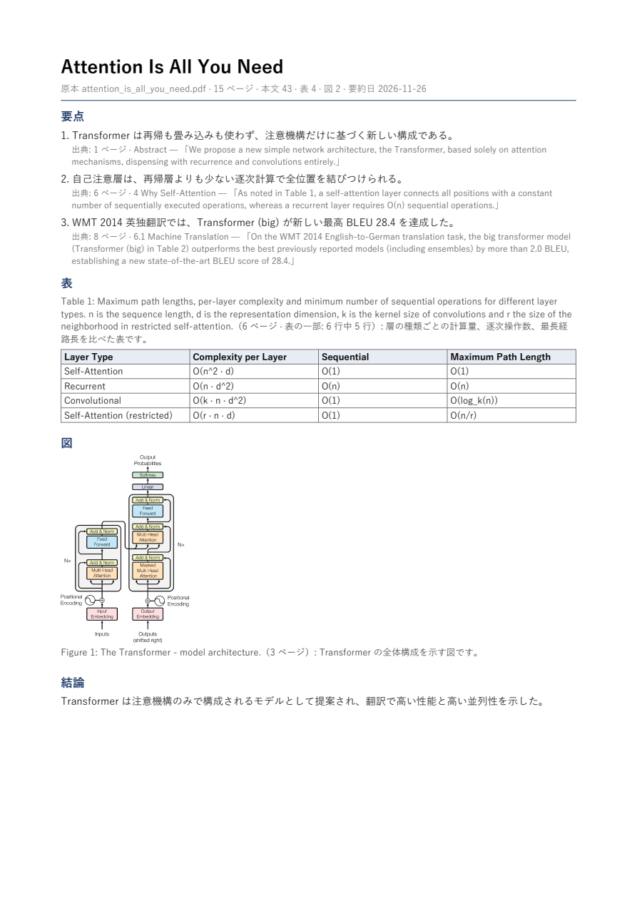
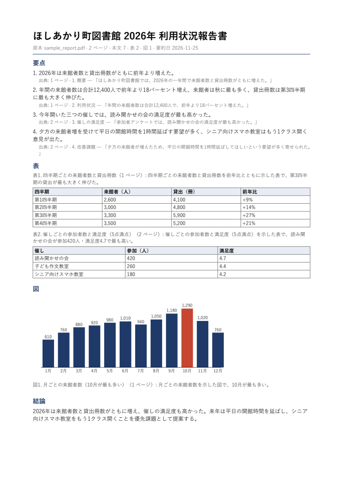

# チュートリアル 3. PDF を渡すと A4 一枚の要約がメールで届く

フローに PDF を一つ渡すと、プログラムが本文・表・図に分けて数え、ワーカー一人（そら）が内容を A4 一枚にまとめ、要約 PDF を添付してメールで送ります。**要約ページには文書の表と図がそのまま入ります。** モデルはどの表と図が大事かを**選ぶだけ**で、表のセルと図はファイルサーバーが読み取った値からプログラムが描きます（モデルが打ち直すことはありません）。要点はすべて、根拠にした**段落のアドレス**とその段落から一字一句そのまま写した文を付け、その引用と「本当に一枚か」はモデルではなく**プログラムが**検査します。

これは日本語版です。要約、メール、分類結果は日本語です（`"language": "ja"`、nextop 0.3.1 から）。英語版（`../../en/tutorial_03_pdf_summary`）と韓国語版（`../../ko/tutorial_03_pdf_summary`）は同じ論文をそれぞれの言語で要約します。

例の PDF は論文 **"Attention Is All You Need"** です（英語の論文を日本語で要約します）。論文のファイルはこのチュートリアルに含まれておらず、`python get_paper.py` がダウンロードします。インターネットなしで試すときは、このチュートリアルが作る架空の報告書（`python make_sample_pdf.py`、日本語）を使ってください。

> 論文: Ashish Vaswani, Noam Shazeer, Niki Parmar, Jakob Uszkoreit, Llion Jones, Aidan N. Gomez, Lukasz Kaiser, Illia Polosukhin, **"Attention Is All You Need"**, 2017. arXiv: <https://arxiv.org/abs/1706.03762> (PDF: <https://arxiv.org/pdf/1706.03762>)
>
> 論文の 1 ページ目には次の案内があります。"Provided proper attribution is provided, Google hereby grants permission to reproduce the tables and figures in this paper solely for use in journalistic or scholarly works." つまり出典を示せば、報道または学術の著作に限って表と図を転載できます。このチュートリアルは論文の PDF をアップロードも配布もせず（`input/*.pdf` は `.gitignore` に入っています）、ダウンロードした PDF から作った要約ページだけを例として見せます。要約ページを宣伝など別の目的に使う前に、この許可の範囲（報道・学術）を確かめてください。

## 完成するとこうなります

PDF ファイルをフローに渡すと、四つのブロックが順に動きます。

1. **受け取り（intake、プログラム）**: PDF をファイルサーバー（`pdf`）に上げます。ファイルサーバーがテキスト層を読み、PDF 一つを一件として持ち、その中の本文・表・図を**文書の順とページを保ったまま**部分に分けます。本文の部分はさらに段落に分かれ、段落ごとにアドレス（`fs://pdf/001#3.1`）が付きます。
2. **分類（classify、プログラム）**: 部分を本文・表・図として数え、分類結果を作ります。本文の部分ごとの段落のアドレス、表のセルと図の画像ファイルもこの結果に入ります。モデルは使いません。
3. **要約（そら、モデル）**: 決まった形（タイトル、要点 3〜5 個、要約ページに載せる表 0〜2 個と図 0〜2 個、結論）で書きます。要点ごとに段落のアドレスとその段落の原文の引用を付け、表と図は**アドレスで選びます**（大きな表なら表示する行番号も）。
4. **送付（deliver、プログラム）**: 要約を A4 の PDF に描きます。選んだ表はセルどおりの表として、選んだ図はそのままの画像としてキャプション付きで入れます。ちょうど一ページかを数えてから、分類結果をメール本文に入れ、PDF を添付して送ります。

列の多い表は小さな文字で描き、14 行を超える表はそらが選んだ行だけを描いて「表の一部: N 行中 M 行」と書きます。列が 10 を超える表は描けないので差し戻します。一枚に収まらないときはプログラムがどれだけはみ出したかを伝え、そらが表や図を減らすか文を短くして書き直します。プログラムが黙って切ることはありません。

### 実際の実行例（論文 Attention Is All You Need）

モデル: OpenAI の `gpt-5.4-mini`（日本語の動画を録画したときと同じモデル）。nextop は 0.4.0（コンパイル済みの wheel 0.4.0.dev6。PyPI への公開前なので `setup.bat <wheel のパス>` でインストールしました）、2026-11-26 実行。入力は `python get_paper.py` でダウンロードした論文（15 ページ）。文はモデルによって毎回変わります。（以前の 0.3.1 とローカルモデルでの実行例は、下の「旧い実行」の注に残しています。）

件名: `[PDF要約・テスト] attention_is_all_you_need.pdf の A4 要約（本文 43、表 4、図 2）`（先頭の `[PDF要約・テスト]` はテストモード `MAIL_TEST_MODE=1` のときだけ付きます）。添付: `要約_attention_is_all_you_need.pdf`。同じ二つのファイルが `summaries/` にも残ります。

**メール本文 = プログラムが作った分類結果**（ファイル: [`example_output/attention_is_all_you_need_report.txt`](example_output/attention_is_all_you_need_report.txt)。ここでは長い行を `…` で縮め、本文の一覧は最初の 8 件だけを載せています。）

```
PDF の分類: attention_is_all_you_need.pdf（15 ページ）
本文 43 · 表 4 · 図 2

[本文] 43
  1. （見出しなし）（1 ページ）· 173 文字
  2. Attention Is All You Need（1 ページ）· 397 文字
  3. Abstract（1 ページ）· 2216 文字
  4. 1 Introduction（2 ページ）· 1904 文字
  5. 2 Background（2 ページ）· 1812 文字
  6. 3 Model Architecture（2 ページ）· 489 文字
  7. 3 Model Architecture（3 ページ）· 260 文字
  8. 3.1 Encoder and Decoder Stacks（3 ページ）· 1316 文字
  …

[表] 4
  1. Table 1: Maximum path lengths, per-layer complexity and minimum number of sequential operations…（6 ページ）· 6 行 × 4 列 · 列: Layer Type | Complexity per Layer | Sequential | Maximum Path Length
  2. Table 2: The Transformer achieves better BLEU scores than previous state-of-the-art models on t…（8 ページ）· 13 行 × 5 列 · 列:  | BLEU |  | Training Cost (FLOPs) | 
  3. Table 3: Variations on the Transformer architecture. Unlisted values are identical to those of …（9 ページ）· 26 行 × 13 列 · 列:  |  |  |  |  |  |  |  |  | train | PPL | BLEU | params
  4. Table 4: The Transformer generalizes well to English constituency parsing (Results are on Secti…（10 ページ）· 13 行 × 3 列 · 列: Parser | Training | WSJ 23 F1

[図] 2
  1. Figure 1: The Transformer - model architecture.（3 ページ）· 911×1343 ピクセル
  2. Figure 2: (left) Scaled Dot-Product Attention. (right) Multi-Head Attention consists of several…（4 ページ）· 1216×769 ピクセル
```

nextop 0.4.0 の読み取りパーツ（タイプフォルダー `pages`）は論文をこう読みました。本文の部分には論文の本当の節タイトル（`1 Introduction`、`3.1 Encoder and Decoder Stacks`）が付き、表 1〜4 は縦線がないにもかかわらずキャプション付きの表の部分になり、図 1 と図 2 はそれぞれ元の解像度で切り出された一つの図の部分で、キャプションも全文が付きます。論文の図 3〜5 は画像ではなく線で描かれた図なので、図の部分にはなりません。残っている限界は韓国語版の [`PLATFORM_ISSUES.md`](../../ko/tutorial_03_pdf_summary/PLATFORM_ISSUES.md) にあります。

**添付された A4 一枚の要約**（描かれたとおり: [`example_output/attention_is_all_you_need_summary.pdf`](example_output/attention_is_all_you_need_summary.pdf)）



そらは表 1（層の種類ごとの計算量。6 行のうち見出し行と 4 行）と図 1（モデルの構成）を選び、プログラムが表の部分のセルを表として、図の部分の画像をそのまま描きました。そらが書いたのは表のアドレス `fs://pdf/001#21` と行番号 `[1, 3, 4, 5, 6]`、図のアドレス `fs://pdf/001#7` だけで、セルは読み取った表のものです。三つの要点は、それぞれ一つの段落（`fs://pdf/001#3.1`、`#23.4`、`#34.1`）のアドレスと、その段落からそのまま写した引用を持ち、すべてプログラムが段落の本文と一字ずつ照らし合わせて通しました（引用の途中の改行も、PDF の行の変わり目のまま通りました）。引用の横のページと節は分類結果から取ったもので、要約はちょうど A4 一枚です。要点の事実は論文と照らし合わせました。BLEU 28.4 と「2.0 BLEU 超」、自己注意の一定数の逐次演算と再帰層の O(n) は、どれも論文にあります。

**日本語の品質について。** この実行の要約と結論は日本語だけで、中国語や韓国語の混ざりはありませんでした（引用と表・図のキャプションは英語の原文のままです）。以前のローカルモデルでは日本語の文に中国語が混ざることが多く（同じ論文 5 回のうち 4 回）、そのため日本語の文字集合（cp932）にない漢字を差し戻すプログラムの検査（`language_errors`）を足しました。`gpt-5.4-mini` の 1 回の実行ではこの検査は働きませんでした。1 回だけの結果なので、実際に使う前に、要約の日本語を目で確かめてください。

**プログラムの検査**

この実行では、そらの最初の保存は文が長く一ページを超え、プログラムが差し戻しました（表は 1 つ、図は 1 つ）。

```
The summary does not fit one A4 page: it runs to 2 pages and about 395 characters of text spill past page 1. Make it smaller by at least that much: choose fewer tables or figures, show fewer rows of a table, or shorten the sentences (key points, lines, conclusion).
```

そらは文を短くし、表の行を減らして保存し直し、2 回目の保存で通りました（モデル呼び出しは全部で 4 回。そらは先に部分を 10 回開きました）。別の実行（0.3.1、ローカルモデル）では、要点に中国語の字が入った保存が次のように差し戻されました。

```
key_points[3].point "エンコーダ・デコーダはそれぞれ N=6 の同一層のスタックで構成され、各層は多头..." has Chinese characters that Japanese does not use (头); write it again in Japanese only
```

引用が段落の文と一字一句同じでないときは、次のように差し戻されます（テストで一語を変えたもの。この文は nextop の日本語の言語パックのものです。この例は nextop 0.3.1 のときのもので、アドレスは旧い形です。0.4.0 では `fs://pdf/001#3.1` のように段落のアドレスが入ります）。

```
引用が見つかりません: 「ほしあかり町図書館では、2026年の一年間で来館者数と貸出冊数がとても増えた。」（summary.key_points[0]）は fs://pdf/003 のテキストにありません。原文を一字一句そのまま引用するか、その主張を削除してください。
```

選んだ表についての検査は、たとえば次のように言います（`tests/test_flow.py` から）。

```
summary.tables[0] (fs://pdf/001#3) has 39 columns, more than 10: it cannot be drawn on the page. Choose another table or none.
summary.tables[0] (fs://pdf/001#2) has 20 rows. Give the numbers of the rows to show (rows, 1 is the header; at most 14 including it), or choose another table.
```

**かかった時間**（`gpt-5.4-mini`、OpenAI の API。環境とモデルによって大きく変わります。数字は `runs/<run>/cost.json` と `events.jsonl` から）:

| 作業 | 時間 |
|---|---|
| 受け取りと部分への読み取り（15 ページの論文） | 7.8 秒 |
| 分類 | 0.6 秒 |
| そら: モデル呼び出し 4 回（部分を 10 回開く、保存 2 回: 一ページ超え 1 回、通過） | 11.7 秒（プロンプト 52,241 + 出力 1,401 = 53,642 トークン） |
| A4 の描画、一ページの確認、メール送信 | 0.9 秒 |
| 実行全体 | 21.0 秒 |

**nextop 0.4.0.dev9 でもう一度確かめました（2026-11-27、`gpt-5.4-mini`）。** 段落の分割パーツを nextop の新しい例に替え、テストは実行が自分で付ける既定の索引を使うようにしました。新しい仮想環境に wheel だけを入れ、同じ論文で動かしました。そらは `get` で 9 か所を開き、最初の保存は 1 ページを約 358 文字はみ出して差し戻され、2 回目で通りました。モデル呼び出し 4 回、53,458 トークン、18.2 秒。要点は 3 つで、どれも段落のアドレス（`fs://pdf/001#3.1`、`#23.4`、`#34.1`）を付け、引用はプログラムが確かめました。この回は表も図も選ばず、文だけの A4 1 ページになりました。メールも送られました。要約の文は日本語だけで、韓国語は混ざっていません。上の出力例は 0.4.0.dev6 の実行のままです。（この日の最初の実行は、モデルへの 4 回目の呼び出しが 12 分以上返ってこず、止めてやり直しました。下の PLATFORM_ISSUES.md を見てください。）

### 実際の実行例（架空の報告書: 表をそのまま描く）

論文の要約にも表がありますが、罫線のある表を持つ日本語のテスト用報告書（`python make_sample_pdf.py`、2 ページ、表 2 つ、図 1 つ）では表と図が一緒に見られます（`nextop run --flow pdf_summary --input input.sample.json`）。そらは表を二つと図 1 を選び、最初の保存で通りました。時間は約 16 秒（モデル呼び出し 2 回）。（この例は nextop 0.3.1 とローカルモデルでの 2026-11-25 の実行です。0.4.0.dev6 と `gpt-5.4-mini` では取り直していません。）分類結果: [`example_output/sample_report_report.txt`](example_output/sample_report_report.txt)、A4 要約: [`example_output/sample_report_summary.pdf`](example_output/sample_report_summary.pdf)。



この実行の 3 番目の引用「参加者アンケートでは、読み聞かせの会の満足度が最も高かった。」は、PDF のテキストでは「高かっ」と「た。」の間で行が変わっています。nextop 0.3.1 ではこの行の変わり目で引用が一致しなかったため、チュートリアル側で改行を取り除いてから比べていました。nextop 0.4.0 の `quotes` 検査は日本語の行の変わり目を扱えるので、その回避は外しました（理由は [`PLATFORM_ISSUES.md`](PLATFORM_ISSUES.md)）。

**要約ページのページ番号と部分の名前はプログラムが入れたものです**（モデルが書いた数字ではありません）。表のセル、図のファイル、表と図の名前（キャプション）、行数と列数、図の大きさ、ページ数は、ファイルサーバーが関数に渡す部分の木（`parts` の表の `columns`・`rows`、図の `image`・`width`・`height`、`caption`、`pages`、それに `doc.pages`）です。モデルはまだ図を見られないので、図の説明はキャプションにあることだけを書きます。

## 時間と必要なもの

約 1 時間。できあがったプロジェクトを読み、設定を埋めて動かします。

- Python 3.11〜3.13 と nextop 0.4.0（PDF の読み取り付き）: 下の 0 の `setup.bat` がすべてインストールします（手動なら `pip install -r requirements.txt`）。このチュートリアルは nextop 0.4.0 のファイルサーバー（タイプフォルダー、共通ツール、段落のアドレス）で書かれています。0.4.0 が PyPI に公開されるまでは、受け取った wheel ファイルでインストールします: `setup.bat <wheel ファイルのパス>` `requirements.txt` は nextop 0.4.0 に固定し、`project.json` の `"nextop": ">=0.4,<0.5"` がこのプロジェクトに必要なバージョンを示します（別のバージョンだと `nextop check` が直し方を知らせます）。すでに別の nextop が入っている場合は `setup.bat` が 0.4.0 に入れ替え、最後にインストールされたバージョンを表示します。
- PDF の読み取りと A4 の描画: `nextop[pdf]` と `reportlab`（どちらも `requirements.txt` に入っています）
- 例の論文をダウンロードするインターネット（`python get_paper.py`、約 2 MB）。ない場合は架空の報告書を使います
- 日本語の TrueType フォント: Windows には游ゴシック（またはメイリオ、MS ゴシック）があるので何もしなくてかまいません。Linux では IPAex ゴシック（`fonts-ipaexfont`）、macOS では Arial Unicode が見つかります。どれもないときは `.env` の `JAPANESE_FONT=` に `.ttf` ファイルのパスを書きます（「設定」を参照）。このチュートリアルにフォントファイルは付いていません。PDF には使った文字だけが入ります。
- OpenAI API のキー（既定。ほかの OpenAI 互換 API でも動きます。下の設定を参照）
- メールアカウントの SMTP 設定（任意。なければメールの段階だけが失敗し、要約は `summaries/` に残ります）

手順 1〜4 はモデルなしですぐにできます。テストは偽のモデルを使います。

## ここで学べる nextop の機能

- **タイプフォルダーで定義したファイルサーバー**: `file_servers/pdf/types/pages/type.json`（pdf、公式の読み取りパーツ `pdf_text`、段落の分割 `paragraphs`、図の部分は `figures` タイプへ回す）と `types/figures/type.json`（図）。PDF 一つが一件（`fs://pdf/001`）になり、本文・表・図が順番とページを保った部分（`#1`、`#2` ...）に、本文の部分はさらに段落（`#3.1`、`#3.2` ...）に分かれます。読むのはモデルではなくプログラムです。
- **段落の分割パーツ**（`parts/splitter/paragraphs.py`、nextop の例のパーツをコピーしたもの）: 空行で段落を分けます。段落が一つの部分は、その部分がそのまま段落です。
- ファイルを上げる開始関数（`FILES_OUT`、`_uploads`）と、ファイルを受け取る関数（`FILES_IN`）: intake が PDF を上げ、classify が PDF の部分の木をデータ（`parts`）として受け取って数えます
- ワーカー一人とプログラムのブロック（`intake`、`classify`、`deliver`）からなるフロー。モデルは要約にだけ使います
- プログラムの検査: 要点のアドレスが分類結果の段落（または表）か、引用がその段落に一字一句あるか（`quotes`）を、モデルなしで確かめます（`checks.py`）
- 測る検査: 「選んだ表と図は描けるか」（列は 10 まで、大きな表は行番号）と「A4 一枚か」。長すぎても黙って切らず、どれだけ超えたかをワーカーに伝えて書き直させます。検査とメールのブロックは同じ描画コードを使います（`functions/_pdf.py`）
- 日本語の検査: 書いた文に仮名があり、韓国語の文字や日本語にない漢字がないこと（`language_errors`）
- ワーカーの出力の形（スキーマ）: 要点 3〜5 個（`minItems`、`maxItems`）、アドレスで選ぶ表 0〜2 個と図 0〜2 個、大きな表の行番号
- 関数が受け取る文書の値（`table.rows`、`figure.image`、`region.caption`）: 表と図をページに描くのはモデルではなくプログラム
- PDF の添付とメールのテストモード
- モデルなしのテスト: 偽のモデルと、このコンピューター上の小さなメールサーバー

## 手順

このフォルダー（`ja/tutorial_03_pdf_summary`）で PowerShell を開きます。

### 0. インストール: setup.bat を実行する

このフォルダーの `setup.bat` をダブルクリックするか、PowerShell で `.\setup.bat` を実行します。最初の 1 回で、このチュートリアルに必要なものをすべて自動でインストールします。

- Python 3.11〜3.13 を探します。なければ winget で Python 3.12 をインストールします（そのあと新しいターミナルを開いて `setup.bat` をもう一度実行）
- このフォルダーに仮想環境 `.venv` を作り、`requirements.txt`（nextop[pdf]、reportlab、pytest など）をインストールします。`setup.bat C:\ダウンロード\nextop-0.4.0...whl` のように wheel ファイルのパスを渡すと（または環境変数 `NEXTOP_WHEEL`）、nextop だけをそのファイルでインストールします。wheel は Python のバージョンに合っている必要があります（`cp311` なら Python 3.11）
- `.env` がなければ `.env.example` をコピーして作り、記入する名前だけを表示します。キーの値は自分で `.env` に書きます
- モデルなしのテストを実行し、すべて通ると最後に `Setup OK` と表示します

何度実行しても大丈夫です（すでにある `.venv` と `.env` はそのまま残します）。以下のコマンドは仮想環境を有効にしてから実行します。

```powershell
.venv\Scripts\activate
```

手動でインストールする場合:

```powershell
py -3.12 -m venv .venv
.venv\Scripts\activate
pip install -r requirements.txt
copy .env.example .env
```

### 1. フォルダーを見る

```
project.json              プロジェクトの設定（LLM の接続、"language": "ja"）
get_paper.py              例の論文（Attention Is All You Need）を input/ にダウンロード
make_sample_pdf.py        テスト用の PDF を描く（架空の図書館の報告書、2 ページ、インターネットなしで使う用）
input.json                実行の入力: {"pdf_path": "input/attention_is_all_you_need.pdf"}
input.sample.json         架空の報告書用の同じもの: {"pdf_path": "samples/sample_report.pdf"}
workers/summarizer        そら: A4 の要約（mission.md、worker.json の出力の形、checks.py の検査）
functions/intake.py       開始ブロック: PDF をファイルサーバーに上げる
functions/classify.py     本文・表・図を分ける（モデルなし）
functions/deliver.py      A4 の PDF を描き（選んだ表と図を含む）、一ページか確かめてメールで送る
functions/_pdf.py         補助: フォント、分類結果、A4 の描画（表と図）とページ数、日本語の検査、メール
file_servers/pdf          PDF の置き場（実行ごとに新しい）: file_server.json + types/pages（pdf）+ types/figures（図）
parts/splitter/paragraphs.py   段落の分割パーツ（本文の部分を段落に分ける）
flows/pdf_summary.json    intake -> classify -> そら -> deliver
tests/                    モデルなしのテスト
example_output/           上の実際の実行の分類結果、要約 PDF と画像
PLATFORM_ISSUES.md        この版を作る中で見つけた nextop の問題
```

### 2. モデルなしでプログラムの部分をテストする

```powershell
python -m pytest -q tests
```

`21 passed` と出れば成功です。テストが確かめること:
- 日本語のサンプル PDF が、順番とページを保った本文・表・図の部分に読まれること。分類結果の個数、表の行数と列数、表と図のキャプション
- 偽のモデルでフロー全体が動き、メールがテスト用サーバーに届くこと（件名は `[PDF要約・テスト]` で始まり、本文に分類結果、添付の PDF はちょうど一ページ）
- 一語違う引用は `quotes` の検査で差し戻され、直すと通ること。PDF の行の変わり目をまたぐ引用は通ること。要点のアドレスが段落ではなく本文の部分全体なら、その部分の段落のアドレスを伝えて差し戻すこと
- 選んだ表は表の部分のセルどおりに、選んだ図は図の部分の画像どおりに A4 ページに描かれること。行を選んだときはその行だけが描かれ、「表の一部」と書かれること
- 一ページを超える要約（表と図が多すぎる場合も）は差し戻され、短くすると通ること。分類結果にない表や図、列が 10 を超える表、14 行を超えるのに行番号のない表は差し戻されること。表も図も選ばなくてもよいこと。メールのブロックは一ページでないものを送らないこと
- 日本語でない文（仮名のない文、韓国語の文字、日本語にない漢字）は差し戻され、直すと通ること
- フォントがないときのエラーがすることを伝えること、日本語の添付ファイル名と宛先（テストモード）が正しいこと

### 3. 設定を埋める

```powershell
copy .env.example .env
```

（メモ帳で `.env` を作るときは「UTF-8」で保存してください。）そのうえで下の「設定」のとおりに埋めます。

### 4. 例の PDF を用意する

```powershell
python get_paper.py
```

論文 "Attention Is All You Need" が `input/attention_is_all_you_need.pdf` としてダウンロードされます（出典と許可の案内はこのページの最初にあります）。この PDF をアップロードしたり配ったりしないでください（`.gitignore` に入っています）。

インターネットなしで試すときは、架空の報告書を描いて、手順 6 で `input.json` の代わりに `input.sample.json` を使います。

```powershell
python make_sample_pdf.py
```

`samples/sample_report.pdf` ができます（開いてみてください。タイトル、段落、表 2 つ、棒グラフ 1 つ）。自分の PDF を使う方法は手順 8 にあります。

### 5. フローを確かめる

```powershell
nextop check
```

LLM のキーを埋める前は次のように出ます。

```
[error] adapter llm.default: API key missing: set LLM_API_KEY in the environment or .env
```

モデルのアドレス、キー、名前を埋めると `OK: pdf summary (workers 1, tools 0, flows 1, file servers 1)`。PDF の読み取りパーツが入っていないときは、この段階で `pip install "nextop[pdf]"` を実行するように言われます。

### 6. 動かす

```powershell
nextop run --flow pdf_summary --input input.json
```

論文なら約 50 秒、架空の報告書なら約 15 秒（モデルによります）で `run <id>: done` と出ます。架空の報告書は `--input input.sample.json` で動かします。最初は `MAIL_TEST_MODE=1` なので、メールは `OFFICE_EMAIL` にだけ届きます。

### 7. 結果を見る

- `OFFICE_EMAIL` の受信箱: 上のようなメール（件名は `[PDF要約・テスト]` で始まり、要約 PDF が添付）
- `summaries/attention_is_all_you_need_summary.pdf` と `..._report.txt`: 同じ内容
- `runs/<実行 id>/`: フローの記録。そらの `blocks/summarizer/attempt-1/` にはモデル呼び出し（`calls.jsonl`）とツール呼び出し（`tools.jsonl`）があります。そらが開いた部分と段落（`get`）と、検査が差し戻した文（`refused_by: program` の付いた `save_output` の行）です。`file_servers/pdf/` にはこの実行で読み取った部分があります

### 8. 自分の PDF で試す

PDF をどこかに置き、そのパスを `input.json` の `pdf_path` に書きます（このフォルダーからの相対パス、またはフルパス）。

```json
{"pdf_path": "C:/Documents/my_report.pdf"}
```

そのうえでもう一度 `nextop run --flow pdf_summary --input input.json`。読めるのはテキスト層のある PDF だけです（スキャンした画像は読めません）。とても長い PDF は、そらが部分を一つずつ開くので時間がかかります。画像として貼られた表は表ではなく図になります。縦線のない表は、上に「Table N:」のキャプションがあれば見つかります（日本語の「表1.」のキャプションは、このチュートリアルでは罫線のある表でだけ確かめました）。キャプションのない表、線で描かれた図、二段組みはまだ苦手です。

## しくみ

```
intake（プログラム）  PDF のパス -> pdf ファイルサーバーに上げる
   |                      ファイルサーバーの読み取りパーツ（pdf_text）が PDF を一件として持ち、
   |                      本文・表・図の部分を順番とページ付きで保存する（fs://pdf/001 = PDF、#1 #2 ... = 部分）
   |                      本文の部分は段落に分け直す（#3.1 #3.2 ... = 段落、paragraphs パーツ）
   |
   +--> classify（プログラム）  部分を本文 / 表 / 図として数える -> 分類結果、本文の部分ごとに段落のアドレス
   |        表: キャプション、ページ、行 x 列、セル   図: キャプション、ページ、大きさ、画像ファイル
   |
   +--> そら（summarizer）  <-- 分類結果 + pdf ファイルサーバー（get で部分と段落を開く）
   |        summary: タイトル / 要点 3〜5 / 選んだ表 0〜2（+ 行番号） / 選んだ図 0〜2 / 結論
   |        checks.py: アドレスが段落（または表）か、引用がその段落に一字一句あるか（quotes）、選んだ表と図が描けるか、
   |                   日本語か、描くと A4 一枚か（違えば、どれだけ違うかを伝えて選び直し・書き直し）
   |        v   summary
   +--> deliver（プログラム）  A4 の PDF を描く（選んだ表のセルと図は分類結果から） -> 一ページか確かめる
                               -> 分類結果を本文に、PDF を添付してメールで送る
```

- **PDF の渡し方は二つあり、このチュートリアルは二つ目を使います。** 一つはファイルサーバーの `documents/` フォルダーに PDF を置き、`nextop index --file-server pdf` で読み込む方法で、残り続ける置き場と別の読み込み手順になります。もう一つはここで使う方法で、実行時にパスを渡し、開始関数（`intake`）が上げます。一度に PDF 一つ、実行ごとに新しい置き場なので以前の PDF が混ざらず、コマンドも一つです。PDF を集めて後から質問したいときは `documents/` を使います（「次に試すこと」）。
- ファイルサーバーの読み取りパーツは PDF のテキスト層を**プログラムで**読みます。本文の 1.2 倍以上の大きさの短い行（または本文と同じ大きさの太字の行）は見出し、罫線の格子や「Table N:」のキャプションの下でそろった列は表、画像は図です。この段階にモデルは関わりません。
- classify 関数は intake が上げた PDF の部分の木（`FILES_IN` の `parts`）を数えるだけです。表と図のキャプション（`caption`）はファイルサーバーの読み取りパーツから来ます。
- そらは `get` で本文の部分と段落、表を開き、ページに載せる表と図をアドレスで選びます（表の数字を打ち直さないので写し間違いが起きません）。要点ごとに段落のアドレス（`source`。分類結果の `paragraphs` から）と、その段落から一字一句写した文（`quote`）を付けます。プログラムがその段落と一字ずつ比べます（違ってよいのは空白と改行だけ）。本文が短い部分（約 8000 文字まで）は、`get` がその下の段落をアドレスと本文の組（`parts`）で順に返します。長い部分は一つ下の部分のカードで返すので、そのアドレスでさらに開きます。
- 一ページの検査: `checks.py` が表と図も含めて要約を描き、ページを数えます。超えたときは「何ページで、何文字はみ出したか」をそらに伝え、そらは表や図を減らすか文を短くします。メールのブロック（`deliver`）は同じコードでもう一度描き、一ページでないものは送りません。モデルの判断がいらない検査だけを使います。
- 日本語の検査: 書いた文（要点、表と図の説明、結論）に仮名がない、韓国語の文字がある、日本語の文字集合（cp932）にない漢字がある、のどれかなら差し戻します。タイトルと引用は原文のままなので検査しません。
- 要約ページのページ番号と部分の名前は、プログラムが読んだ分類結果から取ります。モデルが写したページ番号は使いません。

## 設定

### LLM（`project.json`、`workers/summarizer/worker.json`、`.env`）

既定は OpenAI API です。`project.json` の `base_url` は `https://api.openai.com/v1`、各 `workers/*/worker.json` の `"model"` は `gpt-5.4-mini` です。`.env` の `LLM_API_KEY=` のあとに OpenAI API のキーを入れてください。ほかの OpenAI 互換 API でも動きます。`base_url` とモデル名を変えてください。

`nextop check` が `OK` と言えば完了です。

### メール（SMTP）

`.env` の `SMTP_HOST`、`SMTP_PORT`、`SMTP_USER`、`SMTP_PASS` を埋めます。ポート 587 は STARTTLS、465 は SSL を使います（ほかのポートは暗号化なしで送るので、自分のコンピューター上のテスト用サーバーにだけ使ってください）。

- `MAIL_TEST_MODE=1`（既定）: メールは `OFFICE_EMAIL` にだけ届き、件名は `[PDF要約・テスト]` で始まります。最初はこのままにしてください。
- 本番: `MAIL_TEST_MODE=0` にして `MAIL_TO=a@example.com,b@example.com` を埋めます（複数ならカンマ区切り）。件名は `[PDF要約]` で始まります。

パスワードとキーは `.env` にだけ書きます。`.env` はコミットも共有もしないでください（`.gitignore` に入っています）。

### フォント（`.env` の `JAPANESE_FONT`）

要約 PDF とテスト用 PDF は日本語の TrueType フォントで描きます。プログラムが探す順番は、`.env` の `JAPANESE_FONT`（太字は `JAPANESE_FONT_BOLD`）、Windows の游ゴシック・メイリオ・MS ゴシック、Linux の IPAex ゴシック、macOS の Arial Unicode です。どれもないときは `no Japanese TrueType font found ...` と出るので、フォント（.ttf）を入れて、そのパスを `JAPANESE_FONT=` に書いてください。`.ttc` ファイルは最初のフォントを使います。CFF アウトラインのフォント（Noto Sans CJK の .otf/.ttc、ヒラギノなど）は reportlab で使えません。ライセンスで許されたフォントだけを使ってください（このチュートリアルはフォントファイルを配りません）。

## 次に試すこと

- 集めて質問する: `file_servers/pdf/file_server.json` を `"lifetime": "project"` にし、`documents/` に PDF を置いて `nextop index --file-server pdf` で読み込むと、置き場に複数の PDF が残ります。そのうえで intake 関数の代わりに `{"from": "documents", ...}` の共有の線を使います
- 要約の形を変える: `worker.json` の出力の形と `mission.md` を変えると（たとえば「リスク」を足す）、同じ種類の検査がそのまま働きます。ページのレイアウトと表・図の描き方は `functions/_pdf.py` の `render_summary` にあります
- 複数の PDF を一度に: フォルダーの PDF ごとにフローを一回ずつ動かす短いスクリプト（PDF ごとに `nextop run`）
- 読み手ごとに違う要約: メールの関数を `MAIL_TO` ごとに分ける
- スキャンした PDF: テキスト層のないページはまだ読めません。画像から文字を読む読み取りパーツ（`ocr` の枠）ができれば、同じフローで使えます
