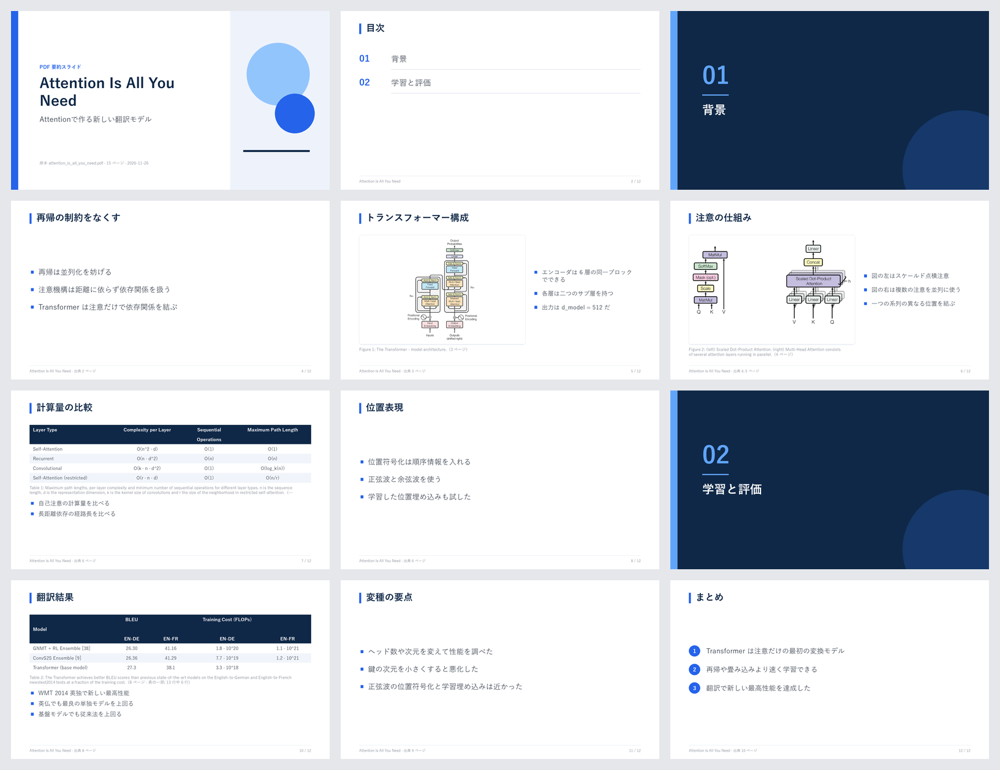
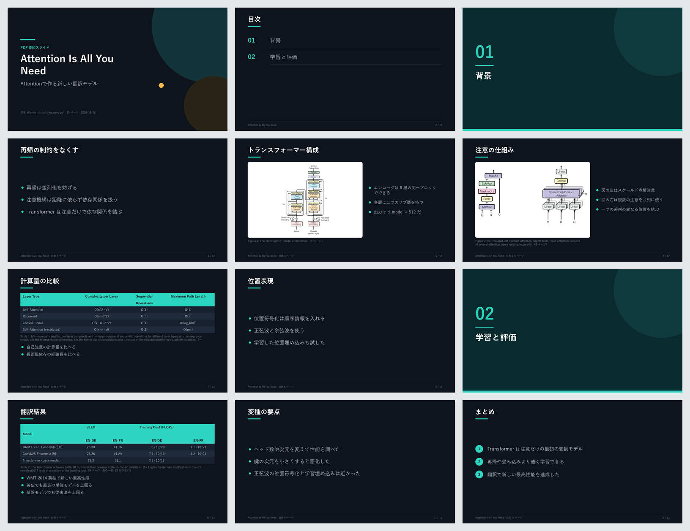
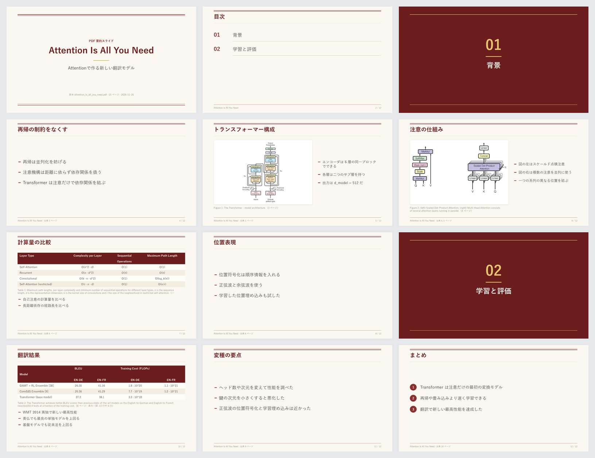

# チュートリアル 5. PDF を渡すと、テーマ付きの要約スライドができる

フローに PDF を一つとテーマの名前を渡すと、ワーカー二人がスライドの構成を決めて文を書き、プログラムが**テーマ付きの .pptx ファイルと、スライドごとの PNG プレビュー**を作ります。テーマは 8 つのレイアウト（表紙、目次、セクション、箇条書き、図と説明、表と説明、2 列の比較、まとめ）に色、フォント、背景、アクセントの図形をまとめて着せるもので、ベーシック、ダーク、アカデミックの三つが付いています。スライドの枚数は、プログラムが文書のページ数から決めます。

モデルは**選ぶことと書くことだけ**をします。構成担当（みなと）はスライドごとにレイアウトと根拠になる文書の部分を**アドレスで**選び、文担当（しおり）は**スライド一枚ずつ**タイトルと短い箇条書きを書いて、どの文にも根拠にした段落のアドレスと、その段落からの引用を付けます。表のセル、図、キャプション、ページ番号、文書のタイトル、目次、スライド番号は、ファイルサーバーが読み取った値から**プログラムが**入れます。引用が文書にあるか、レイアウトの名前とアドレスが正しいか、文字が枠に収まるか、文が日本語かは、モデルではなく**プログラムが**検査します。

これは日本語版です。スライド、発表者のノート、レイアウトとテーマの名前、メールは日本語で、日本語のフォントで描きます（`"language": "ja"`、nextop 0.3.1 から）。英語版（`../../en/tutorial_05_pdf_to_ppt`）と韓国語版（`../../ko/tutorial_05_pdf_to_ppt`）は同じ論文からそれぞれの言語のスライドを作ります。

例の PDF はチュートリアル 3 と同じ論文 **"Attention Is All You Need"** です。論文のファイルはこのチュートリアルに含まれておらず、`python get_paper.py` がダウンロードします。

> 論文: Ashish Vaswani, Noam Shazeer, Niki Parmar, Jakob Uszkoreit, Llion Jones, Aidan N. Gomez, Lukasz Kaiser, Illia Polosukhin, **"Attention Is All You Need"**, 2017. arXiv: <https://arxiv.org/abs/1706.03762>
>
> 論文の 1 ページ目の案内: "Provided proper attribution is provided, Google hereby grants permission to reproduce the tables and figures in this paper solely for use in journalistic or scholarly works." つまり出典を示せば、表と図を**報道または学術の著作に限って**使えます。下の例のスライドには論文の図 1、図 2 と表 1、表 2 が入っています（出典: Vaswani et al., 2017）。こうしたスライドを宣伝など別の目的に使う前に、この許可を確かめてください。このチュートリアルは論文の PDF をアップロードも配布もしません（`input/*.pdf` は `.gitignore` に入っています）。

## 完成するとこうなります

PDF とテーマをフローに渡すと、六つのブロックが順に動きます。

1. **受け取り（intake、プログラム）**: PDF をファイルサーバー（`pdf`）に上げ、ページ数からスライドの枚数とセクションの数を決めます（15 ページなら 12 枚、セクション 2 つ）。レイアウトごとに、1 枚に載せる箇条書きの数と、箇条書き一つに入る文字数も測って依頼（brief）に入れます。
2. **分類（classify、プログラム）**: ファイルサーバーが読み取った本文・表・図の部分を数えて分類結果を作ります。表のセルと図のファイルもここに入ります。
3. **構成（みなと、モデル）**: スライドごとにレイアウトを一つと、根拠になる部分を選びます（本文の部分のアドレス、表か図のアドレス、表示する表の行）。プログラムが構成を検査し、通ってから次に進みます（表と図のスライドに、その表や図を扱う本文の部分があるか、など）。
4. **切り分け（split、プログラム）**: 構成をスライド一枚ずつの切り分け（slide）に分けます。切り分けには、そのスライドの番号、レイアウト、扱うこと、箇条書きの個数と文字数、根拠になる本文の部分と段落のアドレス、入れる表や図が入っています。
5. **執筆（しおり、モデル、スライド一枚ずつ）**: しおりは切り分けごとに会話を一つ開き、**そのスライド一枚だけ**を書いて保存します（12 枚なら会話 12 個、4 つずつ同時に）。部分とその段落を開いて、タイトルと箇条書きを書きます。箇条書きごとに出典の段落のアドレス（`fs://pdf/001#4.2` のような形）と、その段落から一字一句そのまま写した引用を付けます（引用はスライドには出ず、発表者のノートに入ります。ノートには段落が属する節とページが出ます）。検査で差し戻されたスライドは、その一枚だけを書き直します。書き終わると、集め（gather）が構成の順に並べます。
6. **送付（deliver、プログラム）**: スライドを組み立て、`output/<名前>_<テーマ>.pptx`、スライドごとの PNG、全スライドを並べた画像一枚を保存します。メールが設定されていれば .pptx を送ります（メールがない、または失敗しても、フローは正常に終わります）。

### 実際の実行例（Attention Is All You Need、15 ページ → 12 枚）

モデル: OpenAI の `gpt-5.4-mini`（日本語の動画を録画したときと同じモデル）。nextop は 0.4.0（コンパイル済みの wheel 0.4.0.dev6。PyPI への公開前なので `setup.bat <wheel のパス>` でインストールしました）、2026-11-26 実行。フローはベーシックのテーマで一度だけ動かし、プログラム（`render_deck.py`、モデルなし）が同じスライドをダークとアカデミックでも描きました。文はモデルによって毎回変わります。（以前の 0.3.1 とローカルモデルでの実行例は、この版では置き換えました。）

**ベーシック**（[`example_output/attention_is_all_you_need_basic.pptx`](example_output/attention_is_all_you_need_basic.pptx)、スライドの画像は [`example_output/attention_is_all_you_need_basic/`](example_output/attention_is_all_you_need_basic/)）



**ダーク**（[`.pptx`](example_output/attention_is_all_you_need_dark.pptx)、[スライドの画像](example_output/attention_is_all_you_need_dark/)）



**アカデミック**（[`.pptx`](example_output/attention_is_all_you_need_academic.pptx)、[スライドの画像](example_output/attention_is_all_you_need_academic/)）



アカデミックのタイトルは明朝体（游明朝、MS 明朝、IPAex 明朝）で描きますが、この画像を作ったコンピューター（韓国語版の Windows）には明朝体がなかったので、本文と同じ游ゴシックで描かれています。

みなとは 12 枚を、表紙、目次、セクション 2 枚、箇条書き 3 枚、図のスライド 2 枚（論文の図 1 と図 2）、表のスライド 2 枚（表 1 全体、表 2 の一部）、まとめと決めました。2 列の比較は選ばなかったので、8 つのレイアウトのうち 7 つが出ています（2 列の比較はテストで描いています。`tests/test_layouts.py`）。表 2 についてみなとが書いたのはアドレス `fs://pdf/001#31` と行番号だけで、見出しの行はプログラムがいつも加え、「表の一部: 13 行中 6 行」と書きました。セルの値は読み取った表のものです。図 1 と図 2 は図の部分の画像で、そのキャプション、ページ番号、下の「出典 4, 5 ページ」は、プログラムが分類結果から入れました。

この実行のスライドを全部読んで見たこと: 枠からはみ出す文字や重なりはなく、韓国語や中国語の字も、英単語の混ざりもありません（タイトルの `Attention Is All You Need` と表・図のキャプションは原文のままです）。要点の出典は、すべて箇条書きの横に「出典: N ページ · 節名 — 「原文」」の形で発表者のノートに入っています（段落のアドレスで、引用はその段落から取った原文です）。気になった点: 箇条書きは各 3 つで、以前のローカルモデルの実行（5 つ）より薄く、図 2 のスライドの 3 つ目「一つの系列の異なる位置を結ぶ」は図の内容から少し外れています。文は「〜だ」と「〜する」で、スライドとしては硬めです。これは検査では見つけられない質の問題なので、実際に使う前にスライドを読んでください。日本語は単語の間に空白がないので、行は文字の間で折り返します（句読点で始まる行や、数字と「年」の間の折り返しは作りません）。

**日本語の品質について。** この実行の日本語は、「トランスフォーマー構成」のように英語の用語を日本語にしたもの以外、問題は見つかりませんでした。以前のローカルモデルの実行では中国語からの誤り（「畳み込み」が「巻込み」など）があったので、日本語の文字集合（cp932）にない漢字を差し戻す検査と、かなのない文を差し戻す検査があります。`gpt-5.4-mini` の 1 回の実行では、かなのないタイトル（`Transformer 構成`）をその検査が差し戻し、次の保存で「トランスフォーマー構成」になりました。

**.pptx の中身**: スライドマスターにはちょうど 8 つのレイアウト（`表紙`、`目次`、`セクション`、`箇条書き`、`図と説明`、`表と説明`、`2 列の比較`、`まとめ`）があり、それぞれにテーマの背景とアクセントの図形があります。テーマの配色とフォントも設定してあるので、PowerPoint で新しいスライドや図形を足しても同じテーマになります。文字はすべて編集できるテキストボックスで、文字の言語は日本語（`ja-JP`）、東アジアの文字用のフォントも同じフォントにしてあります。箇条書きは一つのボックスの段落なので、編集すると PowerPoint が折り返し直します。どのスライドの発表者のノートにも、箇条書きごとの出典（ページ、節のタイトル、引用）があります。

```
1. エンコーダもデコーダも N = 6 の同一層のスタック
   出典: 3 ページ · 3.1 Encoder and Decoder Stacks — 「The encoder is composed of a stack of N = 6 identical layers.」
```

**PNG のプレビューはこのチュートリアルが自分で描きます。** LibreOffice は使いません。.pptx を書くのと同じレイアウトのデータ（ボックスの位置、改行、色）から Pillow が描くので、LibreOffice も PowerPoint もいりません。

**プログラムの検査**

この実行では、みなとの最初の保存は枚数と表が合わず差し戻されました（スライド 13 枚、表の行と列が多すぎる）。2 回目と 3 回目は表が高すぎる、図を二度使っている、表の列が多すぎるで差し戻され、4 回目で通りました。

```
the outline has 13 slides; brief.slides is 12: give exactly that many
slides[9].table fs://pdf/001#31 with these rows is 233 points tall; at most 200 leave room for the bullets. Show fewer rows.
slides[10].table fs://pdf/001#37 has 13 columns, more than 7: it cannot be read on a slide. Choose another table or another layout.
```

しおりは部分を 26 回開き、保存は 4 回で、最初の 3 回は次のように差し戻されて、4 回目で通りました（モデル呼び出し 7 回）。

```
slides[4].bullets[2].source 'fs://pdf/001#22.1' is not a paragraph of this slide's parts ['fs://pdf/001#6', 'fs://pdf/001#8', 'fs://pdf/001#9']; use one of ['fs://pdf/001#6.1', 'fs://pdf/001#6.2', 'fs://pdf/001#8.1', ...]
slides[4].title "Transformer 構成" is not Japanese (it has no hiragana or katakana); write it again in Japanese
slides[6] is table (表と説明): only a comparison has columns; leave columns []
引用が見つかりません: 「In this work we adopt a similar solution for our model, although following [18] ...」（writing.slides[5].bullets[2]）は fs://pdf/001#10.1 のテキストにありません。原文を一字一句そのまま引用するか、その主張を削除してください。
```

（最初の保存には、出典の段落のアドレスがそのスライドの部分の段落でないもの、表のスライドに箇条書きがないもの、かなのないタイトルなど、ほかにも問題がありました。差し戻しは一度に全部伝えられるので、みなとが書き直せました。出典は段落のアドレス（`fs://pdf/001#6.1` のように）で、検査の差し戻しはそのスライドの部分の段落の一覧を伝えます。）

テスト（`tests/`）にもこうした文が出てきます。

```
slides[3].layout 'timeline' is not a layout; use one of: cover (表紙), agenda (目次), section (セクション), bullets (箇条書き), figure (図と説明), table (表と説明), comparison (2 列の比較), closing (まとめ)
slides[4].bullets[0].text "新しいモデルはすべての単語を一度に見て、処理をうまく分けられるので訓練がとても速" takes 7 lines, its box holds 3 (theme ベーシック). Shorten it by about 55 characters.
slides[2].title "利用状況（usage）" writes a term twice with parentheses ("...利用状況（usage）..."): a slide shows a term once. Write it in Japanese or in English, not both
```

文字が収まるかは**三つのテーマすべてで**測り、いちばん厳しい結果を伝えるので、一度通ったスライドはどのテーマで描き直しても収まります（上のダークとアカデミックはそうして描きました）。

**かかった時間**（`gpt-5.4-mini`、OpenAI の API。環境とモデルによって大きく変わります。数字は `runs/<run>/cost.json` と `events.jsonl` から）:

| 作業 | 時間 |
|---|---|
| 受け取りと部分への読み取り（15 ページの論文） | 7.7 秒 |
| 分類 | 0.5 秒 |
| みなと: モデル呼び出し 4 回（保存 4 回: 枚数と表、表が高すぎる、通過までの差し戻し 3 回） | 16.4 秒 |
| しおり: モデル呼び出し 7 回（部分を 26 回開く、保存 4 回: 差し戻し 3 回、通過） | 44.3 秒 |
| スライドの組み立て、.pptx と PNG 12 枚の保存、メール | 3.4 秒 |
| 実行全体 | 72.3 秒（モデル呼び出し 11 回、プロンプト 190,820 + 出力 10,624 = 201,444 トークン） |
| 別のテーマで描き直し（`render_deck.py`、モデルなし） | テーマごとに約 6 秒 |

**スライドを一枚ずつ書くようにしたあと（nextop 0.4.0.dev9、2026-11-27、`gpt-5.4-mini`）。** 上の例のデッキは 0.4.0.dev6 の実行のもので、そのときはしおりが 12 枚を一度に保存していました。一枚だけ間違えても 12 枚すべてが差し戻され、書き直すうちに新しい間違いが出ました。今は構成をスライドごとに切り分けるので（上）、差し戻されたスライドだけを書き直し、順番はプログラムが決めます。同じ論文、ベーシックのテーマで 2 回動かしました。

| 実行 | モデル呼び出し | トークン | 時間 | みなとの保存 | しおりの差し戻し | 結果 |
|---|---|---|---|---|---|---|
| 1 | 29（みなと 4、しおり 25） | 156,438 | 51.1 秒 | 4 回（スライドの数、表の行が多すぎ、表が高すぎ） | 1 回（表のスライドの箇条書きの数） | 12 枚の .pptx、プレビュー、メール |
| 2 | 26（みなと 3、しおり 23） | 123,526 | 36.5 秒 | 3 回（表の行が多すぎ、表が高すぎ） | 2 回（表紙のタイトルがかなのない英語、2 列の比較で箇条書きを列に入れなかった） | 12 枚の .pptx、プレビュー、メール |

しおりの会話は一枚につき 1〜3 回の呼び出しでした（目次とセクションは 1 回）。どちらのデッキもスライドがずれたり抜けたりせず、文は日本語で、韓国語は混ざっていません（「key size」「dropout」のような論文の用語は英語のまま残ることがあります）。

架空の報告書（`python make_sample_pdf.py`、2 ページ → 7 枚、ダーク）でも、nextop 0.3.1 とローカルモデルで実際に動かしました（2026-11-25、0.4.0.dev6 では取り直していません。run 20261125-214614-a9c5、約 59 秒、モデル呼び出し 4 回、どちらのワーカーも最初の保存で通過）。表のスライド 2 枚とまとめの日本語に問題はなく、引用「参加者アンケートでは、読み聞かせの会の満足度が最も高かった。」は PDF のテキストでは行の途中（「高かっ」と「た。」の間）で改行されていましたが、日本語の改行を除いて比べるので通りました。

## 時間と必要なもの

約 1 時間。できあがったプロジェクトを読み、設定を埋めて動かします。

- Python 3.11〜3.13 と nextop 0.4.0（PDF の読み取り付き）: 下の 0 の `setup.bat` がすべてインストールします（手動なら `pip install -r requirements.txt`）。このチュートリアルは nextop 0.4.0 のファイルサーバー（タイプフォルダー、共通ツール、段落のアドレス）で書かれています。0.4.0 が PyPI に公開されるまでは、受け取った wheel ファイルでインストールします: `setup.bat <wheel ファイルのパス>` `requirements.txt` は nextop 0.4.0 に固定し、`project.json` の `"nextop": ">=0.4,<0.5"` がこのプロジェクトに必要なバージョンを示します（別のバージョンだと `nextop check` が直し方を知らせます）。すでに別の nextop が入っている場合は `setup.bat` が 0.4.0 に入れ替え、最後にインストールされたバージョンを表示します。
- このチュートリアルの道具: python-pptx、Pillow、fonttools、reportlab（`requirements.txt` に入っています。reportlab はテスト用 PDF を描くだけ）
- 例の論文をダウンロードするインターネット（`python get_paper.py`、約 2 MB）
- 日本語の TrueType フォント: Windows には游ゴシック（またはメイリオ、MS ゴシック）があり、アカデミックのタイトル用に游明朝か MS 明朝があれば使います。Linux では IPAex ゴシック・IPAex 明朝（`fonts-ipaexfont`）、macOS では Arial Unicode が見つかります。どれもないときは `.env` の `JAPANESE_FONT=` に `.ttf` ファイルのパスを書きます。このチュートリアルにフォントファイルは付いていません。
- OpenAI API のキー（既定。ほかの OpenAI 互換 API でも動きます。下の設定を参照）
- メールアカウントの SMTP 設定（任意。なければスライドは `output/` に保存されるだけです）

手順 2（テスト）はモデルなしですぐにできます。

## ここで学べる nextop の機能

- **仕事を分ける二人のワーカー**: 構成担当の出力（`outline`）が文担当の入力になります。ワーカーごとに小さな出力が一つです。
- **量はプログラムが決める**: スライドとセクションの数、レイアウトごとの箇条書きの数と文字数は、開始関数（`intake`）が文書の大きさとフォントから測って依頼に入れます。ワーカーは数えません。
- **アドレスで選び、値はプログラムが入れる**: 表はアドレスと行番号、図はアドレス、出典は本文の部分のアドレスで選びます。セル、画像、キャプション、ページ番号は、関数が受け取る PDF の部分の木（`parts` の表の `columns`・`rows`、図の `image`、`caption`、`pages`、それに `doc.pages`）をプログラムが入れます。
- **タイプフォルダーで定義したファイルサーバー**（`types/pages`: pdf、読み取りパーツ `pdf_text`、段落の分割 `paragraphs`、図は `types/figures` へ）、ファイルを上げる開始関数（`FILES_OUT`）と受け取る関数（`FILES_IN`）: チュートリアル 3 と同じです。分類結果には、本文の部分ごとに、その中の段落のアドレス（`paragraphs`）が入ります。
- **プログラムの検査だけ**（モデルの検査なし）: 出典がそのスライドの parts の段落か、検査パーツ `quotes`（その段落に引用が一字一句あるか。`columns[].bullets[]` の中の引用も）、レイアウトとアドレス、個数、テキストボックスを本当に測る収まりの検査（何文字縮めるかを伝える）、フォントにない文字、日本語の検査（仮名、韓国語の文字、日本語にない漢字）、括弧で用語を二度書くことの検査
- **日本語の折り返し**: 単語の間に空白がない日本語を、文字の間で、行頭や行末に来てはいけない記号の決まり（禁則）を守って折り返します
- プログラムが使い回せる出力: 保存したデッキ（`output/<名前>_deck.json`）を、モデルなしで別のテーマで描き直す

## 手順

このフォルダー（`ja/tutorial_05_pdf_to_ppt`）で PowerShell を開きます。

### 0. インストール: setup.bat を実行する

このフォルダーの `setup.bat` をダブルクリックするか、PowerShell で `.\setup.bat` を実行します。最初の 1 回で、このチュートリアルに必要なものをすべて自動でインストールします。

- Python 3.11〜3.13 を探します。なければ winget で Python 3.12 をインストールします（そのあと新しいターミナルを開いて `setup.bat` をもう一度実行）
- このフォルダーに仮想環境 `.venv` を作り、`requirements.txt`（nextop[pdf]、python-pptx、Pillow、fonttools、reportlab、pytest など）をインストールします。`setup.bat C:\ダウンロード\nextop-0.4.0...whl` のように wheel ファイルのパスを渡すと（または環境変数 `NEXTOP_WHEEL`）、nextop だけをそのファイルでインストールします。wheel は Python のバージョンに合っている必要があります（`cp311` なら Python 3.11）
- `.env` がなければ `.env.example` をコピーして作り、記入する名前だけを表示します。キーの値は自分で `.env` に書きます
- モデルなしのテストを実行し、すべて通ると最後に `Setup OK` と表示します

何度実行しても大丈夫です（すでにある `.venv` と `.env` はそのまま残します）。以下のコマンドは仮想環境を有効にしてから実行します。

```powershell
.venv\Scripts\activate
```

手動でインストールする場合:

```powershell
py -3.12 -m venv .venv
.venv\Scripts\activate
pip install -r requirements.txt
copy .env.example .env
```

### 1. フォルダーを見る

```
project.json              プロジェクトの設定（LLM の接続、"language": "ja"）
requirements.txt          このチュートリアルが使う道具（python-pptx ほか）
get_paper.py              例の論文を input/ にダウンロード
make_sample_pdf.py        テスト用の PDF を描く（架空の図書館の報告書、2 ページ、日本語）
render_deck.py            保存したデッキを別のテーマで描き直す（モデルなし）
input.json                実行の入力: {"pdf_path": "input/attention_is_all_you_need.pdf", "theme": "basic"}
input.sample.json         テスト用の報告書をダークのテーマで
workers/planner           みなと（スライド構成担当）: mission.md、worker.json の出力の形、checks.py の検査
workers/writer            しおり（スライド文担当）: 同じ構成。スライド一枚を書き、その一枚を検査
functions/intake.py       開始ブロック: PDF を上げ、スライドとセクションの数を決める
functions/classify.py     本文・表・図を分ける（モデルなし）。節の断片（pieces）と、表や図を扱う本文の部分（text_parts）も見つける
functions/split_slides.py 切り分けの関数: 構成をスライド一枚ずつに切り分ける
functions/deliver.py      スライドを組み立て、.pptx と PNG を保存、メール
functions/_deck.py        テーマ 3 つ、レイアウト 8 つ、文字の測定と日本語の折り返し、スライドの配置、収まりの検査
functions/_pptx.py        .pptx を書く（スライドマスターに 8 つのレイアウト、テーマの配色とフォント、ja-JP）
functions/_preview.py     PNG のプレビューと全体の画像（Pillow）
functions/_render.py      保存: .pptx、PNG、デッキ（JSON）とその画像
functions/_common.py      設定、フォント、分類結果、日本語と括弧の検査、メール
file_servers/pdf          PDF の置き場（実行ごとに新しい）: file_server.json + types/pages（pdf）+ types/figures（図）
parts/splitter/paragraphs.py   段落の分割パーツ（本文の部分を段落に分ける）
flows/pdf_to_ppt.json     intake -> classify -> みなと -> split -> しおり（スライドごと） -> gather -> deliver
tests/                    モデルなしのテスト
example_output/           上の実際の実行の .pptx 3 つとスライドの画像
PLATFORM_ISSUES.md        この版を作る中で見つけた nextop の問題
```

### 2. モデルなしでテストする

```powershell
pip install -r requirements.txt
python -m pytest -q tests
```

`30 passed` と出れば成功です。テストが確かめること:
- 8 つのレイアウトが三つのテーマすべてで描けること。.pptx のスライドマスターに正しい名前のレイアウトが 8 つあり、PNG は 1600×900、テキストボックス・表・画像がスライドからはみ出さず重ならないこと
- 収まりの検査が縮める文字数を伝え、その分縮めると本当に収まること。箇条書きが下にはみ出すと何ポイントかを伝えること。フォントにない文字を見つけること
- 日本語は文字の間で折り返し、句読点で行が始まらず、開き括弧で行が終わらず、「2026年」の数字と「年」が離れないこと。英語の単語は切らないこと
- 表のセル（見出しの行も）、キャプション、ページ、文書のタイトル、目次が、プログラムによって分類結果から入ること。保存したデッキが別のテーマで描き直せること
- 偽のモデルでフロー全体が動くこと: .pptx の表のセルが読み取った表と同じ、画像が図の部分の画像、発表者のノートに出典、文字の言語は ja-JP、メールに .pptx が付くこと。メールがなくてもフローは正常に終わり、テーマは日本語の名前（`アカデミック`）でも選べること
- 間違ったレイアウトの名前、間違った枚数、ない表、間違った箇条書きの数、そのスライドの parts の段落でない出典、文書にない引用、韓国語の文字、括弧で二度書いた用語、収まらない文字は差し戻され、直すと通ること。PDF の行の変わり目をまたぐ日本語の引用は通ること。知らないテーマは最初に止まること

### 3. 設定を埋める

```powershell
copy .env.example .env
```

（メモ帳で `.env` を作るときは「UTF-8」で保存してください。）下の「設定」を見てください。

### 4. 例の PDF を用意する

```powershell
python get_paper.py
```

インターネットなしで試すときは、`python make_sample_pdf.py` でテスト用の報告書（`samples/sample_report.pdf`）を描き、手順 6 で `input.sample.json` を使います（2 ページなので 7 枚、セクション 1 つ）。

### 5. フローを確かめる

```powershell
nextop check
```

LLM のキーを埋める前は `[error] adapter llm.default: API key missing: set LLM_API_KEY in the environment or .env`、埋めると `OK: pdf to ppt (workers 2, tools 0, flows 1, file servers 1)` と出ます。

### 6. 動かす

```powershell
nextop run --flow pdf_to_ppt --input input.json
```

テーマは `input.json` の `theme` で選びます: `basic`、`dark`、`academic`（大文字小文字は問いません）、または日本語の名前 `ベーシック`、`ダーク`、`アカデミック`。論文は 3 分ほどかかります（モデルによります）。

### 7. 結果を見る

- `output/attention_is_all_you_need_basic.pptx`: PowerPoint か LibreOffice で開きます
- `output/attention_is_all_you_need_basic/slide_01.png` ...: スライドごとのプレビュー。`output/attention_is_all_you_need_basic_overview.png`: 全スライドを一枚の画像に
- `output/attention_is_all_you_need_deck.json`: デッキ（文、出典、表のセル、画像の場所）。次の手順で使います
- メールを設定していれば、`OFFICE_EMAIL` の受信箱に `[PDFスライド・テスト] attention_is_all_you_need.pdf のスライド（12 枚、ベーシック テーマ）` が .pptx と全体の画像付きで届きます
- `runs/<実行 id>/blocks/planner/`、`blocks/writer/`: モデル呼び出し（`calls.jsonl`）、ツール呼び出しと検査が差し戻した文（`tools.jsonl` の `refused_by: program`）

### 8. 別のテーマで描き直す（モデルなし）

```powershell
python render_deck.py output/attention_is_all_you_need_deck.json dark
python render_deck.py output/attention_is_all_you_need_deck.json アカデミック
```

数秒で `output/attention_is_all_you_need_dark.pptx` とそのプレビューができます。実行中に三つのテーマすべてで文字を測ってあるので、はみ出しません。

### 9. 自分の PDF で試す

`input.json` の `pdf_path` に PDF のパスを書いて、もう一度動かします。読めるのはテキスト層のある PDF だけです。ページが多いほどスライドも増え（最大 17 枚、セクション 4 つ。短い文書はセクション 1 つ）、表のない文書は表のスライドなしで構成されます。列が 7 を超える表はスライドに載せません。

## しくみ

```
intake（プログラム）   PDF のパス、テーマ -> pdf ファイルサーバーに上げる。ページ数からスライドとセクションの数（brief）
   |                     レイアウトごとの箇条書きの数と、箇条書き一つの文字数（フォントで測る）も brief に入れる
   +--> classify（プログラム）  本文 / 表 / 図の部分を数える -> 分類結果: 表のセル、図のファイル、キャプション、ページ、
   |                           いくつかに分かれた節の断片（pieces）、表や図を扱う本文の部分（text_parts）
   |
   +--> みなと（planner）  <-- brief + 分類結果
   |        outline: スライドごとに layout、topic、parts（本文の部分のアドレス）、table + rows、figure
   |        checks.py: スライドの数と順番（cover, agenda, section, ..., closing）、レイアウトの名前、分類結果にあるアドレス、
   |                   表の列と行、表が箇条書きの場所を残すか（三つのテーマすべてで測る）、
   |                   表と図のスライドの parts にその text_parts があるか
   |        （通らないと先に進まない。しおりは構成を直せないので、構成の間違いはここで止める）
   +--> split（切り分けの関数 split_slides）  brief + 分類結果 + outline -> スライドごとに切り分け（slide）を一つ
   |        |  slide: no/of、layout、topic、bullets（最小、最大）、bullet_chars、title_chars、
   |        |         parts（アドレス、タイトル、ページ、段落のアドレス）、table（セル、キャプション）、figure（キャプション）、document
   |        +--> しおり@1（writer）   <-- slide 1 + pdf ファイルサーバー（get で部分と段落を開く）
   |        +--> しおり@2（writer）   <-- slide 2      ... 4 つずつ同時に
   |        +--> しおり@12（writer）  <-- slide 12
   |                 writing: このスライドの title、bullets[text, source, quote]、2 列の比較なら columns
   |                 checks.py: 個数、出典がこのスライドの parts の段落か、引用がその段落にあるか（quotes）、日本語か、
   |                            括弧で二度書いた用語、フォントにない文字、どの文字も枠に収まるか（三つのテーマすべてで。縮める文字数を
   |                            伝える。セクションのタイトルは目次の一行でも測る）。差し戻されたら、この一枚だけを書き直す
   |        gather（集め）  しおり@1 ... しおり@12 の writing を切り分けの順の一覧（gathered）に
   +--> deliver（プログラム）  分類結果 + outline + gathered -> デッキ -> .pptx、PNG、全体の画像、メール

**なぜ一枚ずつ書くのですか？** 以前はしおりが 12 枚を一度に書いて、一度に保存していました。すると一枚だけ間違えても 12 枚すべてが差し戻され、
モデルが全部を書き直すうちに新しい間違いをしました（一枚を抜かして後ろのスライドが一つずつずれる、12 枚のうち 9 枚だけを書き続ける、など）。
今は一つの会話が一枚だけを受け持ち、スライドの番号と順番はプログラムが決め、差し戻された一枚だけを書き直します。
```

- **一つのレイアウトのデータが三つの仕事をします。** `_deck.layout_slide` がスライドのすべてのボックス（位置、大きさ、文字、色）を決め、同じボックスで .pptx を書き（`_pptx.py`）、PNG を描き（`_preview.py`）、収まりの検査（しおりの `checks.py`）が測ります。検査を通った文字はプレビューでもはみ出しません。
- **文字は測り、縮めません。** 文字の大きさはレイアウトごとに決まっていて（タイトル 28 pt、箇条書き 22 pt など）、プログラムが本物のフォントファイルで測って改行します。日本語は文字の間で折り返し、句読点・閉じ括弧・小さい「っ」などは行頭に、開き括弧は行末に置かず、文字に続けて書いた数字や英単語（`2026年`、`第3四半期`）は離しません。.pptx でも日本語の改行（`eaLnBrk`）を有効にし、英単語の途中では改行しない（`latinLnBrk="0"`）ようにしています。はみ出したときは小さくしたり黙って切ったりせず、しおりに「何行必要で、枠は何行、約何文字縮める」と伝えます。プログラムが足す文字（キャプション、フッター）だけは行数の上限で `…` を付けて縮めます。
- **表**: プログラムはみなとが選んだ行の前にいつも見出しの行（1 行目と、そのすぐ下の数字のない行）を加え、省いた行があるときはキャプションに「表の一部: N 行中 M 行」と書きます。キャプションは最初の一文を見せ、全文は発表者のノートに入れます。
- **図**: 図の部分の画像を、縦横の比を保ってカードに収めます。モデルはまだ図を見られないので、しおりは図の近くの文から書きます。
- **引用の比べ方**: PDF のテキストでは日本語の文の途中でも行が変わります。nextop 0.3.1 ではこの行の変わり目で引用が一致しなかったため、チュートリアル側で改行と空白を除いてから比べていました。nextop 0.4.0 の `quotes` 検査は日本語の行の変わり目を扱えるので、その回避は外しました（理由は [`PLATFORM_ISSUES.md`](PLATFORM_ISSUES.md)）。出典は段落のアドレスで、プログラムがその段落の中で引用を探します。
- **テーマ**は `_deck.py` の `THEMES` の色、フォントの役割、箇条書きの記号と、`decor()` のアクセントの図形です。.pptx ではアクセントの図形と背景はスライドマスターのレイアウトに入り、スライドには中身だけが入ります。

## 設定

### LLM（`project.json`、`workers/*/worker.json`、`.env`）

既定は OpenAI API です。`project.json` の `base_url` は `https://api.openai.com/v1`、各 `workers/*/worker.json` の `"model"` は `gpt-5.4-mini` です。`.env` の `LLM_API_KEY=` のあとに OpenAI API のキーを入れてください。ほかの OpenAI 互換 API でも動きます。`base_url` とモデル名を変えてください。

### メール（任意）

`.env` の `SMTP_HOST`、`SMTP_PORT`、`SMTP_USER`、`SMTP_PASS`、`OFFICE_EMAIL` を埋めます。`MAIL_TEST_MODE=1`（既定）ではメールは `OFFICE_EMAIL` にだけ届き、件名は `[PDFスライド・テスト]` で始まります。本番は `MAIL_TEST_MODE=0` と `MAIL_TO=a@example.com,b@example.com`。パスワードとキーは `.env` にだけ書き、`.env` はコミットも共有もしないでください。

### フォント（`.env` の `JAPANESE_FONT`）

プログラムは `.env` の `JAPANESE_FONT`（太字は `JAPANESE_FONT_BOLD`）、次に Windows の游ゴシック・メイリオ・MS ゴシック、Linux の IPAex ゴシック、macOS の Arial Unicode を探します。アカデミックのタイトルは游明朝・MS 明朝（Windows）か IPAex 明朝（Linux）で、なければ本文のフォントを使います。`.ttc` ファイルは最初のフォントを使います。.pptx にはフォントの名前だけが入るので、そのフォントのないコンピューターでは PowerPoint が似たフォントで表示します。

## 次に試すこと

- テーマを足す: `_deck.py` の `THEMES` に色とフォントをもう一組、`decor()` にアクセントの図形を書くと、8 つのレイアウトすべてが新しいテーマを着ます
- レイアウトを変える: `layout_slide()` のボックスを動かすか `STYLES` の大きさを変えると、収まりの検査とプレビューもついてきます
- 発表の原稿: 発表者のノートの出典から、スライドごとに話すことを書くワーカーをもう一人
- 会社のテンプレート: 会社の .pptx テンプレート（スライドマスター）の色とフォントを読んで、テーマとして使う
