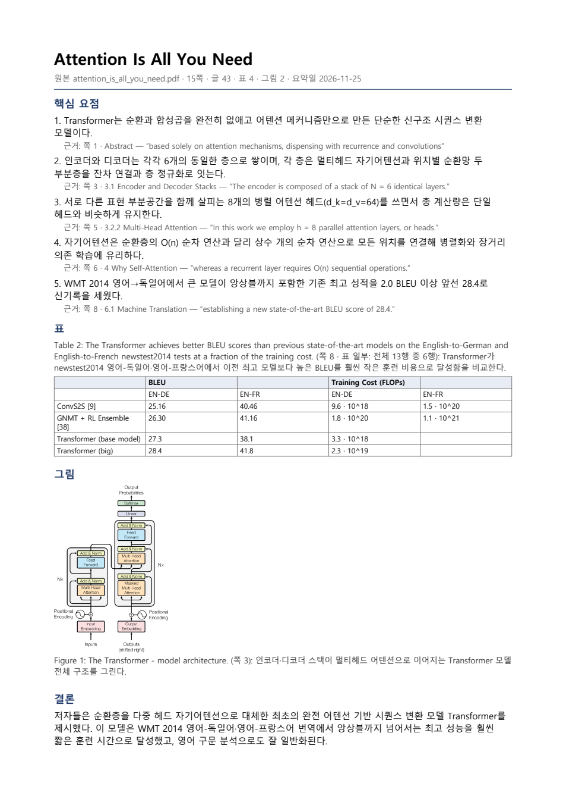
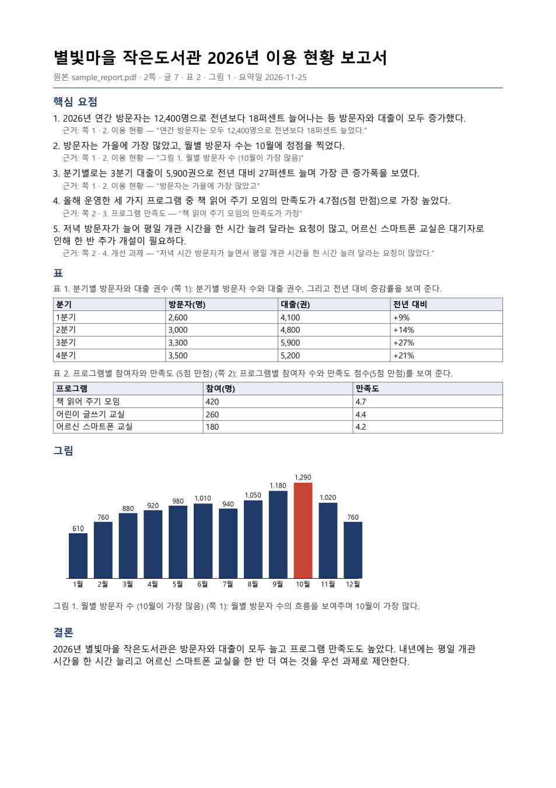

# 튜토리얼 3. PDF를 올리면 A4 한 장으로 요약해서 메일로 보내 줍니다

PDF 한 개를 올리면 프로그램이 글, 표, 그림으로 나누어 세고, 직원 한 명(하늘)이 내용을 A4 한 장으로 요약하고, 요약 PDF를 첨부해 메일로 보내 줍니다. 요약 쪽에는 **문서의 표와 그림이 그대로 들어갑니다.** 모델이 어느 표와 그림이 중요한지 **고르기만** 하고, 표의 칸과 그림은 프로그램이 파일 서버가 읽어 둔 값으로 그립니다(모델이 다시 쓰지 않습니다). 요약의 모든 요점은 근거가 된 **문단의 주소**와 그 문단에서 글자 그대로 옮긴 문장을 붙이고, 그 인용과 "정말 한 장인지"는 모델이 아니라 **프로그램이** 검사합니다.

예제 PDF는 논문 **"Attention Is All You Need"** 입니다(영어 논문을 한국어로 요약). 논문 파일은 이 튜토리얼에 들어 있지 않고 `python get_paper.py`가 내려받습니다. 인터넷 없이 해 보려면 이 튜토리얼이 만드는 가짜 보고서(`python make_sample_pdf.py`)를 쓰세요.

> 논문: Ashish Vaswani, Noam Shazeer, Niki Parmar, Jakob Uszkoreit, Llion Jones, Aidan N. Gomez, Lukasz Kaiser, Illia Polosukhin, **"Attention Is All You Need"**, 2017. arXiv: <https://arxiv.org/abs/1706.03762> (PDF: <https://arxiv.org/pdf/1706.03762>)
>
> 논문 첫 쪽에는 이런 안내가 있습니다. "Provided proper attribution is provided, Google hereby grants permission to reproduce the tables and figures in this paper solely for use in journalistic or scholarly works." 즉 출처를 밝히면 표와 그림을 언론 보도나 학술 저작에 옮겨 쓸 수 있습니다. 이 튜토리얼은 논문 PDF를 올리거나 나눠 주지 않고(`input/*.pdf`는 `.gitignore`에 있습니다), 내려받은 PDF에서 요약한 쪽만 예로 보여 줍니다. 요약한 쪽을 홍보 같은 다른 목적으로 쓰기 전에는 이 허락의 범위(언론·학술용)를 확인하세요.

## 완성하면 이렇게 됩니다

PDF 파일을 흐름에 넘기면 네 단계가 차례로 돕니다.

1. **올리기(intake, 프로그램)**: PDF를 파일 서버(`pdf`)에 올립니다. 파일 서버가 글자층을 읽어 PDF 한 개를 한 건으로 두고, 그 안의 글, 표, 그림을 **문서 순서와 쪽을 지켜** 부분으로 나눕니다. 글 부분은 다시 문단으로 나뉘어 문단마다 주소(`fs://pdf/001#3.1`)가 생깁니다.
2. **분류(classify, 프로그램)**: 부분을 글, 표, 그림으로 세어 분류 결과를 만듭니다. 글 부분마다 그 안의 문단 주소, 표의 칸과 그림 파일 위치도 이 결과에 담깁니다. 모델은 쓰지 않습니다.
3. **요약(하늘, 모델)**: 정해진 틀(제목, 핵심 요점 3~5개, 요약 쪽에 실을 표 0~2개와 그림 0~2개, 결론)로 씁니다. 요점마다 문단 주소와 그 문단의 원문 인용을 붙이고, 표와 그림은 **주소로 고릅니다**(표가 크면 보여 줄 행 번호도).
4. **전달(deliver, 프로그램)**: 요약을 A4 PDF로 그립니다. 고른 표는 칸 그대로 표로, 고른 그림은 그림 그대로 넣고 캡션을 붙입니다. 정확히 한 쪽인지 세어 본 뒤, 분류 결과를 본문에 넣어 PDF를 첨부해 메일로 보냅니다.

표는 칸이 많으면 글자를 줄여 그리고, 행이 14개를 넘으면 하늘이 고른 행만 그리면서 "표 일부: 전체 N행 중 M행"이라고 적습니다. 열이 10개를 넘는 표는 그릴 수 없다고 돌려보냅니다. 한 장에 안 들어가면 프로그램이 넘친 양을 알려 주고, 하늘이 표와 그림을 덜 고르거나 문장을 줄여 다시 씁니다. 프로그램이 몰래 자르지 않습니다.

### 실제 실행 예 (논문 Attention Is All You Need)

모델: 이 컴퓨터에서 돌린 로컬 모델(OpenAI 호환 API). nextop은 PyPI의 0.3.0(`pip install "nextop[pdf]==0.3.0"`), 2026-11-25 실행. 입력은 `python get_paper.py`로 받은 논문(15쪽). 모델에 따라 매번 문장이 달라집니다.

제목: `[PDF 요약·시험] attention_is_all_you_need.pdf A4 요약 (글 43 · 표 4 · 그림 2)` (앞의 `[PDF 요약·시험]`은 시험 모드(`MAIL_TEST_MODE=1`)일 때만 붙습니다.) 첨부: `요약_attention_is_all_you_need.pdf`. 같은 두 파일이 `summaries/`에도 남습니다.

**메일 본문 = 프로그램이 만든 분류 결과** (파일: [`example_output/attention_is_all_you_need_report.txt`](example_output/attention_is_all_you_need_report.txt). 아래는 긴 줄만 `…`로 줄였고, 글 목록은 앞 8개만 보입니다.)

```
PDF 분류 결과: attention_is_all_you_need.pdf (15쪽)
글 43개 · 표 4개 · 그림 2개

[글] 43개
  1. Provided proper attribution is provided, Google hereby grant (쪽 1) · 173자
  2. Attention Is All You Need (쪽 1) · 431자
  3. Abstract (쪽 1) · 2233자
  4. 1 Introduction (쪽 2) · 1929자
  5. 2 Background (쪽 2) · 1835자
  6. 3 Model Architecture (쪽 2) · 516자
  7. 3 Model Architecture (쪽 3) · 262자
  8. 3.1 Encoder and Decoder Stacks (쪽 3) · 1353자
  …

[표] 4개
  1. Table 1: Maximum path lengths, per-layer complexity and minimum number of sequential operations for different layer types. n is the sequence l…
  2. Table 2: The Transformer achieves better BLEU scores than previous state-of-the-art models on the English-to-German and English-to-French news…
  3. Table 3: Variations on the Transformer architecture. Unlisted values are identical to those of the base model. All metrics are on the English-…
  4. Table 4: The Transformer generalizes well to English constituency parsing (Results are on Section 23 of WSJ) (쪽 10) · 13행 × 3열 · 열: Parser | T…

[그림] 2개
  1. Figure 1: The Transformer - model architecture. (쪽 3) · 911×1343 픽셀
  2. Figure 2: (left) Scaled Dot-Product Attention. (right) Multi-Head Attention consists of several attention layers running in parallel. (쪽 4) · 1216×769 픽셀
```

읽는 부품(PyPI의 nextop 0.3.0)이 이 논문을 이렇게 읽었습니다. 글 부분의 제목은 `1 Introduction`, `3.2 Attention`처럼 논문의 진짜 절 제목이고, 띄어쓰기가 있고, 쪽 옆에 세로로 찍힌 arXiv 표시는 더 이상 글로 나오지 않습니다. 세로선이 없는 논문의 표 1~4가 캡션(`Table 2: ...`)과 함께 표 부분이 되었고(그 전 실행에서는 표 5개가 모두 어텐션 그림의 글자 조각이었습니다), 그림 1과 2는 그림 부분 하나씩입니다. 남은 한계는 [`PLATFORM_ISSUES.md`](PLATFORM_ISSUES.md)에 있습니다. 그림 3~5는 선으로 그린 그림이라 그림 부분이 아니고, 쪽 13~15에는 `Input-Input Layer5`처럼 그림 안의 글자가 제목으로 잡힙니다. 거듭제곱은 `2.3 · 10^19`처럼 `^`로 읽힙니다. 저자 줄은 제목 부분(`Attention Is All You Need`, 431자)에 함께 들어갑니다. 그림 1과 2는 그림 자체의 해상도로 잘려(911×1343, 1216×769 픽셀) 요약 쪽에서도 선명하고, 그림 2의 캡션은 끝까지(`... running in parallel.`) 읽힙니다. 쪽 13의 그림 속 글자는 더 이상 제목이 되지 않아 글 부분이 43개입니다.

**첨부된 A4 한 장 요약** (그린 그대로: [`example_output/attention_is_all_you_need_summary.pdf`](example_output/attention_is_all_you_need_summary.pdf))



하늘은 표 2(영어-독일어, 영어-프랑스어 BLEU와 훈련 비용, 전체 13행 중 6행)와 그림 1(트랜스포머 구조)을 골랐고, 프로그램이 표 부분의 칸을 그대로 표로, 그림 부분의 이미지를 그대로 그렸습니다(그림 1은 논문의 그림 1입니다. 출처: Vaswani et al., 2017). 하늘이 쓴 것은 주소 `fs://pdf/032`와 행 번호 `[1, 3, 7, 10, 12, 13]`뿐이고(제목 행 1은 늘 나옵니다), 표의 칸은 파싱된 표와 같습니다. 훈련 비용 칸은 `2.3 · 10^19`, `1.1 · 10^21`처럼 거듭제곱을 지켜 나옵니다. 요점 5개의 인용은 모두 원문에 글자 그대로 있고(프로그램이 검사), 한자는 없고, 요약은 정확히 A4 한 쪽입니다. 요점 2의 `위치별 순환망`(원문은 position-wise feed-forward network, 순환이 아닙니다)은 모델이 용어를 잘못 옮긴 것입니다(이전 실행에서도 같은 실수가 있었습니다). 인용 검사는 인용이 원문에 있는지만 보고 번역이 맞는지는 보지 않으므로, 이런 실수는 사람이 읽어서 찾아야 합니다.

**프로그램이 검사하는 모습**

이번 실행에서 하늘의 첫 저장은 한 장을 넘어서 돌려보내졌습니다.

```
The summary does not fit one A4 page: it runs to 2 pages and about 316 characters of text spill past page 1. Make it smaller by at least that much: choose fewer tables or figures, show fewer rows of a table, or shorten the sentences (key points, lines, conclusion).
```

하늘은 문장을 줄여 두 번째 저장에서 통과했습니다(총 모델 호출 4번). 이전 실행에서는 인용이 원문에 글자 그대로 없어서 이렇게 돌려보낸 적도 있습니다.

```
인용을 원문에서 찾을 수 없습니다: "The encoder is composed of a stack of N = 6 identical layers. Each layer has two..." (summary.key_points[1])가 fs://pdf/011의 글에 없습니다. 원문을 글자 그대로 인용하거나 그 주장을 빼 주세요.
``` 다른 실행에서는 가끔 한자가 섞여서 이렇게 돌려보냈고, 하늘은 고쳐서 다시 저장했습니다.

```
key_points[1].point "분기별 방문자와 대출이 모두前年보다 증가했으며, 그중 3분기 대출 증가 ..." has Chinese characters (前年); write it again in Korean only
```

표를 고를 때의 검사 문장도 시험(`tests/test_flow.py`)에서 이렇게 나옵니다.

```
summary.tables[0] (fs://pdf/001#3) has 39 columns, more than 10: it cannot be drawn on the page. Choose another table or none.
summary.tables[0] (fs://pdf/001#2) has 20 rows. Give the numbers of the rows to show (rows, 1 is the header; at most 14 including it), or choose another table.
```

**걸린 시간** (모델 한 대와 이 컴퓨터에서 잰 값입니다. 모델과 컴퓨터에 따라 크게 달라집니다.)

| 일 | 시간 |
|---|---|
| 올리기와 부분으로 읽기 (intake, 15쪽 논문) | 6.6초 |
| 분류 (classify) | 0.7초 |
| 하늘: 모델 호출 4번 (열기 2번, 저장 2번: 한 장 초과, 통과) | 24.4초 (프롬프트 약 6.2만 토큰) |
| A4 그리기와 한 장 확인, 메일 보내기 (deliver) | 4.8초 |
| 전체 | 약 36.4초 |

**이전 실행과 달라진 점** (플랫폼 브랜치 7be49ed에서 PyPI 0.3.0으로): 글 부분이 44개에서 43개가 되었고(쪽 13의 그림 속 글자가 더 이상 제목이 아님), 그림이 그림 자체의 해상도로 잘려 요약 쪽의 그림 1이 선명해졌고, 그림 2의 캡션이 끝까지 나옵니다. 고른 표와 그림은 이전과 같고(표 2, 그림 1), 모델 호출은 5번에서 4번, 시간은 44.1초에서 36.4초가 되었습니다.

### 실제 실행 예 (가짜 보고서: 표를 그대로 넣는 모습)

**nextop 0.4.0(개발판 0.4.0.dev6)으로 다시 확인 (2026-11-27)**: 파일 서버를 유형 폴더와 문단 쪼개기로 바꾼 뒤, 새 가상 환경에 휠만 설치하고 아래 시험용 보고서로 돌렸어요. 하늘은 글 부분 7개를 주소로 열었고(문단이 여럿인 부분은 문단마다 주소와 글이 함께 와요), 요점 5개를 모두 문단 주소(`fs://pdf/001#3.1`처럼, 문단이 하나뿐인 부분은 그 부분 주소)로 붙였고, 인용은 첫 저장에서 모두 통과했어요. 모델 호출 2번, 9,434 토큰, 7.6초(개발판 0.4.0.dev5: 2번, 9,469 토큰, 8.5초, 문단 9개를 하나씩 열었음; 0.3.0: 2번, 12,090 토큰, 16.6초). 표 2개와 그림 1개가 들어간 A4 한 쪽이에요. 위의 논문 요약 예는 0.3.0으로 만든 것이라 주소가 옛 모양(`fs://pdf/032`)이에요.

**nextop 0.4.0(개발판 0.4.0.dev7)으로 다시 확인 (2026-11-27, 모델 gpt-5.4-mini)**: 문단 쪼개기 부품을 새 예시로 바꾸고 새 가상 환경에서 같은 시험용 보고서로 돌렸어요. 하늘은 글 부분과 문단 8개를 열었고, 요점 5개를 모두 문단 주소로 붙였고, 인용은 첫 저장에서 모두 통과했어요. 모델 호출 3번, 14,507 토큰, 9.7초(dev6: 2번, 9,434 토큰, 7.6초). 표 2개(5행 × 4열, 4행 × 3열, 머리 행 그대로)와 그림 1개가 들어간 A4 한 쪽이에요. 이 개발판부터 PDF를 읽을 때 쪽 번호와 쪽마다 되풀이되는 머리글·바닥글은 본문에서 빠지고, 제목 없는 첫 글 부분은 "(제목 없음)" 대신 첫 낱말이 제목이 됩니다. 위 논문 분류 결과의 첫 줄(`Provided proper attribution is provided, Google hereby grant`)이 그 모양이에요(같은 논문을 튜토리얼 5에서 dev7로 읽으면 첫 부분 제목이 `Provided proper attribution is provided, Google hereby`이고, 한 글자짜리 문단은 없어요).

위 논문 요약에도 표가 들어가지만, 선이 있는 표가 있는 시험용 보고서(`python make_sample_pdf.py`, 2쪽, 표 2개, 그림 1개)로 같은 흐름을 돌리면 이렇게 됩니다(`nextop run --flow pdf_summary --input input.sample.json`). 하늘은 표 2개와 그림 1을 모두 골랐고 한 번에 통과했습니다. 걸린 시간 약 16.6초(모델 호출 2번 10.9초, PyPI 0.3.0). 분류 결과는 [`example_output/sample_report_report.txt`](example_output/sample_report_report.txt), A4 요약은 [`example_output/sample_report_summary.pdf`](example_output/sample_report_summary.pdf).



요약에 나오는 **쪽 번호와 부분 이름은 프로그램이** 파일 서버의 부분 정보에서 읽어 넣습니다(모델이 쓴 숫자가 아닙니다). 표의 칸, 그림 파일, 표와 그림의 이름(캡션), 행과 열 수, 그림의 크기, 쪽 수는 파일 서버가 함수에 건네 주는 부분 나무(`parts`의 표 `columns`·`rows`, 그림 `image`·`width`·`height`, `caption`, `pages`, 그리고 `doc.pages`)를 그대로 씁니다. 그림은 아직 모델이 눈으로 보지 못합니다. 그래서 그림 줄은 그림 아래 설명 글(캡션)에 있는 내용만 씁니다.

## 만드는 데 걸리는 시간과 준비물

약 1시간. 이미 만들어진 프로젝트를 읽고 설정을 채워 돌려 보는 튜토리얼입니다.

- Python 3.11~3.13과 nextop 0.4.0(PDF 읽는 도구 포함): 아래 0단계의 `setup.bat`이 모두 설치합니다(직접 하려면 `pip install -r requirements.txt`). 이 튜토리얼은 nextop 0.4.0의 파일 서버(유형 폴더, 공통 도구, 문단 주소)로 쓰였습니다. 0.4.0이 PyPI에 올라가기 전에는 받은 휠 파일로 설치합니다: `setup.bat <휠 파일 경로>` `requirements.txt`가 nextop 0.4.0을 고정하고 `project.json`의 `"nextop": ">=0.4,<0.5"`가 이 프로젝트에 필요한 버전을 알립니다(다른 버전이면 `nextop check`가 어떻게 고치는지 알려 줍니다). 이미 다른 nextop이 깔려 있으면 `setup.bat`이 0.4.0으로 맞추고, 끝에 깔린 버전을 보여 줍니다.
- PDF 읽기와 A4 그리기 도구: `nextop[pdf]`와 `reportlab` (`requirements.txt`에 들어 있습니다)
- 예제 논문을 내려받을 인터넷(`python get_paper.py`, 약 2MB). 인터넷이 없으면 가짜 보고서를 씁니다
- 한글 글꼴 하나(TrueType): Windows는 맑은 고딕이 이미 있어서 아무것도 안 해도 됩니다. 다른 컴퓨터는 나눔고딕 같은 글꼴을 설치하거나 `.env`의 `KOREAN_FONT=`에 `.ttf` 파일 경로를 적습니다(아래 "설정 채우기"). 글꼴 파일은 이 튜토리얼에 들어 있지 않습니다. 만든 PDF에는 쓴 글자만 담깁니다.
- OpenAI API 키 (기본값입니다. 다른 OpenAI 호환 API도 됩니다. 아래 설정 참고)
- 메일 보내는 계정의 SMTP 정보 (선택, 없으면 메일 단계만 실패하고 요약은 `summaries/`에 남습니다)

모델 없이도 4단계까지는 지금 바로 할 수 있습니다. 모델은 가짜로 바꿔서 시험합니다.

## 이 튜토리얼로 배우는 nextop 기능

- **유형 폴더로 정의한 파일 서버**: `file_servers/pdf/types/pages/type.json`(pdf, 공식 읽는 부품 `pdf_text`, 문단 쪼개기 `paragraphs`, 그림 부분은 `figures` 유형으로 보냄)과 `types/figures/type.json`(그림). PDF 한 개가 한 건(`fs://pdf/001`)이 되고, 글, 표, 그림이 순서와 쪽을 지키는 부분(`#1`, `#2` …)으로, 글 부분은 다시 문단(`#3.1`, `#3.2` …)으로 나뉩니다. 모델이 아니라 프로그램이 읽습니다.
- **문단 쪼개기 부품**(`parts/splitter/paragraphs.py`, nextop 예시 부품을 복사한 것): 빈 줄로 문단을 나눕니다. 문단이 하나인 부분은 그 부분이 곧 문단입니다.
- 시작 함수가 파일을 올리기(`FILES_OUT`, `_uploads`)와 파일을 받는 함수(`FILES_IN`): 올리기 함수가 PDF를 올리고, 분류 함수가 PDF의 부분 나무를 데이터(`parts`)로 받아 셉니다
- 직원 한 명과 프로그램 블록(`intake`, `classify`, `deliver`)이 섞인 흐름. 모델은 요약 하나에만 씁니다
- 프로그램 검사: 요점의 주소가 분류 결과의 문단(또는 표)인지, 붙인 인용이 그 문단에 글자 그대로 있는지(`quotes`) 모델 없이 확인합니다 (`checks.py`)
- 검사에서 "고른 표와 그림을 그릴 수 있는지"(열 10개 이하, 큰 표는 행 번호)와 "A4 한 장인지"까지 프로그램이 재서 알려 주기: 넘치면 글을 몰래 자르지 않고, 넘친 양을 직원에게 알려 다시 쓰게 합니다. 같은 그리기 코드를 검사와 메일 블록이 함께 씁니다(`functions/_pdf.py`)
- 직원 출력 틀(스키마): 요점 3~5개(`minItems`, `maxItems`), 표 0~2개와 그림 0~2개(주소로 고름), 큰 표는 행 번호
- 함수가 받는 문서 값(`table.rows`, `figure.image`, `region.caption`): 모델이 아니라 프로그램이 표와 그림을 요약 쪽에 그림
- 메일에 PDF 첨부(한글 파일 이름)와 시험 모드
- 모델 없이 하는 시험: 가짜 모델, 이 컴퓨터의 작은 메일 서버

## 단계별 따라 하기

PowerShell에서 이 폴더(`ko/tutorial_03_pdf_summary`)로 이동해 시작합니다.

### 0. 설치: setup.bat 실행

이 폴더의 `setup.bat`을 두 번 클릭하거나, PowerShell에서 `.\setup.bat`을 실행합니다. 처음 한 번 필요한 것을 모두 자동으로 설치합니다.

- Python 3.11~3.13을 찾습니다. 없으면 winget으로 Python 3.12를 설치합니다(설치 뒤 터미널을 새로 열고 `setup.bat`을 다시 실행)
- 이 폴더에 가상 환경 `.venv`를 만들고 `requirements.txt`(nextop[pdf], reportlab, pytest 등)를 설치합니다. `setup.bat C:\받은폴더\nextop-0.4.0...whl`처럼 휠 파일 경로를 주면(또는 환경 변수 `NEXTOP_WHEEL`) nextop만 그 파일로 설치합니다. 휠 파일은 파이썬 버전에 맞아야 합니다(`cp311`이면 Python 3.11)
- `.env`가 없으면 `.env.example`을 복사해 만들고, 채워야 할 이름만 보여 줍니다. 키 값은 직접 `.env`에 적습니다
- 모델 없이 하는 시험을 돌리고, 모두 통과하면 마지막에 `Setup OK`가 나옵니다

여러 번 실행해도 됩니다(이미 있는 `.venv`와 `.env`는 그대로 둡니다). 아래 명령은 가상 환경을 켠 뒤 실행합니다.

```powershell
.venv\Scripts\activate
```

직접 설치하려면:

```powershell
py -3.12 -m venv .venv
.venv\Scripts\activate
pip install -r requirements.txt
copy .env.example .env
```

### 1. 폴더 구조 보기

```
project.json              프로젝트 설정 (LLM 연결)
get_paper.py              예제 논문(Attention Is All You Need)을 input/에 내려받는 프로그램
make_sample_pdf.py        시험용 PDF를 만드는 프로그램 (지어낸 도서관 보고서, 2쪽, 인터넷 없이 쓸 때)
input.json                실행에 넘기는 값: {"pdf_path": "input/attention_is_all_you_need.pdf"}
input.sample.json         같은 값, 가짜 보고서용: {"pdf_path": "samples/sample_report.pdf"}
workers/summarizer        하늘: A4 요약 (mission.md, worker.json의 출력 틀, checks.py의 검사)
functions/intake.py       시작 블록: PDF를 파일 서버에 올림
functions/classify.py     글, 표, 그림 분류 (모델 없음)
functions/deliver.py      A4 PDF 그리기(고른 표와 그림 넣기), 한 장 확인, 메일 보내기
functions/_pdf.py         도우미: 글꼴, 분류 결과, A4 그리기(표와 그림)와 쪽 수 세기, 메일
file_servers/pdf          PDF 저장소 (실행마다 새로): file_server.json + types/pages(pdf) + types/figures(그림)
parts/splitter/paragraphs.py   문단 쪼개기 부품 (글 부분을 문단으로 나눔)
flows/pdf_summary.json    intake -> classify -> 하늘 -> deliver
tests/                    모델 없이 하는 시험
example_output/           위 "실제 실행 예"의 분류 결과, 요약 PDF와 그림
PLATFORM_ISSUES.md        이 튜토리얼을 만들며 찾은 nextop 쪽 문제(재현 방법 포함)
```

### 2. 모델 없이 프로그램 부분 시험하기

```powershell
python -m pytest -q tests
```

`19 passed`가 보이면 됩니다. 이 시험이 확인하는 것:
- 샘플 PDF가 글, 표, 그림 부분으로 순서와 쪽을 지켜 읽힌다. 분류 결과의 개수, 표의 행과 열, 표와 그림의 설명 글
- 가짜 모델로 흐름 전체가 돈다. 메일이 시험 서버에 도착하고(제목 앞 `[PDF 요약·시험]`, 본문에 분류 결과, 첨부 PDF는 정확히 한 쪽)
- 인용이 한 글자라도 다르면 `quotes` 검사가 돌려보내고, 고치면 통과한다. 요점의 주소가 문단이 아니라 글 부분 전체이면 그 부분의 문단 주소를 알려 주며 돌려보낸다
- 요약 쪽(A4)에 고른 표가 표 부분의 칸 그대로, 고른 그림이 그림 부분의 이미지 그대로 들어간다. 행을 골랐으면 그 행만 나오고 "표 일부"라고 적힌다
- 요약이 한 장을 넘으면(표와 그림을 너무 많이 골랐을 때 포함) 검사가 돌려보내고, 줄이면 통과한다. 보고서에 없는 표나 그림을 고르거나, 열이 10개를 넘는 표를 고르거나, 행이 14개를 넘는 표를 행 번호 없이 고르면 돌려보낸다. 표와 그림을 하나도 고르지 않아도 된다. 메일 블록은 한 장이 아니면 메일을 보내지 않는다
- 한글 글꼴이 없으면 무엇을 하면 되는지 알려 주고, 한자 섞임을 찾고, 한글 파일 이름 첨부와 받는 사람(시험 모드)이 맞다

### 3. 설정 채우기

```powershell
copy .env.example .env
```

(메모장으로 `.env`를 새로 만들 때는 "UTF-8"(BOM 없음)로 저장하세요.) 열어서 아래를 채웁니다. 자세한 내용은 "설정 채우기" 절을 보세요.

### 4. 예제 PDF 준비하기

```powershell
python get_paper.py
```

논문 "Attention Is All You Need"를 `input/attention_is_all_you_need.pdf`로 내려받습니다(논문 출처와 이용 안내는 이 문서 맨 위에 있습니다). 이 PDF는 올리거나 나누지 마세요(`.gitignore`에 들어 있습니다).

인터넷 없이 해 보려면 가짜 보고서를 만들고, 6단계에서 `input.json` 대신 `input.sample.json`을 쓰세요.

```powershell
python make_sample_pdf.py
```

`samples/sample_report.pdf`가 생깁니다(열어 보세요: 제목, 문단, 표 2개, 막대그래프 그림 1개). 직접 가진 PDF로 바꾸는 방법은 8단계에 있습니다.

### 5. 흐름 검사

```powershell
nextop check
```

LLM 키를 채우기 전에는 이렇게 나옵니다.

```
[error] adapter llm.default: API key missing: set LLM_API_KEY in the environment or .env
```

모델 주소, 키, 이름을 채우면 `OK: pdf summary (workers 1, tools 0, flows 1, file servers 1)`이 나옵니다. PDF 읽는 도구를 설치하지 않았다면 이 단계에서 `pip install "nextop[pdf]"`를 하라고 알려 줍니다.

### 6. 실행

```powershell
nextop run --flow pdf_summary --input input.json
```

논문은 50초쯤, 가짜 보고서는 20초쯤 뒤(모델에 따라 다릅니다) `run <번호>: done`이 나옵니다. 가짜 보고서는 `--input input.sample.json`으로 돌립니다. 처음에는 `MAIL_TEST_MODE=1`이라 메일이 `OFFICE_EMAIL` 한 곳으로만 갑니다.

### 7. 결과 확인

- `OFFICE_EMAIL`의 메일함: 위 예시 같은 메일(논문은 표 2와 그림 1이 들어간 요약)(제목은 `[PDF 요약·시험]`으로 시작, 첨부는 요약 PDF)
- `summaries/attention_is_all_you_need_summary.pdf`와 `..._report.txt`: 같은 내용
- `runs/<실행 번호>/`: 흐름의 기록. 하늘의 `blocks/summarizer/attempt-1/`에 모델 호출(`calls.jsonl`)과 도구 호출(`tools.jsonl`)이 있습니다. 하늘이 연 부분과 문단(`get`)과 검사가 돌려보낸 문장(`save_output` 줄의 `refused_by: program`)이 보입니다. `file_servers/pdf/`에는 이 실행에서 읽힌 부분들이 있습니다

### 8. 내 PDF로 해 보기

PDF 파일을 아무 곳에나 두고 `input.json`의 `pdf_path`에 경로를 적습니다(이 폴더 기준 상대 경로나 전체 경로).

```json
{"pdf_path": "C:/문서/내_보고서.pdf"}
```

다시 `nextop run --flow pdf_summary --input input.json`. 글자층이 있는 PDF(스캔한 그림이 아닌 PDF)만 읽힙니다. 아주 긴 PDF는 하늘이 부분을 하나씩 열어 보므로 시간이 더 걸립니다. 표를 그림으로 넣은 PDF는 표가 아니라 그림으로 분류됩니다. 세로선이 없는 표도 "Table N:" 캡션이 표 위에 있으면 찾습니다. 캡션이 없는 표, 선으로 그린 그림, 두 단 편집은 아직 약합니다(`PLATFORM_ISSUES.md` 6번).

## 어떻게 동작하나

```
intake (프로그램)  PDF 경로 -> pdf 파일 서버에 올림 (쪽 수는 여기서 셈)
   |                      파일 서버가 읽는 부품(pdf_text)으로 PDF 한 개를 한 건으로 두고
   |                      글, 표, 그림 부분을 순서와 쪽을 지켜 저장 (fs://pdf/001 = 원본, #1 #2 ... = 부분)
   |                      글 부분은 문단으로 다시 나눔 (#3.1 #3.2 ... = 문단, paragraphs 부품)
   |
   +--> classify (프로그램)  부분을 글 / 표 / 그림으로 세어 분류 결과(report), 글 부분마다 문단 주소
   |        표: 설명 글, 쪽, 행 x 열, 칸의 글   그림: 설명 글, 쪽, 크기, 그림 파일
   |
   +--> 하늘 (summarizer)  <-- 분류 결과 + pdf 파일 서버(get으로 부분과 문단을 열어 읽음)
   |        요약: 제목 / 핵심 요점 3~5 / 고른 표 0~2(+행 번호) / 고른 그림 0~2 / 결론
   |        checks.py: 주소가 문단(또는 표)인가, 인용이 그 문단에 글자 그대로 있나(quotes), 고른 표와 그림을 그릴 수 있나,
   |                   한자 섞임, 그리면 A4 한 장인가 (넘치면 넘친 양을 알려 주고 다시 고르거나 쓰게 함)
   |        v   summary
   +--> deliver (프로그램)  요약을 A4 PDF로 그림(고른 표의 칸과 그림을 report에서 가져와 넣음) -> 한 쪽인지 다시 확인 -> 분류 결과를 본문에, PDF를 첨부해 메일
```

- **PDF를 넣는 방법을 둘 중 골랐습니다.** 하나는 파일 서버의 `documents/` 폴더에 PDF를 넣고 `nextop index --file-server pdf`로 가져오는 방법인데, 오래 남는 저장소를 쓰고 가져오기 단계가 따로 있습니다. 이 튜토리얼은 다른 하나, "실행할 때 경로를 넘기면 시작 함수(`intake`)가 올리는" 방법을 씁니다. 한 번에 한 PDF만 다루고, 실행마다 저장소가 새로 시작해서 지난 PDF가 섞이지 않고, 명령도 하나입니다. 같은 PDF를 계속 모아 두고 묻고 싶을 때는 `documents/`를 씁니다(다음에 해 볼 것).
- 파일 서버의 읽는 부품이 PDF의 글자층을 **프로그램으로** 읽습니다. 글자 크기가 본문의 1.2배 이상인 짧은 줄을 제목으로, 선으로 그려진 칸을 표로, 이미지를 그림으로 봅니다. 모델은 이 단계에 없습니다.
- 분류 함수는 올리기 함수가 올린 PDF의 부분 나무를 받아(`FILES_IN`의 `parts`) 센 것뿐입니다. 표와 그림의 설명 글(`caption`)은 파일 서버가 읽는 부품에서 받습니다.
- 하늘은 글 부분과 문단, 표를 `get`으로 직접 열어 읽고, 요약 쪽에 실을 표와 그림을 주소로 고릅니다(표의 숫자를 다시 쓰지 않으므로 틀리게 옮길 수 없습니다). 요점마다 문단 주소(`source`, 분류 결과의 `paragraphs`에서)와 그 문단에서 글자 그대로 옮긴 문장(`quote`)을 씁니다. 프로그램이 그 문단과 한 글자씩 맞춰 봅니다(공백과 줄바꿈 차이만 봐줌). 글 부분을 `get`으로 열면 그 안의 문단이 문단마다 주소와 글을 함께 가지고 차례대로 와요(`parts`). 글이 아주 긴 부분(약 8,000자 넘음)만 글 없이 문단 카드로 오니, 그때는 필요한 문단을 주소로 엽니다.
- A4 한 장 검사: 검사(`checks.py`)가 요약을 표와 그림까지 실제로 그려 쪽 수를 셉니다. 넘치면 "몇 쪽이고 몇 글자 넘쳤다"를 하늘에게 알려, 표와 그림을 덜 고르거나 문장을 줄여 다시 쓰게 합니다. 메일 블록(`deliver`)도 같은 그리기 코드로 한 번 더 확인하고, 한 쪽이 아니면 메일을 보내지 않습니다. 모델 판단이 필요 없는 검사만 썼습니다.
- 쪽 번호와 부분 이름은 분류 결과에서 프로그램이 읽어 요약에 적습니다. 모델이 옮겨 적은 쪽 번호는 쓰지 않습니다.

## 설정 채우기

### LLM (`project.json`, `workers/summarizer/worker.json`, `.env`)

기본값은 OpenAI API입니다. `project.json`의 `base_url`은 `https://api.openai.com/v1`, 각 `workers/*/worker.json`의 `"model"`은 `gpt-5.4-mini`입니다. `.env`의 `LLM_API_KEY=` 뒤에 OpenAI API 키를 넣으세요. 다른 OpenAI 호환 API도 됩니다. `base_url`과 모델 이름을 바꾸세요.

그다음 `nextop check`가 `OK`를 말하면 끝입니다.

### 메일 (SMTP)

`.env`의 `SMTP_HOST`, `SMTP_PORT`, `SMTP_USER`, `SMTP_PASS`를 채웁니다. 포트 587은 STARTTLS, 465는 SSL입니다(그 밖의 포트는 암호화 없이 보내므로 내 컴퓨터의 시험 서버에만 쓰세요).

- `MAIL_TEST_MODE=1`(기본): 메일이 `OFFICE_EMAIL` 한 곳으로만 가고 제목이 `[PDF 요약·시험]`으로 시작합니다. 처음에는 이대로 두세요.
- 실제 운영: `MAIL_TEST_MODE=0`으로 바꾸고 `MAIL_TO=a@example.com,b@example.com`(쉼표로 여러 명)을 채웁니다. 제목은 `[PDF 요약]`으로 시작합니다.

비밀번호와 키는 `.env`에만 쓰고, `.env`는 올리거나 공유하지 마세요(`.gitignore`에 들어 있습니다).

### 한글 글꼴 (`.env`의 `KOREAN_FONT`)

요약 PDF와 시험용 PDF는 한글 글꼴로 그립니다. 프로그램은 이 순서로 찾습니다. `.env`의 `KOREAN_FONT`(그리고 굵은 글꼴 `KOREAN_FONT_BOLD`), Windows의 맑은 고딕, Linux의 나눔고딕(`/usr/share/fonts/truetype/nanum/`). 어느 것도 없으면 `no Korean TrueType font found ...`라고 알려 줍니다. 그때는 글꼴(.ttf)을 설치하고 그 파일 경로를 `KOREAN_FONT=`에 적으세요. 글꼴은 사용 허락을 확인한 것만 쓰세요(이 튜토리얼은 글꼴 파일을 나눠 주지 않습니다).

## 다음에 해 볼 것

- 쌓아 두고 묻기: `file_servers/pdf/file_server.json`을 `"lifetime": "project"`로 바꾸고 PDF를 `documents/`에 넣어 `nextop index --file-server pdf`로 가져오면, 여러 PDF가 저장소에 남습니다. 이때는 올리기 함수 대신 `{"from": "documents", ...}` 공유선을 씁니다
- 요약 틀 바꾸기: `worker.json`의 출력 틀과 `mission.md`를 고치면(예: "위험 요소" 항목 추가) 같은 방식의 검사가 그대로 돕니다. 한 장에 맞는지와 표와 그림을 어떻게 그리는지는 `functions/_pdf.py`의 `render_summary`가 정합니다
- 한 번에 여러 PDF: 폴더의 PDF마다 흐름을 한 번씩 돌리는 짧은 스크립트 (`nextop run`을 PDF마다 호출)
- 받는 사람마다 다른 요약: 메일 함수가 `MAIL_TO`별로 나누어 보내기
- 스캔한 PDF: 글자층이 없는 쪽은 아직 읽히지 않습니다. 글자를 읽는 부품(`ocr` 자리)이 생기면 같은 흐름이 그대로 쓸 수 있습니다
