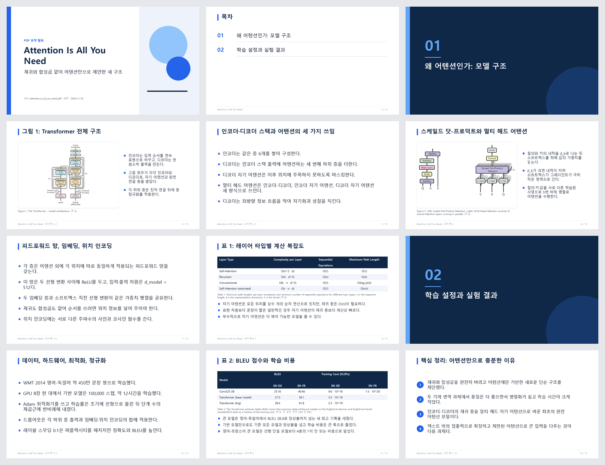
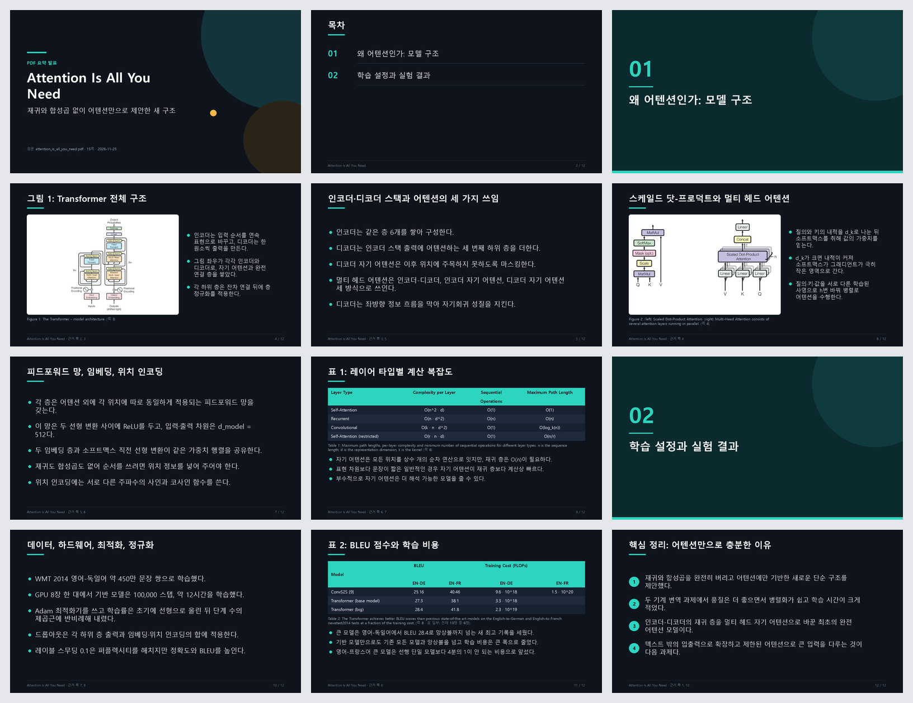
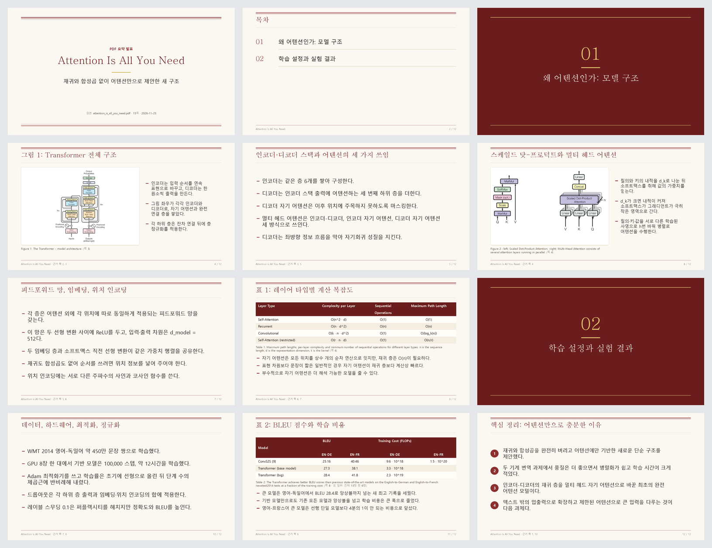

# 튜토리얼 5. PDF를 넣으면 요약해서 테마가 입혀진 PPT를 만들어 줍니다

PDF 한 개와 테마 이름을 넘기면, 직원 두 명이 슬라이드 구성을 짜고 글을 쓰고, 프로그램이 **테마가 입혀진 .pptx 파일과 슬라이드마다 PNG 미리 보기**를 만들어 줍니다. 테마는 레이아웃 8가지(표지, 목차, 구역 표지, 글머리표, 그림과 설명, 표와 설명, 두 단 비교, 핵심 정리)에 색, 글꼴, 배경, 장식 도형을 한 번에 입힌 것이고, 기본·다크·학술 세 가지가 들어 있습니다. 슬라이드 수는 문서의 쪽 수로 프로그램이 정합니다.

모델은 **고르고 쓰기만** 합니다. 구성 담당(보람)은 슬라이드마다 레이아웃과 근거가 될 문서 부분을 **주소로** 고르고, 작성 담당(새롬)은 **슬라이드 한 장씩** 따로 제목과 짧은 글머리표를 쓰면서 문장마다 근거 문단의 주소와 그 문단의 원문 인용을 붙입니다. 표의 칸, 그림, 캡션, 쪽 번호, 문서 제목, 목차, 슬라이드 번호는 **프로그램이** 파일 서버가 읽어 둔 값으로 넣습니다. 인용이 원문에 있는지, 레이아웃 이름과 주소가 맞는지, 글이 상자에 들어가는지, 한자가 섞였는지는 모델이 아니라 **프로그램이** 검사합니다.

예제 PDF는 튜토리얼 3과 같은 논문 **"Attention Is All You Need"** 입니다(영어 논문을 한국어 발표 자료로). 논문 파일은 이 튜토리얼에 들어 있지 않고 `python get_paper.py`가 내려받습니다.

> 논문: Ashish Vaswani, Noam Shazeer, Niki Parmar, Jakob Uszkoreit, Llion Jones, Aidan N. Gomez, Lukasz Kaiser, Illia Polosukhin, **"Attention Is All You Need"**, 2017. arXiv: <https://arxiv.org/abs/1706.03762>
>
> 논문 첫 쪽의 안내: "Provided proper attribution is provided, Google hereby grants permission to reproduce the tables and figures in this paper solely for use in journalistic or scholarly works." 출처를 밝히면 표와 그림을 **언론 보도나 학술 저작에** 옮겨 쓸 수 있다는 뜻입니다. 아래 예시 슬라이드에는 논문의 그림 1, 2와 표 1, 2가 들어 있습니다(출처: Vaswani et al., 2017). 이 슬라이드를 홍보 같은 다른 목적으로 쓰기 전에는 이 허락의 범위를 꼭 확인하세요. 이 튜토리얼은 논문 PDF를 올리거나 나눠 주지 않습니다(`input/*.pdf`는 `.gitignore`에 있습니다).

## 완성하면 이렇게 됩니다

PDF와 테마를 흐름에 넘기면 여섯 단계가 차례로 돕니다.

1. **올리기(intake, 프로그램)**: PDF를 파일 서버(`pdf`)에 올리고, 쪽 수로 슬라이드 수와 구역 수를 정합니다(15쪽이면 12장, 구역 2개). 레이아웃마다 글머리표 개수와 한 글머리표에 들어가는 글자 수도 재어 요청(brief)에 담습니다.
2. **분류(classify, 프로그램)**: 파일 서버가 읽어 둔 글, 표, 그림 부분을 세어 분류 결과(report)를 만듭니다. 표의 칸과 그림 파일도 여기에 담깁니다.
3. **구성(보람, 모델)**: 슬라이드마다 레이아웃 하나와 근거 부분(글 부분 주소, 표나 그림 주소, 표의 행 번호)을 고릅니다. 프로그램이 구성을 검사하고 나서야 다음 단계로 갑니다(표와 그림 슬라이드에 그 표나 그림을 다루는 글 부분이 있는지, 쪽마다 나뉜 한 절의 조각이 한 슬라이드에 모두 있는지 등).
4. **나누기(split, 프로그램)**: 구성을 슬라이드 하나씩 조각(slide)으로 나눕니다. 조각에는 그 슬라이드의 번호, 레이아웃, 다룰 내용, 글머리표 개수와 글자 수, 근거 글 부분과 문단 주소, 넣을 표나 그림이 들어 있습니다.
5. **작성(새롬, 모델, 슬라이드 하나씩)**: 새롬은 조각마다 대화를 하나씩 열어 **슬라이드 한 장만** 쓰고 저장합니다(12장이면 대화 12개, 4개씩 동시에). 근거 부분과 그 문단을 열어 읽고 제목과 글머리표를 쓰며, 글머리표마다 근거 문단의 주소(`fs://pdf/001#4.2`처럼)와 그 문단의 원문 인용을 붙입니다(인용은 화면에 나오지 않고 발표자 메모에 들어갑니다). 검사에 걸린 슬라이드는 그 한 장만 다시 씁니다. 다 쓰면 모으기(gather)가 구성의 순서대로 모읍니다.
6. **전달(deliver, 프로그램)**: 슬라이드를 짓고 `output/<이름>_<테마>.pptx`, 슬라이드마다 PNG, 전체를 한 장에 모은 그림을 저장합니다. 메일이 설정되어 있으면 .pptx를 첨부해 보냅니다(메일이 없거나 실패해도 흐름은 잘 끝납니다).

### 실제 실행 예 (논문 Attention Is All You Need, 15쪽 → 12장)

모델: 이 컴퓨터에서 돌린 로컬 모델(OpenAI 호환 API). 기본 테마로 흐름을 한 번 돌리고, 같은 슬라이드 내용을 프로그램(`render_deck.py`, 모델 없음)으로 다크와 학술 테마로 다시 그렸습니다. 모델에 따라 매번 문장이 달라집니다.

**기본 테마** ([`example_output/attention_is_all_you_need_basic.pptx`](example_output/attention_is_all_you_need_basic.pptx), 슬라이드별 그림은 [`example_output/attention_is_all_you_need_basic/`](example_output/attention_is_all_you_need_basic/))



**다크 테마** ([`.pptx`](example_output/attention_is_all_you_need_dark.pptx), [슬라이드별 그림](example_output/attention_is_all_you_need_dark/))



**학술 테마** ([`.pptx`](example_output/attention_is_all_you_need_academic.pptx), [슬라이드별 그림](example_output/attention_is_all_you_need_academic/))



보람은 12장을 표지, 목차, 구역 2개, 그림 2장(논문의 그림 1, 2), 표 2장(표 1 전체, 표 2의 일부), 글머리표 3장, 핵심 정리로 짰습니다. 이번 실행에서는 두 단 비교 레이아웃을 고르지 않아서 8가지 중 7가지가 보입니다(두 단 비교가 그려진 모습은 시험 `tests/test_layouts.py`에서 확인합니다). 보람이 표 2에 대해 쓴 것은 주소 `fs://pdf/032`와 행 번호 `[7, 12, 13]`뿐이고, 프로그램이 제목 행 3개(`BLEU`/`Training Cost`, `Model`, `EN-DE`/`EN-FR`)를 늘 붙여 "표 일부: 전체 13행 중 6행"으로 그렸습니다. 칸의 값(`9.6 · 10^18` 등)은 파싱된 표와 같습니다. 그림 1, 2는 그림 부분의 이미지 그대로이고, 캡션과 쪽 번호, 아래쪽의 "근거 쪽 2, 3"도 프로그램이 분류 결과에서 넣었습니다.

이 실행의 글을 제가 슬라이드마다 읽어 본 결과: 글이 상자를 넘거나 겹친 곳은 없고, 한자와 "용어(term)" 괄호는 없습니다. 한국어는 대체로 자연스럽습니다(예: "디코더 자기 어텐션은 이후 위치에 주목하지 못하도록 마스킹한다"). 다만 recurrence를 "재귀"로 옮긴 것처럼 분야에서 더 흔한 말("순환")과 다른 단어가 몇 곳 있고, 그림 2는 파일 서버가 110dpi로 잘라 둔 그림을 크게 늘려서 조금 흐립니다. 그림 2의 캡션이 "consists of several"에서 끊긴 것은 읽는 부품이 캡션의 첫 줄만 주기 때문입니다(둘 다 [`PLATFORM_ISSUES.md`](PLATFORM_ISSUES.md)).

**.pptx 파일 안**: 슬라이드 마스터에 레이아웃이 정확히 8개(`표지`, `목차`, `구역 표지`, `글머리표`, `그림과 설명`, `표와 설명`, `두 단 비교`, `핵심 정리`) 들어 있고, 각 레이아웃에 테마의 배경과 장식 도형이 있습니다. 테마의 색 구성과 글꼴도 바뀌어 있어서, PowerPoint에서 새 슬라이드나 도형을 더하면 같은 테마로 나옵니다. 글은 모두 고칠 수 있는 글 상자이고, 글머리표는 한 상자 안의 문단이라 고쳐 쓰면 PowerPoint가 줄을 다시 맞춥니다. 슬라이드마다 발표자 메모에 글머리표의 근거(쪽, 절 제목, 원문 인용)가 들어 있습니다.

```
1. 인코더는 같은 층 6개를 쌓아 구성한다.
   근거: 쪽 3 · 3.1 Encoder and Decoder Stacks — “The encoder is composed of a stack of N = 6 identical layers.”
```

**미리 보기 PNG는 이 튜토리얼이 직접 그립니다.** LibreOffice는 쓰지 않습니다. .pptx를 쓰는 데 쓴 같은 배치 정보(상자 위치, 줄 바꿈, 색)로 Pillow가 그리기 때문에 LibreOffice나 PowerPoint가 없어도 됩니다. 이 컴퓨터의 PowerPoint로 같은 .pptx를 그림으로 내보내 비교해 보니 배치, 색, 표, 그림이 같았고, 줄 바꿈만 PowerPoint 쪽이 한 줄에 조금 더 넣는 곳이 있었습니다(검사가 상자 폭의 6%를 여유로 남기기 때문입니다).

**프로그램이 검사하는 모습**

이번 실행에서 보람의 첫 저장은 표가 너무 커서 돌려보내졌습니다.

```
slides[10].table fs://pdf/032 with these rows is 233 points tall; at most 200 leave room for the bullets. Show fewer rows.
```

보람은 행을 줄여 두 번째 저장에서 통과했고, 새롬은 근거 부분 24개를 열어 읽은 뒤 첫 저장에서 통과했습니다. 같은 흐름의 다른 실행에서는 이렇게 돌려보낸 적이 있습니다.

```
인용을 원문에서 찾을 수 없습니다: "self-attention layers are faster than recurrent layers when the sequence length ..." (writing.slides[6].bullets[1])가 fs://pdf/025의 글에 없습니다. 원문을 글자 그대로 인용하거나 그 주장을 빼 주세요.
slides[3].bullets: the bullets run 10 points past the bottom of the slide (theme 기본). Shorten them or give fewer bullets.
```

시험(`tests/`)에서는 이런 문장도 나옵니다.

```
slides[3].layout 'timeline' is not a layout; use one of: cover (표지), agenda (목차), section (구역 표지), bullets (글머리표), figure (그림과 설명), table (표와 설명), comparison (두 단 비교), closing (핵심 정리)
slides[6].bullets[0].text "방문자와 대출이 모두 늘었고 방문자와 대출이 모두 늘었고 방문자와 대출이" takes 5 lines, its box holds 2 (theme 기본). Shorten it by about 108 characters.
slides[6].bullets[0].text writes a term twice with parentheses ("...방문자(visitors)와 대출..."): a slide shows a term once. Write it in Korean or in English, not both
slides[6].bullets[0].text "허용되지 않은 연결을 −∞로 가린다" has characters the slide font cannot draw (−); write them another way (for example - for −, or in words)
```

글이 상자에 들어가는지는 **세 테마 모두로** 재서 가장 좁은 결과를 알려 줍니다. 그래서 한 번 통과한 슬라이드 내용은 어느 테마로 다시 그려도 넘치지 않습니다(위 다크, 학술 테마가 그렇게 그린 것입니다).

**걸린 시간** (모델 한 대와 이 컴퓨터에서 잰 값입니다. 모델과 컴퓨터에 따라 크게 달라집니다.)

| 일 | 시간 |
|---|---|
| 올리기와 부분으로 읽기 (intake, 15쪽 논문) | 6.9초 |
| 분류 (classify) | 0.6초 |
| 보람: 모델 호출 2번 (저장 2번: 표가 너무 큼, 통과) | 20.7초 (프롬프트 약 1.8만 토큰) |
| 새롬: 모델 호출 4번 (부분 열기 3번에 24개, 저장 1번 통과) | 77.7초 (프롬프트 약 7.3만 토큰) |
| 슬라이드 짓기, .pptx와 PNG 12장 저장, 메일 (deliver) | 8.3초 |
| 전체 | 약 114초 (모델 호출 6번) |
| 다른 테마로 다시 그리기 (`render_deck.py`, 모델 없음) | 테마마다 약 2.4초 |

**PyPI의 nextop 0.3.0으로 다시 확인 (2026-11-25)**: 새 가상 환경에 `pip install "nextop[pdf]==0.3.0"`과 `requirements.txt`만 설치하고(플랫폼 소스 없이) 기본 테마로 다시 돌렸습니다. 모델 호출 11번(보람 4번, 새롬 7번), 약 178초에 12장 .pptx와 미리 보기가 만들어지고 메일이 갔습니다. 보람은 표가 너무 크다는 검사에 세 번 돌려보내졌고(높이 233pt, 9행, 204pt), 새롬은 글머리표가 아래로 10pt 넘쳐 한 번 돌려보내졌습니다. 위의 예시 파일(`example_output/`)은 이전 실행의 것이고, 이번 실행의 슬라이드도 글이 상자를 넘거나 겹친 곳이 없었습니다. 시험은 `21 passed`입니다.

**nextop 0.4.0(개발판 0.4.0.dev6)으로 다시 확인 (2026-11-27)**: 새 가상 환경에 휠만 설치하고 논문으로 기본 테마를 돌렸어요. 모델 호출 5번(보람 3번, 새롬 2번), 68,984 토큰, 41.3초에 12장 .pptx와 미리 보기가 만들어지고 메일이 갔어요(개발판 0.4.0.dev5: 9번, 168,541 토큰, 55.9초). 새롬은 한 번에 문단 69개를 주소로 열어 읽고 첫 저장에서 통과했어요(새롬 36,335 토큰; dev5 때는 6번, 135,534 토큰). 보람은 슬라이드 수와 표 크기로 두 번 돌려보내진 뒤 통과했어요. 이 결과 전에 세 번은 새롬이 멈췄어요. 한 번은 슬라이드 하나를 빼먹어 뒤 슬라이드가 한 칸씩 밀렸고, 한 번은 12장 중 9장만 계속 썼고, 한 번은 보람이 한 절(6.2 Model Variations)의 쪽별 조각을 두 슬라이드에 나눠 줘서 새롬이 맞는 문단을 쓸 수 없었어요. 그래서 슬라이드마다 번호(`no`)를 쓰게 하고(빠진 번호는 프로그램이 레이아웃과 다룰 내용으로 알려 줘요), 쪽이 넘어가며 나뉜 같은 절의 문단도 근거로 받게 고쳤어요. 발표자 메모의 근거는 "쪽 6 · 4 Why Self-Attention — 원문 문장"처럼 문단이 속한 절과 쪽으로 나와요. 아쉬운 점: 표지 부제가 문서 제목과 같은 영어("Attention Is All You Need")였고, 몇 글머리표에 영어 낱말이 섞였어요(예: "dropout은 over-fitting을 막는 데 도움이 된다"). 위의 예시와 돌려보낸 문장의 주소(`fs://pdf/032`)는 0.3.0 때의 옛 모양이에요. 2쪽짜리 시험용 보고서로도 돌려 보았는데(dev5), 7장에 구역 2개라 맞는 구성이 하나뿐이어서 보람이 10번 안에 맞추지 못하고 멈췄어요(튜토리얼 과제의 문제로 적어 둠).

**nextop 0.4.0(개발판 0.4.0.dev7)으로 다시 확인 (2026-11-27, 모델 gpt-5.4-mini)**: 문단 쪼개기 부품을 새 예시로 바꾸고 새 가상 환경에서 같은 논문, 기본 테마로 세 번 돌렸어요. 읽기는 좋아졌어요. 쪽 번호("2", "3" …)가 더 이상 한 글자 문단이 되지 않고(15자보다 짧은 글 부분은 제목만 있는 절 `6 Results` 하나), 첫 글 부분의 제목이 "(제목 없음)" 대신 첫 낱말("Provided proper attribution is provided, Google hereby")이에요. 세 번째 실행이 통과했어요. 모델 호출 9번(보람 2번, 새롬 7번), 164,852 토큰, 56.1초에 12장 .pptx와 미리 보기가 만들어지고 메일이 갔어요. 보람은 표 크기로 한 번 돌려보내진 뒤 통과했고, 새롬은 글 부분 28개를 열고 네 번째 저장에서 통과했어요(근거 문단이 슬라이드의 부분 밖이라 세 번 돌려보내짐). 인용은 모두 원문에 있었어요. 앞의 두 번은 새롬이 저장 10번을 모두 돌려보내져 멈췄어요. 한 번은 보람이 표 1(레이어별 복잡도) 슬라이드에 그 표를 설명하는 절(4 Why Self-Attention) 대신 3.2.1 절을 붙여 새롬이 맞는 문단을 쓸 수 없었고, 한 번은 새롬이 슬라이드 내용을 한 칸씩 밀려 썼어요(번호 `no`는 1~12로 모두 있었지만 내용이 다음 슬라이드 것이었어요). dev6 때(통과한 실행 5번, 68,984 토큰)보다 많이 들었어요. 플랫폼 문제가 아니라 한 번에 12장을 쓰는 과제의 어려움이라 튜토리얼 과제의 문제로 적어 둡니다.

**슬라이드를 한 장씩 쓰게 바꾼 뒤 (2026-11-27, nextop 0.4.0.dev7, 모델 gpt-5.4-mini)**: 위의 실패는 모두 새롬이 12장을 한 번에 저장해서 생겼어요. 한 장만 틀려도 12장이 다 돌려보내지고, 다시 쓰다가 새 실수가 생겼어요. 그리고 보람의 실수(표 1 슬라이드에 엉뚱한 절)는 새롬이 고칠 수 없는 것이었어요. 그래서 흐름을 이렇게 바꿨어요. (1) 나누기 블럭이 구성을 슬라이드 하나씩 자르고, 새롬은 한 대화에 한 장만 쓰고 저장하며, 걸린 장만 다시 써요. 순서는 모으기 블럭이 지켜요. (2) 분류 결과에 표와 그림마다 그것을 다루는 글 부분(`text_parts`)을 프로그램이 찾아 두고, 보람의 검사가 표와 그림 슬라이드가 그 글 부분을 근거로 갖는지 봐요. (3) 쪽이 넘어가며 여러 조각으로 나뉜 절은 보람이 한 조각만 골라도 프로그램이 그 절의 조각을 모두 근거로 넣어요(처음에는 조각을 모두 쓰라고 돌려보내게 했는데, 한 실행에서 보람이 같은 지적을 7번 고치지 못해서 프로그램이 넣도록 바꿨어요). (4) 구역 표지 조각에는 그 구역 슬라이드들의 다룰 내용(`covers`)을 넣었어요(한 실행에서 새롬이 구역 이름 대신 "구역 표지"라고 썼어요). (5) 2쪽짜리 보고서는 구역을 하나로 해요(7장에 구역 2개는 맞는 구성이 하나뿐이라 보람이 10번 안에 맞추지 못했어요).

같은 논문, 기본 테마로 다섯 번 돌려 **다섯 번 모두** 12장 .pptx와 미리 보기, 메일이 나왔어요. 마지막 세 번이 지금 코드예요.

| 실행 | 모델 호출 | 토큰 | 시간 | 보람 저장 | 새롬 저장 거절 | 결과 |
|---|---|---|---|---|---|---|
| 1 (중간 코드) | 44 (보람 7, 새롬 37) | 239,481 | 65.3초 | 7번 (슬라이드 수, 절 조각, 표 크기) | 5번 | 통과. 구역 표지 하나가 "구역 표지"라는 제목 |
| 2 (중간 코드) | 40 (보람 9, 새롬 31) | 251,515 | 65.6초 | 9번 (절 조각 지적을 7번 못 고침) | 8번 | 통과 |
| 3 | 31 (보람 5, 새롬 26) | 162,155 | 45.4초 | 5번 | 2번 | 통과 |
| 4 | 31 (보람 3, 새롬 28) | 133,814 | 34.2초 | 3번 | 2번 | 통과 |
| 5 | 36 (보람 3, 새롬 33) | 163,833 | 36.1초 | 3번 | 3번 | 통과 |

새롬의 대화는 한 장에 1~6번 호출이에요(목차와 구역 표지는 거의 1번). 돌려보낸 것은 그림 슬라이드의 글머리표 개수(4개를 씀), 근거가 아닌 주소(표 주소 `#21`을 근거로 씀), 원문에 없는 인용이었고, 모두 그 한 장만 다시 써서 통과했어요. 다섯 덱 모두 슬라이드가 밀리지 않았고, 표 1 슬라이드는 늘 4장 절(`#23`, `#24`)을 근거로 가졌어요. 시험용 보고서(2쪽, 다크 테마)도 한 번 돌렸어요: 모델 호출 13번(보람 1번, 새롬 12번), 39,946 토큰, 12.2초에 7장이 나왔어요(구역을 하나로 하기 전에는 보람이 10번 거절되어 멈췄어요). 아쉬운 점: 시험용 보고서의 표지 부제가 문서 제목과 같았어요.

## 만드는 데 걸리는 시간과 준비물

약 1시간. 이미 만들어진 프로젝트를 읽고 설정을 채워 돌려 보는 튜토리얼입니다.

- Python 3.11~3.13과 nextop 0.4.0(PDF 읽는 도구 포함): 아래 0단계의 `setup.bat`이 모두 설치합니다(직접 하려면 `pip install -r requirements.txt`). 이 튜토리얼은 nextop 0.4.0의 파일 서버(유형 폴더, 공통 도구, 문단 주소)로 쓰였습니다. 0.4.0이 PyPI에 올라가기 전에는 받은 휠 파일로 설치합니다: `setup.bat <휠 파일 경로>` `requirements.txt`가 nextop 0.4.0을 고정하고 `project.json`의 `"nextop": ">=0.4,<0.5"`가 이 프로젝트에 필요한 버전을 알립니다(다른 버전이면 `nextop check`가 어떻게 고치는지 알려 줍니다). 이미 다른 nextop이 깔려 있으면 `setup.bat`이 0.4.0으로 맞추고, 끝에 깔린 버전을 보여 줍니다.
- 이 튜토리얼의 도구: python-pptx, Pillow, fonttools, reportlab (`requirements.txt`에 들어 있습니다. reportlab은 시험용 PDF를 만들 때만 씁니다)
- 예제 논문을 내려받을 인터넷(`python get_paper.py`, 약 2MB)
- 한글 글꼴(TrueType): Windows는 맑은 고딕이 있어서 아무것도 안 해도 됩니다(학술 테마의 제목은 바탕). 다른 컴퓨터는 나눔고딕(학술 테마는 나눔명조도) 같은 글꼴을 설치하거나 `.env`의 `KOREAN_FONT=`에 `.ttf` 경로를 적습니다. 글꼴 파일은 이 튜토리얼에 들어 있지 않습니다.
- OpenAI API 키 (기본값입니다. 다른 OpenAI 호환 API도 됩니다. 아래 설정 참고)
- 메일 보내는 계정의 SMTP 정보 (선택. 없으면 `output/`에만 저장됩니다)

모델 없이도 아래 2단계(시험)까지는 바로 할 수 있습니다.

## 이 튜토리얼로 배우는 nextop 기능

- **직원 두 명이 나눠 일하기**: 구성 담당의 출력(`outline`)이 작성 담당의 입력이 됩니다. 한 직원에게 작은 출력 하나씩만 맡깁니다.
- **나누기 블럭과 모으기 블럭(병렬 구간)**: 나누기 함수(`functions/split_slides.py`, `KIND = "split"`)가 구성을 슬라이드 조각으로 자르면, 새롬 블럭이 조각마다 복사되어(`writer@1` … `writer@12`) 따로 쓰고 따로 검사받습니다. 모으기 블럭(`gather`)이 결과를 조각 순서대로 목록(`gathered`)으로 돌려줘서, 슬라이드 순서는 모델이 아니라 프로그램이 지킵니다.
- **고칠 수 있는 것만 검사하기**: 구성의 잘못(표 슬라이드에 엉뚱한 글 부분 등)은 새롬이 고칠 수 없으니, 새롬이 시작하기 전에 보람의 검사에서 잡습니다.
- **양은 프로그램이 정합니다**: 슬라이드 수, 구역 수, 레이아웃마다 글머리표 개수와 글자 수는 시작 함수(`intake`)가 문서 크기와 글꼴로 재어 요청에 담고, 직원은 세지 않습니다.
- **고르기는 주소로, 값은 프로그램이**: 표는 주소와 행 번호, 그림은 주소, 근거는 글 부분 주소로만 고릅니다. 칸, 그림, 캡션, 쪽 번호는 함수가 받는 PDF의 부분 나무(`parts`의 표 `columns`·`rows`, 그림 `image`, `caption`, `pages`, 그리고 `doc.pages`)로 프로그램이 넣습니다.
- **유형 폴더로 정의한 파일 서버**(`types/pages`: pdf, 읽는 부품 `pdf_text`, 문단 쪼개기 `paragraphs`, 그림은 `types/figures`로), 시작 함수의 파일 올리기(`FILES_OUT`)와 파일 받는 함수(`FILES_IN`): 튜토리얼 3과 같습니다. 분류 결과에는 글 부분마다 그 안의 문단 주소(`paragraphs`)가 있습니다.
- **프로그램 검사만** (모델 검사 없음): 근거 주소가 그 슬라이드 부분의 문단인지, `quotes` 검사 부품(그 문단에 인용이 글자 그대로 있는지, 깊이 들어간 `columns[].bullets[]`의 인용까지), 레이아웃과 주소, 개수, 실제로 재는 글 상자 맞춤(넘친 글자 수를 알려 줌), 글꼴에 없는 글자, 한자, "용어(term)" 괄호
- 출력이 프로그램이 다시 쓸 수 있는 자료라는 것: 저장된 슬라이드 내용(`output/<이름>_deck.json`)을 모델 없이 다른 테마로 다시 그리기

## 단계별 따라 하기

PowerShell에서 이 폴더(`ko/tutorial_05_pdf_to_ppt`)로 이동해 시작합니다.

### 0. 설치: setup.bat 실행

이 폴더의 `setup.bat`을 두 번 클릭하거나, PowerShell에서 `.\setup.bat`을 실행합니다. 처음 한 번 필요한 것을 모두 자동으로 설치합니다.

- Python 3.11~3.13을 찾습니다. 없으면 winget으로 Python 3.12를 설치합니다(설치 뒤 터미널을 새로 열고 `setup.bat`을 다시 실행)
- 이 폴더에 가상 환경 `.venv`를 만들고 `requirements.txt`(nextop[pdf], python-pptx, Pillow, fonttools, reportlab, pytest 등)를 설치합니다. `setup.bat C:\받은폴더\nextop-0.4.0...whl`처럼 휠 파일 경로를 주면(또는 환경 변수 `NEXTOP_WHEEL`) nextop만 그 파일로 설치합니다. 휠 파일은 파이썬 버전에 맞아야 합니다(`cp311`이면 Python 3.11)
- `.env`가 없으면 `.env.example`을 복사해 만들고, 채워야 할 이름만 보여 줍니다. 키 값은 직접 `.env`에 적습니다
- 모델 없이 하는 시험을 돌리고, 모두 통과하면 마지막에 `Setup OK`가 나옵니다

여러 번 실행해도 됩니다(이미 있는 `.venv`와 `.env`는 그대로 둡니다). 아래 명령은 가상 환경을 켠 뒤 실행합니다.

```powershell
.venv\Scripts\activate
```

직접 설치하려면:

```powershell
py -3.12 -m venv .venv
.venv\Scripts\activate
pip install -r requirements.txt
copy .env.example .env
```

### 1. 폴더 구조 보기

```
project.json              프로젝트 설정 (LLM 연결)
requirements.txt          이 튜토리얼이 쓰는 도구 (python-pptx 등)
get_paper.py              예제 논문을 input/에 내려받는 프로그램
make_sample_pdf.py        시험용 PDF를 만드는 프로그램 (지어낸 도서관 보고서, 2쪽)
render_deck.py            저장된 슬라이드 내용을 다른 테마로 다시 그리는 프로그램 (모델 없음)
input.json                실행에 넘기는 값: {"pdf_path": "input/attention_is_all_you_need.pdf", "theme": "basic"}
input.sample.json         같은 값, 시험용 보고서와 다크 테마
workers/planner           보람(구성 담당): mission.md, worker.json의 출력 틀, checks.py의 검사
workers/writer            새롬(작성 담당): 같은 구성. 슬라이드 한 장을 쓰고 그 한 장을 검사
functions/intake.py       시작 블록: PDF 올리기, 슬라이드 수와 구역 수 정하기
functions/classify.py     글, 표, 그림 분류 (모델 없음). 절의 조각(pieces)과 표, 그림을 다루는 글 부분(text_parts)도 찾음
functions/split_slides.py 나누기 함수: 구성을 슬라이드 하나씩 조각으로 자름
functions/deliver.py      슬라이드 짓기, .pptx와 PNG 저장, 메일
functions/_deck.py        테마 3개, 레이아웃 8개, 글자 재기와 줄 바꿈, 슬라이드 배치, 맞춤 검사
functions/_pptx.py        .pptx 쓰기 (슬라이드 마스터의 레이아웃 8개, 테마 색과 글꼴)
functions/_preview.py     PNG 미리 보기와 한 장 모음 그림 (Pillow)
functions/_render.py      저장: .pptx, PNG, 슬라이드 내용(JSON)과 그림 파일
functions/_common.py      설정, 글꼴, 분류 결과, 한자와 괄호 검사, 메일
file_servers/pdf          PDF 저장소 (실행마다 새로): file_server.json + types/pages(pdf) + types/figures(그림)
parts/splitter/paragraphs.py   문단 쪼개기 부품 (글 부분을 문단으로 나눔)
flows/pdf_to_ppt.json     intake -> classify -> 보람 -> split -> 새롬(슬라이드마다) -> gather -> deliver
tests/                    모델 없이 하는 시험
example_output/           위 "실제 실행 예"의 .pptx 3개와 슬라이드 그림
PLATFORM_ISSUES.md        이 튜토리얼을 만들며 찾은 nextop 쪽 문제(재현 방법 포함)
```

### 2. 모델 없이 시험하기

```powershell
pip install -r requirements.txt
python -m pytest -q tests
```

`29 passed`가 보이면 됩니다. 이 시험이 확인하는 것:
- 레이아웃 8개가 세 테마 모두로 그려진다. .pptx의 슬라이드 마스터에 레이아웃이 8개이고 이름이 맞고, PNG가 1600×900이고, 글 상자, 표, 그림이 슬라이드 안에 있고 서로 겹치지 않는다
- 맞춤 검사가 줄일 글자 수를 알려 주고, 정말 그만큼 줄이면 들어간다. 글머리표가 아래로 넘치면 몇 포인트 넘쳤는지 알려 준다. 글꼴에 없는 글자를 찾는다
- 표의 칸(제목 행 포함), 캡션, 쪽, 문서 제목, 목차가 분류 결과에서 프로그램으로 들어간다. 저장된 슬라이드 내용을 다른 테마로 다시 그린다
- 가짜 모델로 흐름 전체가 돈다(새롬은 슬라이드마다 대화 하나, 각 대화는 자기 조각만 받음): .pptx의 표 칸이 파싱된 표와 같고, 그림이 그림 부분의 이미지 그대로이고, 발표자 메모에 근거가 있고, 메일에 .pptx가 첨부된다. 메일이 없어도 흐름은 잘 끝난다
- 틀린 레이아웃 이름, 슬라이드 수, 없는 표, 표를 다루지 않는 글 부분을 붙인 표 슬라이드, 글머리표 개수, 근거가 아닌 주소(그 슬라이드 부분의 문단이 아님), 원문에 없는 인용, "용어(term)" 괄호, 넘치는 글(구역 표지 제목은 목차 줄에서도)을 돌려보내고, 고치면 통과한다. 걸린 슬라이드만 다시 쓴다. 모르는 테마는 시작에서 멈춘다
- 분류 결과가 나뉜 절의 조각(`pieces`)과 표, 그림을 다루는 글 부분(`text_parts`)을 찾고, 조각 하나만 고른 슬라이드도 그 절 전체를 근거로 받는다

### 3. 설정 채우기

```powershell
copy .env.example .env
```

(메모장으로 `.env`를 만들 때는 "UTF-8"(BOM 없음)로 저장하세요.) 자세한 내용은 아래 "설정 채우기" 절에 있습니다.

### 4. 예제 PDF 준비하기

```powershell
python get_paper.py
```

인터넷 없이 해 보려면 `python make_sample_pdf.py`로 시험용 보고서(`samples/sample_report.pdf`)를 만들고 6단계에서 `input.sample.json`을 쓰세요(2쪽이라 7장, 구역 1개가 됩니다).

### 5. 흐름 검사

```powershell
nextop check
```

LLM 키를 채우기 전에는 `[error] adapter llm.default: API key missing: set LLM_API_KEY in the environment or .env`가 나오고, 채우면 `OK: pdf to ppt (workers 2, tools 0, flows 1, file servers 1)`이 나옵니다.

### 6. 실행

```powershell
nextop run --flow pdf_to_ppt --input input.json
```

테마는 `input.json`의 `theme`으로 고릅니다: `basic`(기본), `dark`(다크), `academic`(학술). 한국어 이름(`"기본"`, `"다크"`, `"학술"`)도 됩니다. 논문은 2분쯤 걸립니다(모델에 따라 다릅니다).

### 7. 결과 확인

- `output/attention_is_all_you_need_basic.pptx`: PowerPoint나 LibreOffice로 열어 보세요
- `output/attention_is_all_you_need_basic/slide_01.png` ...: 슬라이드마다 미리 보기, `output/attention_is_all_you_need_basic_overview.png`: 한 장에 모은 그림
- `output/attention_is_all_you_need_deck.json`: 슬라이드 내용(글, 근거, 표 칸, 그림 위치). 다음 단계에서 씁니다
- 메일을 설정했다면 `OFFICE_EMAIL`의 메일함에 `[PDF 발표·시험] attention_is_all_you_need.pdf 발표 자료 (12장, 기본 테마)` 메일이 .pptx와 모음 그림을 달고 옵니다
- `runs/<실행 번호>/blocks/planner/`, `blocks/writer@1/` … `blocks/writer@12/`: 모델 호출(`calls.jsonl`), 도구 호출과 검사가 돌려보낸 문장(`tools.jsonl`의 `refused_by: program`). 새롬은 슬라이드마다 폴더가 따로 있고, `blocks/split/attempt-1/pieces.json`에 조각들이, `blocks/gather/`에 모은 결과가 있습니다

### 8. 다른 테마로 다시 그리기 (모델 없음)

```powershell
python render_deck.py output/attention_is_all_you_need_deck.json dark
python render_deck.py output/attention_is_all_you_need_deck.json academic
```

몇 초 만에 `output/attention_is_all_you_need_dark.pptx`와 미리 보기가 생깁니다. 글이 상자에 들어가는지는 실행할 때 세 테마 모두로 검사했으니 넘치지 않습니다.

### 9. 내 PDF로 해 보기

`input.json`의 `pdf_path`에 PDF 경로를 적고 다시 실행합니다. 글자층이 있는 PDF만 읽힙니다. 쪽 수가 많을수록 슬라이드가 늘고(최대 17장, 구역 4개. 짧은 문서는 구역 1개), 표가 없는 문서는 표 슬라이드 없이 짜입니다. 열이 7개를 넘는 표는 슬라이드에 넣지 않습니다.

## 어떻게 동작하나

```
intake (프로그램)   PDF 경로, 테마 -> pdf 파일 서버에 올림. 쪽 수로 슬라이드 수와 구역 수를 정함(brief)
   |                  레이아웃마다 글머리표 개수와, 글꼴로 잰 글머리표 하나의 글자 수도 brief에 담음
   +--> classify (프로그램)  글 / 표 / 그림 부분을 세어 분류 결과(report): 표의 칸, 그림 파일, 캡션, 쪽,
   |                         여러 조각으로 나뉜 절의 조각들(pieces), 표와 그림을 다루는 글 부분(text_parts)
   |
   +--> 보람 (planner)  <-- brief + report
   |        구성(outline): 슬라이드마다 layout, topic, parts(글 부분 주소), table + rows, figure
   |        checks.py: 슬라이드 수와 순서(표지, 목차, 구역, ..., 핵심 정리), 레이아웃 이름, 주소가 report에 있는지,
   |                   표의 열 수와 행 수, 표가 글머리표 자리를 남기는지(세 테마로 잼),
   |                   표와 그림 슬라이드의 parts에 그 text_parts가 있는지, 한 절의 조각(pieces)이 한 슬라이드에 모두 있는지
   |        (통과해야 다음으로. 새롬은 구성을 고칠 수 없으니 구성의 잘못은 여기서 잡음)
   +--> split (나누기 함수 split_slides)  brief + report + outline -> 슬라이드마다 조각(slide) 하나
   |        |  slide: no/of, layout, topic, bullets(최소, 최대), bullet_chars, title_chars,
   |        |         parts(주소, 제목, 쪽, 문단 주소), table(칸, 캡션), figure(캡션), document(파일, 쪽, 제목)
   |        +--> 새롬@1 (writer)   <-- slide 1 + pdf 파일 서버(get으로 근거 부분과 문단을 열어 읽음)
   |        +--> 새롬@2 (writer)   <-- slide 2      ... 4개씩 동시에
   |        +--> 새롬@12 (writer)  <-- slide 12
   |                 글(writing): 이 슬라이드의 title, bullets[text, source, quote], 두 단 비교는 columns
   |                 checks.py: 개수, 근거가 이 슬라이드 parts의 문단인지, 인용이 그 문단에 있는지(quotes), 한자,
   |                            "용어(term)" 괄호, 글꼴에 없는 글자, 글이 상자에 들어가는지(세 테마로 재고 줄일 글자 수를
   |                            알려 줌. 구역 표지의 제목은 목차 한 줄에도 재 봄). 걸리면 이 한 장만 다시
   |        gather (모으기)  새롬@1 ... 새롬@12의 writing을 조각 순서대로 목록(gathered)으로
   +--> deliver (프로그램)  report + outline + gathered -> 슬라이드 내용(deck) -> .pptx, PNG, 모음 그림, 메일
```

**왜 한 장씩 쓰나요?** 예전에는 새롬이 12장을 한 번에 써서 한 번에 저장했습니다. 그러면 한 장만 틀려도 12장이 모두 돌려보내지고, 모델이 전부 다시 쓰다가 새 실수를 만들었습니다(한 장을 빼먹어 뒤 슬라이드가 한 칸씩 밀리거나, 12장 중 9장만 쓰기를 되풀이함). 이제는 한 대화가 한 장만 맡고, 슬라이드 번호와 순서는 프로그램이 정하며, 걸린 장만 다시 씁니다.

- **한 가지 배치 정보로 세 가지를 합니다.** `_deck.layout_slide`가 슬라이드의 모든 상자(위치, 크기, 글, 색)를 정하고, 같은 상자로 .pptx를 쓰고(`_pptx.py`), PNG를 그리고(`_preview.py`), 맞춤을 검사합니다(새롬의 `checks.py`가 `_deck.piece_deck`으로 그 한 장을 그려 봄). 그래서 검사를 통과한 글은 미리 보기에서도 넘치지 않습니다.
- **글자는 줄이지 않고 잽니다.** 글꼴 크기는 레이아웃마다 정해져 있고(제목 28pt, 글머리표 22pt 등), 프로그램이 실제 글꼴 파일로 단어마다 폭을 재서 줄을 바꿉니다. 넘치면 글자를 작게 하거나 몰래 자르지 않고, 새롬에게 "몇 줄이 필요한데 몇 줄이 들어가니 몇 글자 줄이라"고 돌려보냅니다. 프로그램이 넣는 글(캡션, 바닥글)만 정해진 줄에서 `…`로 줄입니다.
- **표**: 보람이 고른 행 앞에 제목 행(1행과 그 바로 아래의 숫자 없는 행)을 프로그램이 늘 붙이고, 행을 줄였으면 "표 일부: 전체 N행 중 M행"이라고 캡션에 적습니다. 캡션은 첫 문장만 보이고 전체는 발표자 메모에 들어갑니다.
- **그림**: 그림 부분의 이미지를 비율을 지켜 카드 안에 넣습니다. 그림은 아직 모델이 눈으로 보지 못해서, 새롬은 그림 근처의 글을 근거로 씁니다.
- **테마**는 `_deck.py`의 `THEMES`에 있는 색, 글꼴 역할, 글머리표 모양과 `decor()`의 장식 도형입니다. .pptx에서는 장식 도형과 배경이 슬라이드 마스터의 레이아웃에 들어가고, 슬라이드에는 내용만 들어갑니다.

## 설정 채우기

### LLM (`project.json`, `workers/*/worker.json`, `.env`)

기본값은 OpenAI API입니다. `project.json`의 `base_url`은 `https://api.openai.com/v1`, 각 `workers/*/worker.json`의 `"model"`은 `gpt-5.4-mini`입니다. `.env`의 `LLM_API_KEY=` 뒤에 OpenAI API 키를 넣으세요. 다른 OpenAI 호환 API도 됩니다. `base_url`과 모델 이름을 바꾸세요.

### 메일 (선택)

`.env`의 `SMTP_HOST`, `SMTP_PORT`, `SMTP_USER`, `SMTP_PASS`, `OFFICE_EMAIL`을 채웁니다. `MAIL_TEST_MODE=1`(기본)이면 `OFFICE_EMAIL` 한 곳으로만 가고 제목이 `[PDF 발표·시험]`으로 시작합니다. 실제로 쓸 때는 `MAIL_TEST_MODE=0`과 `MAIL_TO=a@example.com,b@example.com`. 비밀번호와 키는 `.env`에만 쓰고, `.env`는 올리거나 공유하지 마세요.

### 한글 글꼴 (`.env`의 `KOREAN_FONT`)

프로그램은 `.env`의 `KOREAN_FONT`(굵게는 `KOREAN_FONT_BOLD`), Windows의 맑은 고딕, Linux와 macOS의 나눔고딕 순서로 찾습니다. 학술 테마의 제목은 바탕(Windows) 또는 나눔명조를 쓰고, 없으면 본문 글꼴을 씁니다. .pptx에는 글꼴 이름만 들어가므로, 다른 컴퓨터에서 열 때 그 글꼴이 없으면 PowerPoint가 비슷한 글꼴로 바꿔 보여 줍니다.

## 다음에 해 볼 것

- 테마 더하기: `_deck.py`의 `THEMES`에 색과 글꼴을 하나 더 적고 `decor()`에 장식 도형을 정하면, 레이아웃 8개가 그대로 새 테마를 입습니다
- 레이아웃 고치기: `layout_slide()`의 상자 위치와 `STYLES`의 글꼴 크기를 바꾸면 맞춤 검사와 미리 보기가 함께 따라갑니다
- 발표 대본: 슬라이드마다 발표자 메모의 근거로 말할 문장을 쓰는 직원을 하나 더 두기
- 회사 서식: 회사의 .pptx 서식 파일(슬라이드 마스터)을 읽어 그 색과 글꼴을 테마로 쓰기
